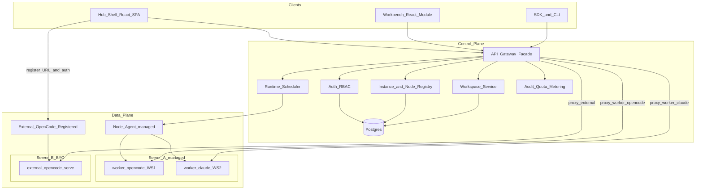

# 目标与架构

> **细节 SoT**：字段级 API、DDL、ADR、验收与运维以 [`docs/architecture/`](../../../docs/architecture/README.md) 为准（含 ADR-012 工作区基数、ADR-013 external 绑定、ADR-014 角色名）。本文为产品/阶段摘要；与 architecture 冲突时以 architecture 为准并回写父索引与对应子 plan。
>
> **父索引**：[多租户 Agent 平台](../多租户_agent_平台_c205364b.plan.md)

> **执行入口（编码）**：请从 [`exec/README.md`](exec/README.md) 按序打开手册并勾选其 YAML todos；本文为产品主题摘要，**不是**执行顺序。

相关：[领域与协作](02-domain-collaboration.plan.md) · [Facade 与实例](03-facade-isolation-instances.plan.md) · [技术栈与仓库](05-stack-repo.plan.md)

## 目标与约束

- **运行时**：OpenCode 与 Claude Agent SDK **对等可调度**，上层统一会话/事件抽象。
- **隔离**：每个工作区 = **独立容器（或等价进程沙箱）**，文件系统与进程完全隔离。
- **协作模型**：全局 **User** 账号可绑定多个租户与项目；角色在 TenantMembership / ProjectMembership **独立生效**；项目内会话归属用户、默认互不可见。A 项目 owner 不自动获得 B 项目权限。
- **凭据模型**：用户可使用 **个人 Provider 凭据**（跨有权项目保留），也可使用 **项目共享凭据**；开会话时按策略解析并锁定版本。
- **前端策略**：**全站 React 单 SPA**（Vite + React Router + shadcn + TanStack）；Workbench 只连 Hub（**Facade 会话/SSE** + **agent 文件白名单**），**不 vendor OpenCode Web**。
- **依赖策略（ADR-010）**：**公开开源优先**（OSI 许可、可自托管/离线镜像）；用流行栈（React/Hono/Drizzle/BullMQ/PostgreSQL/Redis/MinIO 等），清单见 [17-libraries.md](../../../docs/architecture/17-libraries.md)；禁止闭源硬依赖与自研 DS/队列/ORM/JWT。
- **内网 / 离线（ADR-011）**：**默认内网部署**，不依赖公网 CDN/npm/Docker Hub；LLM/Git 走内网；Agent 出网默认拒绝+allowlist；支持空气隔离 offline-bundle。详见 [18-intranet-offline.md](../../../docs/architecture/18-intranet-offline.md)。
- **远程接入 / 配置下发 / 公共空间 / 看板**：同前；IA 以最新 html 原型为准。
- **交互原型 SoT**：[`.cursor/plans/html`](../html/README.md)（含 `management.js` / `memberships.js`）；评审用，正式栈不依赖该 HTML。
- **现状**：OpenCode `serve`/`web` 仅为单机 HTTP + Basic Auth，**无原生多租户/多用户授权**；MCP/配置多为进程级共享。因此多租户与多用户会话边界必须由本平台控制面与门面补齐。
- **仓库**：[`AgentHubEx`](../../../README.md) 几乎为空，按 [技术栈与仓库](05-stack-repo.plan.md) 中 monorepo 从零落地。

## 总体架构



**分层职责**

| 层 | 职责 |
|---|---|
| Hub Frontend | **Hub Shell**（对齐 html 原型：概览/看板/工作台/实例/配置/文件/成员/凭据/审计/设置）+ **Workbench**（嵌于工作台） |
| API Gateway / Facade | 鉴权、凭据注入、配置应用、公共文件/Issue API、反代实例、SSE、审计限流 |
| Control Plane | 实例注册表、ConfigBundle、CommonSpace、**ProjectIssue**、成员/凭据/会话、调度配额 |
| Data Plane | external 登记的 OpenCode，或 **managed `worker/*` 容器**；配置与公共文件同步写入工作区 |
| Object Storage | MinIO/S3：项目公共空间对象 |
| Worker Runtime | 统一 Worker 契约下的 `opencode` / `claude` 实现；一用户工作区一实例 |

### Worker / Adapter 对称布局

运行时与适配层均按引擎分子目录，避免再出现单独的 `claude-worker` / `*-adapter` 平铺包名：

```text
apps/worker/
  common/              # 启动框架、健康检查、配置 Apply 钩子、会话 API 骨架
  opencode/            # managed OpenCode 引擎
  claude/              # Claude Agent SDK 引擎

packages/adapter/
  common/              # 基类、事件/错误归一
  opencode/            # Hub Facade ↔ OpenCode（含 external serve）
  claude/              # Hub Facade ↔ worker/claude
```

- `RuntimeType`：`opencode` | `claude`（镜像：`agenthub/worker-opencode`、`agenthub/worker-claude`）。
- **external** 仍可登记他机原生 `opencode serve`（走 `adapter/opencode`）；**managed** 起 `worker/opencode` 或 `worker/claude`。
- `packages/runtime-contract` 为 Worker 与 Adapter 共用的协议定义。
