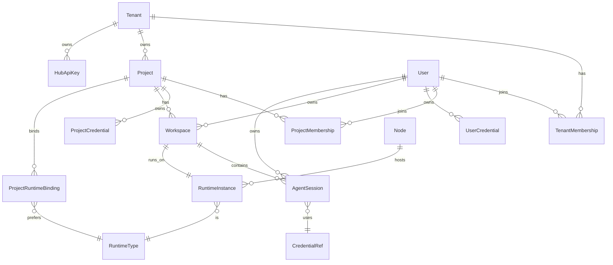
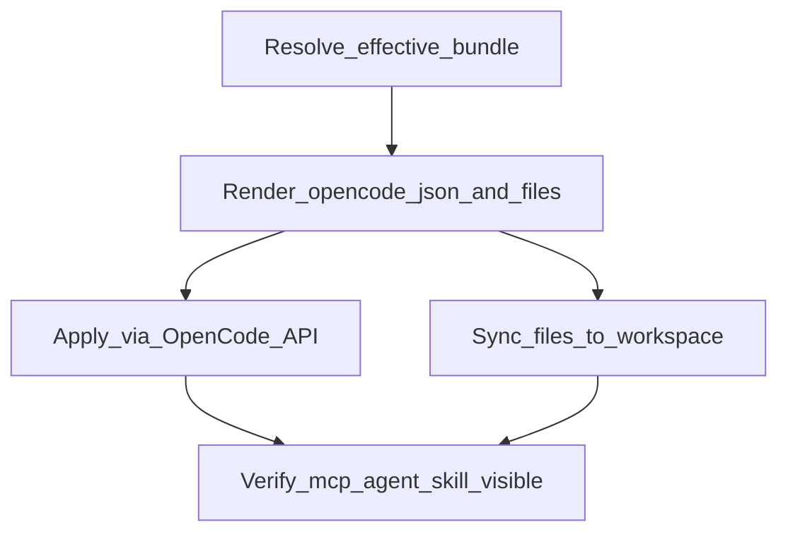
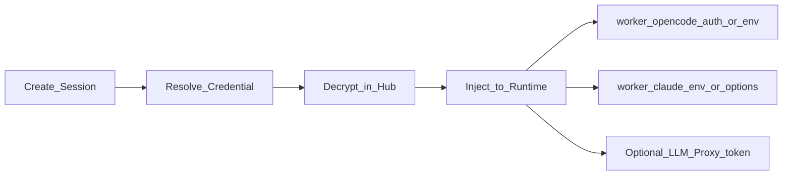

# 领域与协作

> **细节 SoT**：字段级 API、DDL、ADR、验收与运维以 [`docs/architecture/`](../../../docs/architecture/README.md) 为准（含 ADR-012 工作区基数、ADR-013 external 绑定、ADR-014 角色名）。本文为产品/阶段摘要；与 architecture 冲突时以 architecture 为准并回写父索引与对应子 plan。
>
> **父索引**：[多租户 Agent 平台](../多租户_agent_平台_c205364b.plan.md)

> **执行入口（编码）**：请从 [`exec/README.md`](exec/README.md) 按序打开手册并勾选其 YAML todos；本文为产品主题摘要，**不是**执行顺序。

相关：[目标与架构](01-goals-architecture.plan.md) · [Facade 与实例](03-facade-isolation-instances.plan.md) · [前端](04-frontend.plan.md)

## 核心领域模型



层级关系（协作主路径）：

```text
User（全局唯一账号，邮箱唯一）
  ├── TenantMembership[]（租户角色独立）
  ├── ProjectMembership[]（项目角色独立；须先有所属租户成员关系）
  └── UserCredential（个人凭据，跨项目）

Tenant（可停用 suspended）
  └── Project（可归档 archived；不跨租户移动）
        ├── ProjectCredential / CommonSpace / Issue / ConfigBundle
        └── Workspace（每成员 × 引擎，ADR-012）→ AgentSession
```

### 全局用户与多空间绑定（对齐最新原型）

- **User**：全局唯一；邀请时按邮箱复用已有账号，不重复建用户。
- **TenantMembership**：`owner` / `admin` / `member`；与项目角色互不继承。
- **ProjectMembership**：`owner` / `developer` / `viewer`；**绑定项目前必须具备该项目所属租户的成员关系**。
- **取消租户绑定**：级联移除该用户在此租户下全部项目绑定；其他租户关系不变。
- **保护最后一名 owner**：租户与项目均不可去掉最后一名 `owner`。
- **顶部切换器**：只列出当前用户已绑定且可用（租户 active、项目未归档）的空间。
- **平台管理员（`platform.admin`）**：可管理租户元数据/配额/启停，及未绑定空间的目录视图；**不因此获得**他人工作区会话正文或个人凭据访问权。
- **会话授权**：以 **当前项目的 ProjectMembership** 为准（`developer+` 才能开会话）；`tenant.admin` 管理面视同 project.owner，但**会话面**仍仅本人会话（ADR-014）。
- **停用租户 / 归档项目**：阻止进入工作区与新建会话，并停止进行中会话；资料保留，可恢复（恢复不自动重启会话）。详见 architecture 03 §3.7。
- **成员页双视图**：① 当前项目成员；② **用户与多空间绑定**（多选租户→勾选其下项目并分别设角色）。

- **Tenant**：组织边界；`slug` 创建后不可变；配额（并发 / 磁盘 / Token/日）；状态 `active|suspended`。
- **Project**：归属唯一租户；`key` 租户内唯一（问题编号前缀，如 `AH`）；引擎/实例池/凭据策略；状态以 `archivedAt` 表示归档。
- **ProjectCommonSpace**：项目级**公共文件空间**（与个人工作区分离）；门户管理，成员共享只读或按角色写入（见下节）。
- **UserCredential**：用户个人凭据（如 Anthropic / OpenAI / 自定义 OpenAI-compatible）；密文存储；仅 owner 可读写；可被该用户在有权项目中的会话选用。
- **ProjectCredential**：项目级共享凭据；由 `project.owner`（及 `tenant.admin`）配置；项目内 `developer+` 可**使用**但 **API 永不返回明文**。
- **Workspace（个人工作区）**：强隔离执行单元；归属 **`(projectId, ownerUserId, runtimeType)`**（ADR-012）。首次进入/开会话按引擎懒创建，卷路径  
  `/workspaces/{tenantId}/{projectId}/{userId}/{workspaceId}`。  
  个人区可写；公共空间默认只读呈现。Git 种子见 [14-workspace-git.md](../../../docs/architecture/14-workspace-git.md)。
- **AgentSession**：用户在自己工作区内开启的对话/任务；字段含 `ownerUserId`、`workspaceId`、`projectId`、`title`、`runtimeSessionRef`、**`credentialSource` + `credentialId`**（会话创建时锁定，避免中途切换导致计量混乱）。**同一用户可并行多个会话**；列表默认只返回 `ownerUserId = 当前用户`。
- **Node**：可安装 Node Agent 的托管主机（managed 模式）。
- **RuntimeInstance**：可连接的 OpenCode/Claude 端点；`mode=external`（门户登记的已有服务）或 `mode=managed`（Agent 拉起）；含 `baseUrl`、节点认证密文引用、健康状态、标签。
- **ProjectRuntimeBinding**：项目可访问的实例或标签池（「配置后就能连」的绑定关系落在这里）。
- **ConfigBundle / ConfigAssignment**：门户下发的 Agent、MCP、Skill、指令等配置包及其挂载范围（见下节）。
- **ProjectIssue / Board**：项目看板上的问题卡片（见下节）。
- **HubApiKey**：平台/租户开放 API 用的访问密钥（与 LLM Provider 凭据区分命名）。

### 项目看板（问题跟踪）— 对齐原型

目标：一眼区分 **待办 / 进行中 / 评审 / 已解决**；与本人会话联动（对齐 [html 原型看板](../html/README.md)）。

**状态模型（固定四列 + 折叠取消）**

| 列 | status | 含义 |
|---|---|---|
| 待办 | `todo` | 已登记未开始 |
| 进行中 | `in_progress` | 正在解决（可挂本人 AgentSession） |
| 评审 / 验证 | `in_review` | 有结果，**须人工确认** |
| 已解决 | `done` | 已关闭（须人工确认 + 解决说明） |
| 已取消 | `cancelled` | 默认折叠，不占主列 |

**Issue 字段**：项目内 key（如 `AH-21`，前缀来自项目标识）、`title`、`description`、`priority`（P0–P3）、`assigneeUserId`、`labels[]`、`status`、`linkedSessionIds[]`、`resolutionNote`（进入 `in_review`/`done` 必填）、`createdBy`、时间戳。

**交互（与原型一致）**

- 看板 / 列表双视图；搜索、成员、优先级筛选；`⌘K` / `Ctrl+K` 搜问题；导出 JSON。
- 拖拽改状态；卡片 Enter/空格打开详情。
- 从 Issue **创建自己的关联会话**（标题如 `AH-21 · …`）；他人会话仅显示「已关联」元数据，不可读正文。
- Agent 可 **提议** 进入评审；移入 `in_review` / `done` 须负责人或创建人确认并填写验证/解决说明；`owner` 可强制关闭。
- 权限：`viewer` 只读；`developer+` 建卡/改状态；`owner` 强制关闭。

**与其它模块边界**：看板 ≠ 配置中心 ≠ 公共文件；不做完整 Jira/自定义工作流。

### 项目公共空间文件管理

与「个人工作区」分离：公共空间存项目共享资产；个人工作区仍是每人独立可写沙箱。

**典型内容**：产品/技术规范、API 文档、模板代码片段、测试夹具、共享设计稿说明、只读参考仓库导出等（大二进制走对象存储，门户可预览文本与常见文档）。

**存储（首版固定）**

- 元数据：Postgres（路径、大小、checksum、上传者、版本、MIME）。
- 对象：S3 兼容（本地用 MinIO）：键  
  `tenants/{tenantId}/projects/{projectId}/common/{path}`。
- 可选版本：同一 path 保留历史 object version，支持门户回滚单文件。

**门户能力（Hub Shell → 项目 → 文件）**

- 目录浏览、上传、新建文件夹、重命名、移动、删除（软删+回收期）。
- 在线查看/编辑文本（md/json/yaml/源码）；二进制下载。
- 批量上传 zip（自动解压到指定前缀，含路径安全校验，禁止 `..`）。
- 搜索文件名；显示配额用量（项目公共空间磁盘配额）。
- 操作审计：谁在何时改了哪个 path。

**RBAC（首版固定）**

| 角色 | 公共空间 |
|---|---|
| `project.viewer` | 只读浏览/下载 |
| `project.developer` | 读写（上传/编辑/删除自己有权的路径）；默认全树可写，项目可配「受保护前缀」仅 owner 可改 |
| `project.owner` / `tenant.admin` | 全部管理、配额、受保护前缀、强制同步策略 |

**与个人工作区 / Agent 的衔接（首版固定）**

```text
ProjectCommonSpace (S3)
        │  sync / mount
        ▼
个人工作区只读目录：/workspace/project-common/...
个人可写目录：     /workspace/...（含 git clone 的代码）
```

- **同步策略**（项目设置，默认 `on_workspace_start`）：
  - `on_workspace_start`：工作区就绪或用户点「同步公共文件」时，将 common **镜像到** 个人工作区只读树（managed 写卷；external 经 `agenthub-sync`）。
  - `on_common_publish`：公共空间变更后可选推送到在线工作区（节流）。
- **Agent 写入公共空间**：默认 **禁止**（只读挂载）。若需把成果回流公共区，走门户「从工作区提交到公共空间」或显式 API（`developer+`，带审核可选）；避免多 Agent 直接互踩 S3。
- **与 ConfigBundle 分工**：Skill/Agent/MCP 走配置中心；**业务/资料类文件**走公共空间。若将 `AGENTS.md` 放在公共空间根，可在同步后作为 instructions 来源之一（项目可勾选）。

**API（示意）**

- `GET/PUT/PATCH/DELETE /v1/projects/{projectId}/common/files/*`
- `POST /v1/projects/{projectId}/common/upload`（multipart）
- `POST /v1/workspaces/{id}/sync-common`（把公共空间同步进该用户工作区）

### 配置下发（Agent / MCP / Skill / Instructions）

门户作为 **唯一配置源（SoT）**，把 OpenCode 能消费的形态物化到各工作区实例，避免每台机器手改 `opencode.json`。

**可下发资产类型**

| 类型 | Hub 中的形态 | 落到 OpenCode 的目标 |
|---|---|---|
| **Agent** | Markdown（frontmatter + body）或 JSON agent 定义 | `.opencode/agents/*.md` 和/或 `opencode.json#agent` |
| **MCP** | 名称、transport（local/remote）、command/url、env 占位符、启用开关 | `opencode.json#mcp`；运行时 `POST /mcp` / `PATCH /config` |
| **Skill** | 目录 + `SKILL.md`（及附属文件） | `.opencode/skills/<name>/SKILL.md` |
| **Instructions** | `AGENTS.md` 正文、`instructions[]` 额外路径/URL | 工作区根 `AGENTS.md` + config `instructions` |
| **Permission / Model 默认** | 权限矩阵、默认 model、skill 权限通配 | `opencode.json#permission` / model 相关字段 |
| **插件/命令（可选后期）** | 包名或文件包 | 按上游能力扩展 |

**作用域与合并（固定优先级，后者覆盖前者）**

```text
Platform 内置默认
  → Tenant Bundle
  → Project Bundle（主战场）
  → User Overlay（仅允许 Skill/个人 agent 等白名单项；不可覆盖项目强制 MCP deny）
  → Session 一次性覆盖（一般不用）
```

- 项目可设 `configLock`：锁定 MCP 列表、强制某 agent、禁止用户 overlay。
- MCP 中的 secret（Token）不进 Bundle 明文：用 `secretRef: projectCredential:xxx | vault:yyy`，Apply 时由 Hub 注入。

**版本与发布**

- Bundle 不可变版本：`draft` → `published`；项目绑定 `pinVersion` 或 `latest`。
- 发布产生 `ConfigRevision`；每次成功下发记录 `ApplyJob`（目标实例、revision、状态、diff 摘要）。
- 支持回滚到上一 published revision。

**Apply 引擎（连接时 / 手动「立即同步」）**



1. **解析**：按租户/项目/用户合并有效配置。  
2. **渲染**：生成 `opencode.json` 片段 + agents/skills/AGENTS.md 文件树（内容寻址，便于 diff）。  
3. **应用**  
   - **API 通道**：对目标实例 `PATCH /config`、`POST /mcp`（及上游提供的动态配置接口）；适合 MCP/agent JSON/permission。  
   - **文件通道**：写入工作区 `.opencode/**`、`AGENTS.md`  
     - `managed`：Node Agent 写挂载卷后 reload/重启或依赖 OpenCode 热更新。  
     - `external`：要求目标侧运行轻量 **`agenthub-sync` sidecar**（或 Node Agent 精简版）拉取 Bundle 并落盘；Hub 只推任务与签名 URL，不裸 SSH。  
4. **校验**：拉取 `/mcp`、`/agent`、skill 可见性；失败则 ApplyJob=failed 并告警，会话可拒绝进入或带降级提示。  
5. **触发点**：工作区首次就绪、用户点击「同步配置」、Bundle 新版本发布（可选自动推送到已绑定在线实例）。

**门户 UI（配置中心）**

- 租户/项目级：**Agent 库、MCP 库、Skill 库、AGENTS.md 编辑器**。  
- MCP 表单：local command / remote URL、env、secretRef、按角色启用。  
- Skill/Agent：在线编辑 `SKILL.md` / agent markdown，或上传 zip。  
- 项目页：绑定 Bundle 版本、查看合并预览（effective config）、对某实例「立即下发」。  
- 审计：谁改了 Bundle、谁对哪台实例 Apply 成功/失败。

**与多用户/隔离的关系**

- 因推荐「一人一 OpenCode 实例」，Project Bundle 下发到该用户实例时自然带项目标准 MCP/Skill，又不会在共享进程里串租户。  
- 用户 overlay 仅作用于自己的实例文件树。  
- `worker/claude`：Apply 引擎映射为等价结构（系统提示/工具白名单/MCP 桥）；`worker/opencode` 直接落 OpenCode 文件/API。同一套 Bundle 双引擎可消费（映射表在 `packages/runtime-contract`）。

### 凭据模型（用户自有 / 项目配置）

**存储字段（两类凭据共用形态）**

- `provider`：`anthropic` | `openai` | `opencode` | `custom` …
- `label`：展示名（如「公司 Claude」「我的 OpenAI」）
- `secret_ciphertext`：加密后的 API Key / Token（应用层加密或 KMS）
- `metadata`：非敏感（base URL、默认 model、组织 id）
- `status`：`active` / `disabled` / `expired`
- 项目凭据额外：`allowed_roles`（默认 `developer+` 可用）、`is_default`（项目默认凭据）

**解析优先级（开会话时，首版固定）**

1. 请求显式指定：`credentialSource=user|project` + `credentialId`（须校验所有权或项目成员使用权）。
2. 用户在该项目上的 **偏好**（`ProjectMemberPreference.preferredCredentialRef`，可选）。
3. 项目 **默认** `ProjectCredential`（`is_default=true`）。
4. 若仍无可用凭据 → `409/400` 提示用户绑定个人凭据或联系项目 owner 配置。

项目可配置策略 `credentialPolicy`（首版支持三种，默认 `user_or_project`）：

| 策略 | 含义 |
|---|---|
| `user_or_project` | 个人与项目凭据均可选（推荐默认） |
| `project_only` | 强制走项目凭据（适合统一账单/合规） |
| `user_only` | 禁止用项目凭据，必须自备 Key |

**注入方式（不把明文交给浏览器）**



- Hub 在 **创建/唤醒 Workspace 或创建 Session** 时解密凭据，经内网注入 Runtime：
  - `worker/opencode`（或 external OpenCode）：`/auth/:id` 或启动 env；不在 Web 响应中回显。
  - `worker/claude`：进程环境或 per-session options；不持久化明文到卷。
- **推荐进阶（Phase 3）**：Hub LLM Proxy 签发短时上游 token，Runtime 只持有 proxy 凭证，真实 Key 永不进容器。
- 计量：`usage` 记录同时打上 `credentialSource` / `credentialId` / `userId` / `projectId`，便于区分「个人 Key 消耗」与「项目 Key 消耗」。
- 轮换：更新 ProjectCredential 后，已锁定旧 `credentialId` 的会话继续用会话创建时快照策略——首版采用 **会话创建时写入 encrypted credential snapshot 引用版本号**；轮换后新会话用新版本，旧会话可配置为「下次 message 起失效并要求重选」。

### 会话可见性与协作（首版固定）

| 能力 | 规则 |
|---|---|
| 列会话 | 仅本人；`project.owner` / `tenant.admin` 可在审计视图看元数据（标题、创建时间、用量、凭据来源标签），**不能默认读消息正文与凭据明文** |
| 开会话 | 项目 `developer+` 在自己的 Workspace 内 `POST /sessions`，并选定凭据 |
| 发消息 / 事件流 | 仅会话 owner（或被显式分享；首版不做分享） |
| 权限审批（tool permission） | 推送给会话 owner |
| 共享可写工作区（多人同一容器） | 首版不做 |
| 项目公共空间文件 | 门户管理；同步进个人区只读，见上节 |

### RBAC（对齐原型：平台 / 租户 / 项目三层）

- `platform.admin`（原称 operator，已废止）：租户 CRUD、配额、启停；查看租户/项目元数据目录；**不读**会话正文与个人凭据（ADR-014）。
- `tenant.owner|admin`：本租户项目管理、用户多空间绑定（本租户范围）、租户级配额展示；**管理面**视同各项目 `project.owner`；取消租户绑定会清掉其下项目绑定并保护最后一名 owner（见 architecture 03）。
- `tenant.member`：仅进入已绑定的项目（还须有 ProjectMembership）。
- `project.owner`：项目成员/实例绑定/项目凭据/受保护前缀/归档；强制关闭 Issue。
- `project.developer`：个人工作区与会话；看板写；非保护公共文件写。
- `project.viewer`：看板与公共文件只读；**无会话**。
