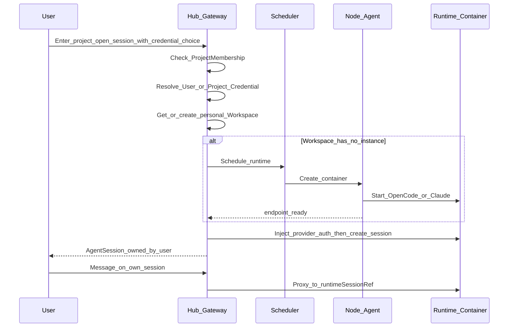

# Facade 与实例

> **细节 SoT**：字段级 API、DDL、ADR、验收与运维以 [`docs/architecture/`](../../../docs/architecture/README.md) 为准（含 ADR-012 工作区基数、ADR-013 external 绑定、ADR-014 角色名）。本文为产品/阶段摘要；与 architecture 冲突时以 architecture 为准并回写父索引与对应子 plan。
>
> **父索引**：[多租户 Agent 平台](../多租户_agent_平台_c205364b.plan.md)

> **执行入口（编码）**：请从 [`exec/README.md`](exec/README.md) 按序打开手册并勾选其 YAML todos；本文为产品主题摘要，**不是**执行顺序。

相关：[领域与协作](02-domain-collaboration.plan.md) · [前端](04-frontend.plan.md) · [安全与交付](06-security-delivery.plan.md)

## 统一门面（Facade）设计

对外只暴露 Hub API，**不对终端用户暴露各节点上的 OpenCode Basic Auth**。

### 路由语义

1. 请求带 `Authorization: Bearer <hub_jwt|api_key>`；路径或 body 含 `projectId`，会话类再含 `sessionId` / `workspaceId`。
2. Gateway 解析身份后校验：
   - 租户 `active` 且用户有 `TenantMembership`；项目 `active` 且有 `ProjectMembership`；
   - 会话/工作区操作另校验 `ownerUserId == currentUser`（审计接口另开前缀）。
3. 解析目标 Workspace（默认取该用户在项目下的 personal workspace；若无则懒创建并调度 RuntimeInstance）：
   - 读项目 `ProjectRuntimeBinding`（runtime 偏好、节点标签、容量）；
   - 选 Node → Node Agent 创建容器 → 注册 endpoint → 健康检查通过。
4. 会话 API：
   - `POST /v1/projects/{projectId}/sessions`：按凭据策略解析 `UserCredential` 或 `ProjectCredential` → 注入 Runtime → 创建 Hub `AgentSession`（锁定 credential 引用）与上游 `runtimeSessionRef`。
   - 后续 `/sessions/{id}/*` 先查 Hub 元数据做 **owner 鉴权**，再代理到对应实例的上游 session。
5. 凭据 API（明文只写不读）：
   - `PUT/DELETE /v1/me/credentials`：用户个人凭据。
   - `PUT/DELETE /v1/projects/{projectId}/credentials`：项目凭据（owner）。
   - `GET .../credentials`：仅返回 `id/label/provider/status/isDefault` 等元数据，**永不返回 secret**。
6. `/v1/workspaces/{id}/agent/*` **白名单反代**（仅 workspace owner；文件/find/PTY 等）：
   - 浏览器**阻断**上游 `/session`、`/event`、`/auth`、`PATCH /config`（会话创建与 SSE 只走 Facade；`/auth` 由 Hub 代写）。
   - 放行 `/file`、`/find`、只读 `/agent` `/mcp` `/config`，以及 P2+ `/pty`（受 capabilities）。
7. 会话 SSE：`GET /v1/sessions/{id}/events`（按用户+租户限流）；断开不销毁容器（idle TTL）。

### 统一会话抽象（双引擎适配）

Hub 定义稳定契约（建议 JSON + SSE），且每条会话记录带 `ownerUserId` 与凭据引用：

- `GET /v1/projects/{projectId}/sessions`（仅当前用户）
- `POST /v1/projects/{projectId}/sessions`（body 可含 `credentialSource` / `credentialId`）
- `POST /v1/sessions/:id/messages` / `POST /v1/sessions/:id/abort`
- `GET /v1/sessions/:id/events`（SSE；可选 `POST .../events/ticket` 回退）
- `GET /v1/workspaces/{id}/agent/file|find|...`（文件类；非独立 `/files`）
- `GET /v1/projects/{projectId}/credentials/options`：当前用户可选凭据列表（个人 + 策略允许的项目凭据元数据）

适配器：

- **`adapter/opencode`**：内网代理 OpenCode HTTP + 事件流；创建会话时在 Hub 登记 owner 映射。
- **`adapter/claude`**：对接 `worker/claude`（`ClaudeSDKClient` / `query()`），事件归一为同一信封（见 `runtime-contract` Envelope）。
- **`adapter/common`**：统一错误码、SSE 封装、与 `runtime-contract` 的编解码。

进入工作区：`GET /v1/projects/{p}/workspaces/me` 返回 `Workspace`（含 `runtimeType` + **`capabilities`**）；React Workbench 按能力渲染同一会话 UI。进入前先选定 **当前用户的 Workspace**。

## 强隔离工作区（2A）+ 多用户

默认：**Project × User → 1 个 personal Workspace → 1 个 Runtime 容器**；该用户在此容器内可开多个 `AgentSession`。



每个 Workspace 容器约定：

- **镜像**
  - `agenthub/worker-opencode`：构建自 `apps/worker/opencode`（内嵌/拉起 OpenCode）。
  - `agenthub/worker-claude`：构建自 `apps/worker/claude`（Claude Agent SDK + 统一 Worker API）。
- **代码种子**：创建个人工作区时可从项目配置的 Git 仓库 clone（每用户独立 working copy / worktree），避免多人共写同一目录。
- **挂载**：仅挂载该 workspace 卷；禁止挂载宿主机全局 docker.sock 给业务容器。
- **网络**：容器只听 Node 内网；由 Node Agent 分配端口或走反向代理；外网只打到 Hub Gateway。
- **凭据**：按会话解析的个人或项目 Provider Key，由 Hub 注入 Runtime 或走 LLM Proxy；容器卷内不落明文密钥文件。
- **资源**：CPU/内存/磁盘 quota per workspace；另加 **每用户并发会话数**、**每项目活跃工作区数** 配额。
- **安全**：容器可写根（便于装依赖）+ 可写 workspace 卷；`cap-drop ALL`、非 root、无 docker.sock；**不做**只读根（ADR-002）。禁止特权容器。

Node Agent API（内网 mTLS）：

- `POST /workspaces`（create+start，标签含 tenantId/projectId/userId）
- `POST /workspaces/:id/stop|start`
- `DELETE /workspaces/:id`
- `GET /health` / `GET /capacity`

## 多服务器管理与「门户配置即可连接」

核心体验（首版就要可用）：

```text
运维在 Server-X 部署 opencode serve/web
        ↓
管理员在 Hub Shell「添加远程实例」填 URL / 认证 / 工作目录说明 / 标签
        ↓
Hub 探测 /global/health，保存为 RuntimeInstance(mode=external)
        ↓
项目绑定该实例（或实例池）
        ↓
用户进入项目 → Hub 校验成员与凭据 → Facade 反代连接 → Workbench 打开
```

浏览器与终端用户 **始终只访问 Hub**；远程 OpenCode 的地址与 `OPENCODE_SERVER_PASSWORD` 只保存在控制面，由 Gateway 代填。

### 两种数据面接入模式

| 模式 | 含义 | 谁创建容器/进程 | 适用 |
|---|---|---|---|
| **external（登记连接）** | 服务器上已有 OpenCode，门户只配置连接 | 运维自行部署 | **MVP 主路径**；利旧机器、快速接入 |
| **managed（Agent 编排）** | 安装 Node Agent，由 Hub 按用户工作区拉起容器 | Node Agent | 强隔离规模化；与 2A 完整对齐 |

`RuntimeInstance` 字段：`mode`、`baseUrl`、`authSecretRef`、`healthStatus`、`labels[]`、`isolation`（`dedicated`|`shared`）、`assignedProjectIds[]`、`syncAgentStatus`、延迟探测等。**无**必填 `boundUserId`（ADR-013）。

### 门户「登记远程 OpenCode」（对齐原型「运行实例」）

- **表单**：实例名称、服务 URL、节点认证、`isolation`、可分配项目、节点标签；提交后 Hub 测活，不向浏览器回显节点认证。
- **绑定模型（ADR-013）**：推荐 `dedicated`（调度保证一人一进程会话注入）；`shared` 仅演示且单活跃用户，intranet 交付禁止新建。禁止把同一 OpenCode 进程当多租户共用。列表展示「项目绑定 / 健康 / sync / 延迟」。
- **可达性**：`GET /global/health`；离线实例可保留配置，但 **配置下发失败并阻断**（原型中 oc-staging-03）。
- **网络**：Hub 访问内网 URL；不对公网裸暴露节点。
- **同步组件**：详情展示 Browser → Hub Facade → Runtime，以及 ConfigBundle → agenthub-sync → Workspace；未装 sync 时文件型下发不可用。
- **项目实例绑定**：项目仅允许绑定已登记且健康策略满足的实例；会话创建前校验成员归属、配置同步与公共文件状态。
- **双引擎**：首版实例引擎为 OpenCode；Claude 在 UI 标注 Phase 3，不可选。

### managed 模式（Node Agent，Phase 2 强化）

- 安装 Node Agent → bootstrap token 注册 → 心跳（容量、实例数、磁盘）。
- Hub 按 `(project, user)` 创建容器并自动写入 `RuntimeInstance(mode=managed)`，无需手填 URL。
- 调度：binding 标签 → 健康有容量 → 用户热实例粘性 → 最少负载。

### 连接路径（两种模式相同）

1. 用户在 Shell 选择项目（及凭据）→ 打开 `/p/:projectId/workbench`。  
2. Hub 解析 binding → 选定 `RuntimeInstance`；`workspaces/me` 带回 `capabilities`。  
3. 开会话时注入 Provider 凭据（服务端）；浏览器只传 `credentialId`。  
4. Workbench：**会话/SSE → Facade**；**文件等 →** `/v1/workspaces/{id}/agent/*` 白名单；Gateway 用保存的节点认证访问 `baseUrl`。

### 运维面（Hub Shell）

- **远程实例**列表：健康、延迟、绑定项目数、模式（external/managed）。  
- **添加 / 编辑 / 测试连接 / 禁用**。  
- 项目侧「选择可访问的实例」。  
- 审计：谁在何时连了哪台实例。
