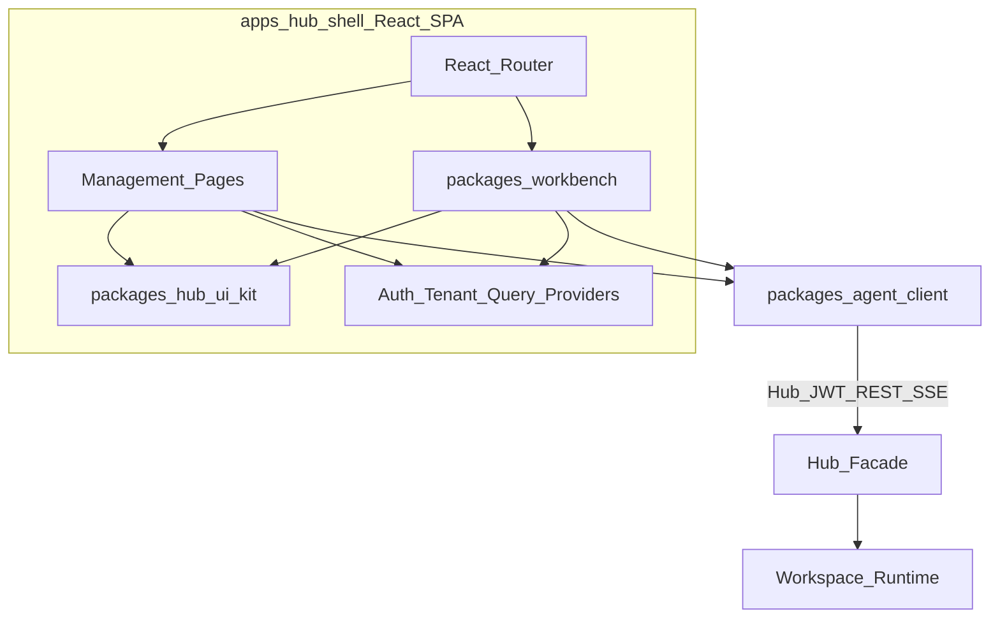

# 前端 SPA

> **细节 SoT**：字段级 API、DDL、ADR、验收与运维以 [`docs/architecture/`](../../../docs/architecture/README.md) 为准（含 ADR-012 工作区基数、ADR-013 external 绑定、ADR-014 角色名）。本文为产品/阶段摘要；与 architecture 冲突时以 architecture 为准并回写父索引与对应子 plan。
>
> **父索引**：[多租户 Agent 平台](../多租户_agent_平台_c205364b.plan.md)

> **执行入口（编码）**：请从 [`exec/README.md`](exec/README.md) 按序打开手册并勾选其 YAML todos；本文为产品主题摘要，**不是**执行顺序。

相关：[Facade 与实例](03-facade-isolation-instances.plan.md) · [领域与协作](02-domain-collaboration.plan.md) · [技术栈与仓库](05-stack-repo.plan.md)

## 前端架构：全站 React 单 SPA（最优路径）

**结论：前端全部 React，一套应用、一套 UI、一套数据层；运行时仍是 OpenCode/Claude，UI 不绑定上游 Solid Web。**  
选型取舍：需要 SEO/SSR 的营销站不适用本门户 → **Vite SPA** 优于 Next.js（部署简单、与 compose **自托管静态**一致、鉴权用 JWT + httpOnly refresh 即可）。不引入 Solid、不 iframe 嵌异栈；不依赖公网 CDN（ADR-011）。

### 结构

| 层 | 包 / 位置 | 职责 |
|---|---|---|
| **App Shell** | `apps/hub-shell` | 路由、布局、Auth/Tenant/Project Provider、懒加载页面 |
| **管理面** | `hub-shell/src/pages/*` | 租户/项目/看板/实例/配置/文件/成员/凭据/审计/设置 |
| **Workbench** | `packages/workbench` | 会话列表、流式消息、工具调用卡片、权限弹窗、文件树/预览、同步入口 |
| **Agent 客户端** | `packages/agent-client` | Facade 会话/SSE + agent 文件白名单；类型来自 `runtime-contract` |
| **UI Kit** | `packages/hub-ui-kit` | shadcn 业务组合（PageHeader、IssueCard、StatStrip…） |

### Workbench 能力分期（控制风险）

| 阶段 | 范围 |
|---|---|
| **P1（MVP）** | 本人会话 CRUD、选凭据开会话、流式 assistant/tool 事件、权限允许/拒绝、只读文件树 + 文本预览、同步配置/公共资料、关联 Issue、capabilities 降级隐藏 |
| **P2+** | 多标签代码预览/轻量编辑、diff、按 capabilities 开终端/PTY；不追求首版对齐 OpenCode Desktop 全量 IDE |

### 连接与产品规则（ADR-008，已收紧）

1. **会话主路径 = Facade**：CRUD / messages / permissions / SSE → `/v1/sessions/{id}/*`（`fetch-event-source` + Bearer；ticket 为回退）。
2. **文件 / find / PTY = agent 反代白名单**；浏览器**禁止** `/agent/event`、`POST /agent/session`。
3. **路由**：`/p/:projectId/workbench?session=`（UUID）；无 `/wb/*`。
4. **Capabilities**：嵌在 `Workspace`；无独立 GET；见 `runtime-contract` Envelope.data 形状。
5. **无 Provider Key UI**；无裸节点地址；`session.status=busy` 时禁切凭据。
6. 细节 SoT：[docs/architecture/10-frontend.md](../../../docs/architecture/10-frontend.md)、[04](../../../docs/architecture/04-gateway-facade.md)。

### 为何这是「最优 React」而非 vendor Solid

- 招人/生态/组件（shadcn、dnd-kit、TanStack）统一，无双运行时与 iframe 鉴权坑。  
- 多租户壳与会话页共享路由守卫、Query 缓存、设计 token。  
- 引擎差异收敛在 **服务端 adapter**，前端不跟 OpenCode Web 发版绑死。  
- 代价是自研 Workbench UI；用分期范围把 P1 压在「能对话、能审权限、能看文件」而不是重 IDE。

### Hub Shell 信息架构（对齐最新 html：三组导航）

侧栏三组（见 `index.html`）；顶栏切换租户/项目；无绑定时引导至租户/项目管理。左下角角色切换仅原型演示。  
**说明**：下表「路由键」为原型 hash（如 `#workbench`）；生产路径为 `/p/:projectId/<键>`（见 [10-frontend.md](../../../docs/architecture/10-frontend.md)）。

**平台与组织**

| 路由键 | 页面 | 要点 |
|---|---|---|
| `tenants` | 租户管理 | 平台管理员：列表/搜索/状态筛选、创建编辑、所有者、并发/磁盘/Token 配额、启停确认、所属项目详情；入口「用户与归属」 |
| `projects` | 项目管理 | 当前租户下项目：创建编辑、搜索筛选、归档/恢复、运行引擎与实例池、凭据策略；详情快捷入口（成员/实例/配置/凭据/文件/设置）；「进入」切换项目上下文 |

**工作空间**（须当前租户+项目均 active 且用户已绑定）

| 路由键 | 页面 | 要点 |
|---|---|---|
| `overview` | 项目概览 | 指标、我的待办、动态、运行环境、交付阶段 |
| `board` | 项目看板 | 四列+折叠取消；人工确认评审/已解决；关联本人会话 |
| `workbench` | 我的工作台 | 同 SPA 内 `packages/workbench`：本人会话/选凭据/流式对话/权限；文件树区分个人/`project-common` |
| `instances` | 运行实例 | 登记、isolation/项目绑定、健康/sync、检测 |
| `config` | 配置中心 | Agent/MCP/Skill/AGENTS.md/权限与模型/下发记录 |
| `files` | 公共文件 | 树+面包屑+保护前缀+版本回滚 |

**项目配置**

| 路由键 | 页面 | 要点 |
|---|---|---|
| `members` | 成员与角色 | Tab：当前项目成员 \| **用户与多空间绑定**；邀请复用邮箱账号；空间绑定对话框 |
| `credentials` | 凭据管理 | 项目/个人；连接参数表单；Hub API Key |
| `nodes` | 托管节点 | Phase 2 设计页 |
| `audit` | 审计日志 | 元数据导出；无正文/密钥 |
| `settings` | 项目设置 | 五标签：基本信息/运行与凭据/公共空间/组织与配额/访问边界 |

**上下文隔离**：切换项目时看板/会话/公共文件/实例/项目凭据/配置/审计按项目隔离加载；**个人凭据随用户保留**。新项目为空上下文，绑定实例与凭据后再开会话。

### 视觉与布局约定（来自原型）

- 冷灰背景、白卡片、蓝色主操作；绿色仅成功/在线；正文深灰。
- 侧栏跨模块导航；顶栏组织/项目上下文；中文 UI + 必要领域名。
- 桌面主视图按视口分配高度；说明/策略类 **page-summary 一律置顶于主内容之前**。
- 响应式：平板/手机；窄屏看板用状态标签切列；表格窄屏改为字段卡片。
- 无障碍：问题卡片键盘可开；dialog/表单可键盘操作（正式实现由 Radix / shadcn 承接）。

### Provider 凭据表单（对齐原型 credential-form）

个人与项目凭据共用连接配置：

- Provider、API Key（只写）、Base URL、默认模型  
- 可增删 Header（固定值或 `secretRef`）  
- 高级：Organization ID、Provider Project ID、请求超时  
- 切换 Provider 更新默认地址，保留用户已改自定义地址  
- 列表仅元数据；策略 `user_or_project` | `project_only` | `user_only` 影响工作台新建会话选项  

### 配置中心 / 公共文件（原型补强）

- 配置发布步进：解析 → 渲染 → 应用 → 校验；目标离线或无 sync → 失败并提示。  
- 公共文件：`docs/` 等受保护前缀仅 owner；同步策略默认 `on_workspace_start`；ZIP 解压仅后端职责。  
- 工作台内可触发「同步配置 / 同步公共资料」（写审计）。
