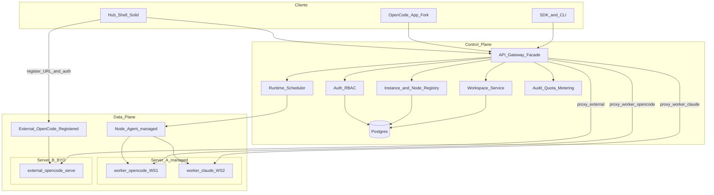
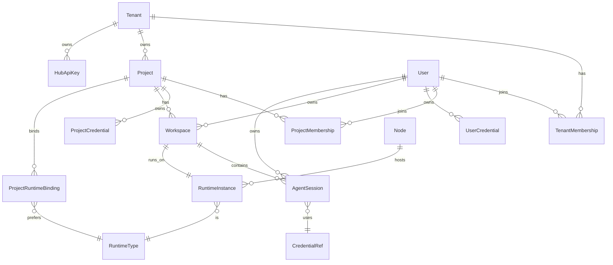
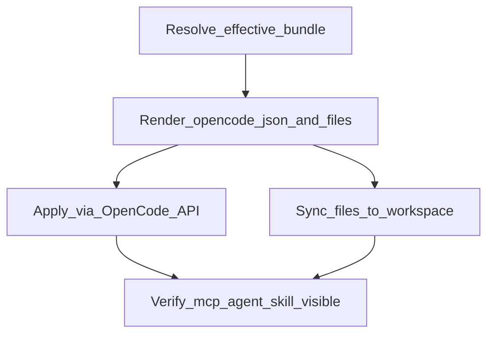
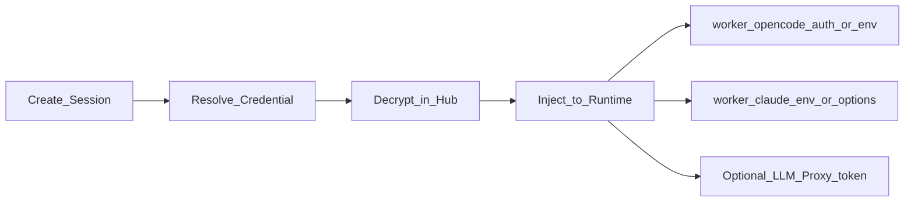
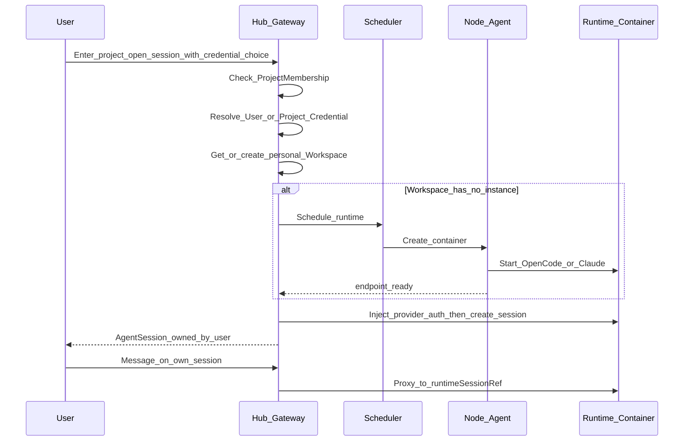
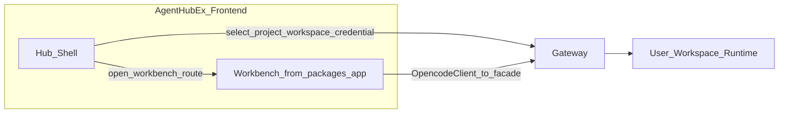

# AgentHubEx 多租户 Agent 平台方案

## 目标与约束

- **运行时**：OpenCode 与 Claude Agent SDK **对等可调度**，上层统一会话/事件抽象。
- **隔离**：每个工作区 = **独立容器（或等价进程沙箱）**，文件系统与进程完全隔离。
- **协作模型**：全局 **User** 账号可绑定多个租户与项目；角色在 TenantMembership / ProjectMembership **独立生效**；项目内会话归属用户、默认互不可见。A 项目 owner 不自动获得 B 项目权限。
- **凭据模型**：用户可使用 **个人 Provider 凭据**（跨有权项目保留），也可使用 **项目共享凭据**；开会话时按策略解析并锁定版本。
- **前端策略**：Workbench 演进 OpenCode `packages/app`；Hub Shell 外挂管理面，**通用组件库**（Kobalte/Tailwind）。
- **远程接入 / 配置下发 / 公共空间 / 看板**：同前；IA 以最新 html 原型为准。
- **交互原型 SoT**：[`.cursor/plans/html`](.cursor/plans/html/README.md)（含 `management.js` / `memberships.js`）；评审用，正式栈不依赖该 HTML。
- **现状**：OpenCode `serve`/`web` 仅为单机 HTTP + Basic Auth，**无原生多租户/多用户授权**；MCP/配置多为进程级共享。因此多租户与多用户会话边界必须由本平台控制面与门面补齐。
- **仓库**：[`AgentHubEx`](README.md) 几乎为空，按下方 monorepo 从零落地。

## 总体架构



**分层职责**

| 层 | 职责 |
|---|---|
| Hub Frontend | **Hub Shell**（对齐 html 原型：概览/看板/工作台/实例/配置/文件/成员/凭据/审计/设置）+ **Workbench**（嵌于工作台） |
| API Gateway / Facade | 鉴权、凭据注入、配置应用、公共文件/Issue API、反代实例、SSE、审计限流 |
| Control Plane | 实例注册表、ConfigBundle、CommonSpace、**ProjectIssue**、成员/凭据/会话、调度配额 |
| Data Plane | external 登记的 OpenCode，或 **managed `worker/*` 容器**；配置与公共文件同步写入工作区 |
| Object Storage | MinIO/S3：项目公共空间对象 |
| Worker Runtime | 统一 Worker 契约下的 `opencode` / `claude` 实现；一用户工作区一实例 |

### Worker / Adapter 对称布局

运行时与适配层均按引擎分子目录，避免再出现单独的 `claude-worker` / `*-adapter` 平铺包名：

```text
apps/worker/
  common/              # 启动框架、健康检查、配置 Apply 钩子、会话 API 骨架
  opencode/            # managed OpenCode 引擎
  claude/              # Claude Agent SDK 引擎

packages/adapter/
  common/              # 基类、事件/错误归一
  opencode/            # Hub Facade ↔ OpenCode（含 external serve）
  claude/              # Hub Facade ↔ worker/claude
```

- `RuntimeType`：`opencode` | `claude`（镜像：`agenthub/worker-opencode`、`agenthub/worker-claude`）。
- **external** 仍可登记他机原生 `opencode serve`（走 `adapter/opencode`）；**managed** 起 `worker/opencode` 或 `worker/claude`。
- `packages/runtime-contract` 为 Worker 与 Adapter 共用的协议定义。

## 核心领域模型



层级关系（协作主路径）：

```text
User（全局唯一账号，邮箱唯一）
  ├── TenantMembership[]（租户角色独立）
  ├── ProjectMembership[]（项目角色独立；须先有所属租户成员关系）
  └── UserCredential（个人凭据，跨项目）

Tenant（可停用 suspended）
  └── Project（可归档 archived；不跨租户移动）
        ├── ProjectCredential / CommonSpace / Issue / ConfigBundle
        └── Workspace（每成员个人工作区）→ AgentSession
```

### 全局用户与多空间绑定（对齐最新原型）

- **User**：全局唯一；邀请时按邮箱复用已有账号，不重复建用户。
- **TenantMembership**：`owner` / `admin` / `member`；与项目角色互不继承。
- **ProjectMembership**：`owner` / `developer` / `viewer`；**绑定项目前必须具备该项目所属租户的成员关系**。
- **取消租户绑定**：级联移除该用户在此租户下全部项目绑定；其他租户关系不变。
- **保护最后一名 owner**：租户与项目均不可去掉最后一名 `owner`。
- **顶部切换器**：只列出当前用户已绑定且可用（租户 active、项目 active）的空间。
- **平台管理员（platform operator）**：可管理租户元数据/配额/启停，及未绑定空间的目录视图；**不因此获得**他人工作区会话正文或个人凭据访问权。
- **会话授权**：以 **当前项目的 ProjectMembership** 为准（`developer+` 才能开会话）；租户 admin ≠ 自动项目权限。
- **停用租户 / 归档项目**：阻止进入工作区与新建会话，并停止进行中会话；资料保留，可恢复（恢复不自动重启会话）。
- **成员页双视图**：① 当前项目成员；② **用户与多空间绑定**（多选租户→勾选其下项目并分别设角色）。

- **Tenant**：组织边界；`slug` 创建后不可变；配额（并发 / 磁盘 / Token/日）；状态 `active|suspended`。
- **Project**：归属唯一租户；`key` 租户内唯一（问题编号前缀，如 `AH`）；引擎/实例池/凭据策略；状态 `active|archived`。
- **ProjectCommonSpace**：项目级**公共文件空间**（与个人工作区分离）；门户管理，成员共享只读或按角色写入（见下节）。
- **UserCredential**：用户个人凭据（如 Anthropic / OpenAI / 自定义 OpenAI-compatible）；密文存储；仅 owner 可读写；可被该用户在有权项目中的会话选用。
- **ProjectCredential**：项目级共享凭据；由 `project.owner`（及 `tenant.admin`）配置；项目内 `developer+` 可**使用**但 **API 永不返回明文**。
- **Workspace（个人工作区，默认）**：强隔离执行单元；归属 `(projectId, ownerUserId)`。首版约定：**每个项目成员自动拥有（或首次进入时懒创建）一份个人工作区**，挂载卷  
  `/workspaces/{tenantId}/{projectId}/{userId}/{workspaceId}`。  
  个人区可写；公共空间默认以只读形式呈现，避免 Agent 互相覆盖共享资料。
- **AgentSession**：用户在自己工作区内开启的对话/任务；字段含 `ownerUserId`、`workspaceId`、`projectId`、`title`、`runtimeSessionRef`、**`credentialSource` + `credentialId`**（会话创建时锁定，避免中途切换导致计量混乱）。**同一用户可并行多个会话**；列表默认只返回 `ownerUserId = 当前用户`。
- **Node**：可安装 Node Agent 的托管主机（managed 模式）。
- **RuntimeInstance**：可连接的 OpenCode/Claude 端点；`mode=external`（门户登记的已有服务）或 `mode=managed`（Agent 拉起）；含 `baseUrl`、节点认证密文引用、健康状态、标签。
- **ProjectRuntimeBinding**：项目可访问的实例或标签池（「配置后就能连」的绑定关系落在这里）。
- **ConfigBundle / ConfigAssignment**：门户下发的 Agent、MCP、Skill、指令等配置包及其挂载范围（见下节）。
- **ProjectIssue / Board**：项目看板上的问题卡片（见下节）。
- **HubApiKey**：平台/租户开放 API 用的访问密钥（与 LLM Provider 凭据区分命名）。

### 项目看板（问题跟踪）— 对齐原型

目标：一眼区分 **待办 / 进行中 / 评审 / 已解决**；与本人会话联动（对齐 [html 原型看板](.cursor/plans/html/README.md)）。

**状态模型（固定四列 + 折叠取消）**

| 列 | status | 含义 |
|---|---|---|
| 待办 | `todo` | 已登记未开始 |
| 进行中 | `in_progress` | 正在解决（可挂本人 AgentSession） |
| 评审 / 验证 | `in_review` | 有结果，**须人工确认** |
| 已解决 | `done` | 已关闭（须人工确认 + 解决说明） |
| 已取消 | `cancelled` | 默认折叠，不占主列 |

**Issue 字段**：项目内 key（如 `AH-21`，前缀来自项目标识）、`title`、`description`、`priority`（P0–P3）、`assigneeUserId`、`labels[]`、`status`、`linkedSessionIds[]`、`resolutionNote`（进入 `in_review`/`done` 必填）、`createdBy`、时间戳。

**交互（与原型一致）**

- 看板 / 列表双视图；搜索、成员、优先级筛选；`⌘K` / `Ctrl+K` 搜问题；导出 JSON。
- 拖拽改状态；卡片 Enter/空格打开详情。
- 从 Issue **创建自己的关联会话**（标题如 `AH-21 · …`）；他人会话仅显示「已关联」元数据，不可读正文。
- Agent 可 **提议** 进入评审；移入 `in_review` / `done` 须负责人或创建人确认并填写验证/解决说明；`owner` 可强制关闭。
- 权限：`viewer` 只读；`developer+` 建卡/改状态；`owner` 强制关闭。

**与其它模块边界**：看板 ≠ 配置中心 ≠ 公共文件；不做完整 Jira/自定义工作流。

### 项目公共空间文件管理

与「个人工作区」分离：公共空间存项目共享资产；个人工作区仍是每人独立可写沙箱。

**典型内容**：产品/技术规范、API 文档、模板代码片段、测试夹具、共享设计稿说明、只读参考仓库导出等（大二进制走对象存储，门户可预览文本与常见文档）。

**存储（首版固定）**

- 元数据：Postgres（路径、大小、checksum、上传者、版本、MIME）。
- 对象：S3 兼容（本地用 MinIO）：键  
  `tenants/{tenantId}/projects/{projectId}/common/{path}`。
- 可选版本：同一 path 保留历史 object version，支持门户回滚单文件。

**门户能力（Hub Shell → 项目 → 文件）**

- 目录浏览、上传、新建文件夹、重命名、移动、删除（软删+回收期）。
- 在线查看/编辑文本（md/json/yaml/源码）；二进制下载。
- 批量上传 zip（自动解压到指定前缀，含路径安全校验，禁止 `..`）。
- 搜索文件名；显示配额用量（项目公共空间磁盘配额）。
- 操作审计：谁在何时改了哪个 path。

**RBAC（首版固定）**

| 角色 | 公共空间 |
|---|---|
| `project.viewer` | 只读浏览/下载 |
| `project.developer` | 读写（上传/编辑/删除自己有权的路径）；默认全树可写，项目可配「受保护前缀」仅 owner 可改 |
| `project.owner` / `tenant.admin` | 全部管理、配额、受保护前缀、强制同步策略 |

**与个人工作区 / Agent 的衔接（首版固定）**

```text
ProjectCommonSpace (S3)
        │  sync / mount
        ▼
个人工作区只读目录：/workspace/project-common/...
个人可写目录：     /workspace/...（含 git clone 的代码）
```

- **同步策略**（项目设置，默认 `on_workspace_start`）：
  - `on_workspace_start`：工作区就绪或用户点「同步公共文件」时，将 common **镜像到** 个人工作区只读树（managed 写卷；external 经 `agenthub-sync`）。
  - `on_common_publish`：公共空间变更后可选推送到在线工作区（节流）。
- **Agent 写入公共空间**：默认 **禁止**（只读挂载）。若需把成果回流公共区，走门户「从工作区提交到公共空间」或显式 API（`developer+`，带审核可选）；避免多 Agent 直接互踩 S3。
- **与 ConfigBundle 分工**：Skill/Agent/MCP 走配置中心；**业务/资料类文件**走公共空间。若将 `AGENTS.md` 放在公共空间根，可在同步后作为 instructions 来源之一（项目可勾选）。

**API（示意）**

- `GET/PUT/PATCH/DELETE /v1/projects/{projectId}/common/files/*`
- `POST /v1/projects/{projectId}/common/upload`（multipart）
- `POST /v1/workspaces/{id}/sync-common`（把公共空间同步进该用户工作区）

### 配置下发（Agent / MCP / Skill / Instructions）

门户作为 **唯一配置源（SoT）**，把 OpenCode 能消费的形态物化到各工作区实例，避免每台机器手改 `opencode.json`。

**可下发资产类型**

| 类型 | Hub 中的形态 | 落到 OpenCode 的目标 |
|---|---|---|
| **Agent** | Markdown（frontmatter + body）或 JSON agent 定义 | `.opencode/agents/*.md` 和/或 `opencode.json#agent` |
| **MCP** | 名称、transport（local/remote）、command/url、env 占位符、启用开关 | `opencode.json#mcp`；运行时 `POST /mcp` / `PATCH /config` |
| **Skill** | 目录 + `SKILL.md`（及附属文件） | `.opencode/skills/<name>/SKILL.md` |
| **Instructions** | `AGENTS.md` 正文、`instructions[]` 额外路径/URL | 工作区根 `AGENTS.md` + config `instructions` |
| **Permission / Model 默认** | 权限矩阵、默认 model、skill 权限通配 | `opencode.json#permission` / model 相关字段 |
| **插件/命令（可选后期）** | 包名或文件包 | 按上游能力扩展 |

**作用域与合并（固定优先级，后者覆盖前者）**

```text
Platform 内置默认
  → Tenant Bundle
  → Project Bundle（主战场）
  → User Overlay（仅允许 Skill/个人 agent 等白名单项；不可覆盖项目强制 MCP deny）
  → Session 一次性覆盖（一般不用）
```

- 项目可设 `configLock`：锁定 MCP 列表、强制某 agent、禁止用户 overlay。
- MCP 中的 secret（Token）不进 Bundle 明文：用 `secretRef: projectCredential:xxx | vault:yyy`，Apply 时由 Hub 注入。

**版本与发布**

- Bundle 不可变版本：`draft` → `published`；项目绑定 `pinVersion` 或 `latest`。
- 发布产生 `ConfigRevision`；每次成功下发记录 `ApplyJob`（目标实例、revision、状态、diff 摘要）。
- 支持回滚到上一 published revision。

**Apply 引擎（连接时 / 手动「立即同步」）**



1. **解析**：按租户/项目/用户合并有效配置。  
2. **渲染**：生成 `opencode.json` 片段 + agents/skills/AGENTS.md 文件树（内容寻址，便于 diff）。  
3. **应用**  
   - **API 通道**：对目标实例 `PATCH /config`、`POST /mcp`（及上游提供的动态配置接口）；适合 MCP/agent JSON/permission。  
   - **文件通道**：写入工作区 `.opencode/**`、`AGENTS.md`  
     - `managed`：Node Agent 写挂载卷后 reload/重启或依赖 OpenCode 热更新。  
     - `external`：要求目标侧运行轻量 **`agenthub-sync` sidecar**（或 Node Agent 精简版）拉取 Bundle 并落盘；Hub 只推任务与签名 URL，不裸 SSH。  
4. **校验**：拉取 `/mcp`、`/agent`、skill 可见性；失败则 ApplyJob=failed 并告警，会话可拒绝进入或带降级提示。  
5. **触发点**：工作区首次就绪、用户点击「同步配置」、Bundle 新版本发布（可选自动推送到已绑定在线实例）。

**门户 UI（配置中心）**

- 租户/项目级：**Agent 库、MCP 库、Skill 库、AGENTS.md 编辑器**。  
- MCP 表单：local command / remote URL、env、secretRef、按角色启用。  
- Skill/Agent：在线编辑 `SKILL.md` / agent markdown，或上传 zip。  
- 项目页：绑定 Bundle 版本、查看合并预览（effective config）、对某实例「立即下发」。  
- 审计：谁改了 Bundle、谁对哪台实例 Apply 成功/失败。

**与多用户/隔离的关系**

- 因推荐「一人一 OpenCode 实例」，Project Bundle 下发到该用户实例时自然带项目标准 MCP/Skill，又不会在共享进程里串租户。  
- 用户 overlay 仅作用于自己的实例文件树。  
- `worker/claude`：Apply 引擎映射为等价结构（系统提示/工具白名单/MCP 桥）；`worker/opencode` 直接落 OpenCode 文件/API。同一套 Bundle 双引擎可消费（映射表在 `packages/runtime-contract`）。

### 凭据模型（用户自有 / 项目配置）

**存储字段（两类凭据共用形态）**

- `provider`：`anthropic` | `openai` | `opencode` | `custom` …
- `label`：展示名（如「公司 Claude」「我的 OpenAI」）
- `secret_ciphertext`：加密后的 API Key / Token（应用层加密或 KMS）
- `metadata`：非敏感（base URL、默认 model、组织 id）
- `status`：`active` / `disabled` / `expired`
- 项目凭据额外：`allowed_roles`（默认 `developer+` 可用）、`is_default`（项目默认凭据）

**解析优先级（开会话时，首版固定）**

1. 请求显式指定：`credentialSource=user|project` + `credentialId`（须校验所有权或项目成员使用权）。
2. 用户在该项目上的 **偏好**（`ProjectMemberPreference.preferredCredentialRef`，可选）。
3. 项目 **默认** `ProjectCredential`（`is_default=true`）。
4. 若仍无可用凭据 → `409/400` 提示用户绑定个人凭据或联系项目 owner 配置。

项目可配置策略 `credentialPolicy`（首版支持三种，默认 `user_or_project`）：

| 策略 | 含义 |
|---|---|
| `user_or_project` | 个人与项目凭据均可选（推荐默认） |
| `project_only` | 强制走项目凭据（适合统一账单/合规） |
| `user_only` | 禁止用项目凭据，必须自备 Key |

**注入方式（不把明文交给浏览器）**



- Hub 在 **创建/唤醒 Workspace 或创建 Session** 时解密凭据，经内网注入 Runtime：
  - `worker/opencode`（或 external OpenCode）：`/auth/:id` 或启动 env；不在 Web 响应中回显。
  - `worker/claude`：进程环境或 per-session options；不持久化明文到卷。
- **推荐进阶（Phase 3）**：Hub LLM Proxy 签发短时上游 token，Runtime 只持有 proxy 凭证，真实 Key 永不进容器。
- 计量：`usage` 记录同时打上 `credentialSource` / `credentialId` / `userId` / `projectId`，便于区分「个人 Key 消耗」与「项目 Key 消耗」。
- 轮换：更新 ProjectCredential 后，已锁定旧 `credentialId` 的会话继续用会话创建时快照策略——首版采用 **会话创建时写入 encrypted credential snapshot 引用版本号**；轮换后新会话用新版本，旧会话可配置为「下次 message 起失效并要求重选」。

### 会话可见性与协作（首版固定）

| 能力 | 规则 |
|---|---|
| 列会话 | 仅本人；`project.owner` / `tenant.admin` 可在审计视图看元数据（标题、创建时间、用量、凭据来源标签），**不能默认读消息正文与凭据明文** |
| 开会话 | 项目 `developer+` 在自己的 Workspace 内 `POST /sessions`，并选定凭据 |
| 发消息 / 事件流 | 仅会话 owner（或被显式分享；首版不做分享） |
| 权限审批（tool permission） | 推送给会话 owner |
| 共享可写工作区（多人同一容器） | 首版不做 |
| 项目公共空间文件 | 门户管理；同步进个人区只读，见上节 |

### RBAC（对齐原型：平台 / 租户 / 项目三层）

- `platform.operator`：租户 CRUD、配额、启停；查看租户/项目元数据目录；**不读**会话正文与个人凭据。
- `tenant.owner|admin`：本租户项目管理、用户多空间绑定（本租户范围）、租户级配额展示；取消租户绑定会清掉其下项目绑定。
- `tenant.member`：仅进入已绑定的项目（还须有 ProjectMembership）。
- `project.owner`：项目成员/实例绑定/项目凭据/受保护前缀/归档；强制关闭 Issue。
- `project.developer`：个人工作区与会话；看板写；非保护公共文件写。
- `project.viewer`：看板与公共文件只读；**无会话**。

## 统一门面（Facade）设计

对外只暴露 Hub API，**不对终端用户暴露各节点上的 OpenCode Basic Auth**。

### 路由语义

1. 请求带 `Authorization: Bearer <hub_jwt|api_key>`；路径或 body 含 `projectId`，会话类再含 `sessionId` / `workspaceId`。
2. Gateway 解析身份后校验：
   - 租户 `active` 且用户有 `TenantMembership`；项目 `active` 且有 `ProjectMembership`；
   - 会话/工作区操作另校验 `ownerUserId == currentUser`（审计接口另开前缀）。
3. 解析目标 Workspace（默认取该用户在项目下的 personal workspace；若无则懒创建并调度 RuntimeInstance）：
   - 读项目 `ProjectRuntimeBinding`（runtime 偏好、节点标签、容量）；
   - 选 Node → Node Agent 创建容器 → 注册 endpoint → 健康检查通过。
4. 会话 API：
   - `POST /v1/projects/{projectId}/sessions`：按凭据策略解析 `UserCredential` 或 `ProjectCredential` → 注入 Runtime → 创建 Hub `AgentSession`（锁定 credential 引用）与上游 `runtimeSessionRef`。
   - 后续 `/sessions/{id}/*` 先查 Hub 元数据做 **owner 鉴权**，再代理到对应实例的上游 session。
5. 凭据 API（明文只写不读）：
   - `PUT/DELETE /v1/me/credentials`：用户个人凭据。
   - `PUT/DELETE /v1/projects/{projectId}/credentials`：项目凭据（owner）。
   - `GET .../credentials`：仅返回 `id/label/provider/status/isDefault` 等元数据，**永不返回 secret**。
6. 将 `/v1/workspaces/{id}/agent/*` **反向代理**到实例（仅 workspace owner）：
   - OpenCode：映射其 OpenAPI（`/session`、`/event`、`/file`…）；阻断浏览器直写上游 `/auth`（改由 Hub 代写）。
   - `worker/claude`：映射到同一会话 API 契约。
7. SSE/WebSocket 按 **用户 + 租户** 限流；断开不销毁容器（可配置 idle TTL）。

### 统一会话抽象（双引擎适配）

Hub 定义稳定契约（建议 JSON + SSE），且每条会话记录带 `ownerUserId` 与凭据引用：

- `GET /v1/projects/{projectId}/sessions`（仅当前用户）
- `POST /v1/projects/{projectId}/sessions`（body 可含 `credentialSource` / `credentialId`）
- `POST /v1/sessions/:id/messages` / `POST /v1/sessions/:id/abort`
- `GET /v1/sessions/:id/events`（SSE）
- `GET /v1/workspaces/{id}/files`（可选）
- `GET /v1/projects/{projectId}/credentials/options`：当前用户可选凭据列表（个人 + 策略允许的项目凭据元数据）

适配器：

- **`adapter/opencode`**：代理 OpenCode HTTP + 事件流；创建会话时在 Hub 登记 owner 映射。
- **`adapter/claude`**：对接 `worker/claude`（`ClaudeSDKClient` / `query()`），事件归一为同一信封（`assistant` / `tool_call` / `tool_result` / `result` / `permission_request`）。
- **`adapter/common`**：统一错误码、SSE 封装、与 `runtime-contract` 的编解码。

项目选择实例时：门面按 binding 返回 `runtimeType` + `basePath`；Hub Web 据此渲染「OpenCode Web 嵌入」或「Claude 会话页」。进入前先选定 **当前用户的 Workspace**。

## 强隔离工作区（2A）+ 多用户

默认：**Project × User → 1 个 personal Workspace → 1 个 Runtime 容器**；该用户在此容器内可开多个 `AgentSession`。



每个 Workspace 容器约定：

- **镜像**
  - `agenthub/worker-opencode`：构建自 `apps/worker/opencode`（内嵌/拉起 OpenCode）。
  - `agenthub/worker-claude`：构建自 `apps/worker/claude`（Claude Agent SDK + 统一 Worker API）。
- **代码种子**：创建个人工作区时可从项目配置的 Git 仓库 clone（每用户独立 working copy / worktree），避免多人共写同一目录。
- **挂载**：仅挂载该 workspace 卷；禁止挂载宿主机全局 docker.sock 给业务容器。
- **网络**：容器只听 Node 内网；由 Node Agent 分配端口或走反向代理；外网只打到 Hub Gateway。
- **凭据**：按会话解析的个人或项目 Provider Key，由 Hub 注入 Runtime 或走 LLM Proxy；容器卷内不落明文密钥文件。
- **资源**：CPU/内存/磁盘 quota per workspace；另加 **每用户并发会话数**、**每项目活跃工作区数** 配额。
- **安全**：只读根文件系统 + 可写 workspace；禁止特权容器。

Node Agent API（内网 mTLS）：

- `POST /workspaces`（create+start，标签含 tenantId/projectId/userId）
- `POST /workspaces/:id/stop|start`
- `DELETE /workspaces/:id`
- `GET /health` / `GET /capacity`

## 多服务器管理与「门户配置即可连接」

核心体验（首版就要可用）：

```text
运维在 Server-X 部署 opencode serve/web
        ↓
管理员在 Hub Shell「添加远程实例」填 URL / 认证 / 工作目录说明 / 标签
        ↓
Hub 探测 /global/health，保存为 RuntimeInstance(mode=external)
        ↓
项目绑定该实例（或实例池）
        ↓
用户进入项目 → Hub 校验成员与凭据 → Facade 反代连接 → Workbench 打开
```

浏览器与终端用户 **始终只访问 Hub**；远程 OpenCode 的地址与 `OPENCODE_SERVER_PASSWORD` 只保存在控制面，由 Gateway 代填。

### 两种数据面接入模式

| 模式 | 含义 | 谁创建容器/进程 | 适用 |
|---|---|---|---|
| **external（登记连接）** | 服务器上已有 OpenCode，门户只配置连接 | 运维自行部署 | **MVP 主路径**；利旧机器、快速接入 |
| **managed（Agent 编排）** | 安装 Node Agent，由 Hub 按用户工作区拉起容器 | Node Agent | 强隔离规模化；与 2A 完整对齐 |

`RuntimeInstance` 字段：`mode`、`baseUrl`、`authSecretRef`、`healthStatus`、`labels[]`、`syncAgentStatus`（agenthub-sync 是否已连接）、**`boundUserId`（独占成员，MVP 必填）**、延迟探测结果等。

### 门户「登记远程 OpenCode」（对齐原型「运行实例」）

- **表单**：实例名称、服务 URL、节点认证用户名/密码或 Token、**绑定成员工作区（独占）**、节点标签；提交后 Hub 测活，不向浏览器回显节点认证。
- **独占绑定（MVP 强制）**：每个 external 实例仅绑定一名非 viewer 成员；禁止多人共用同一 OpenCode 进程充当多租户。列表展示「工作区归属 / 健康 / sync / 延迟」。
- **可达性**：`GET /global/health`；离线实例可保留配置，但 **配置下发失败并阻断**（原型中 oc-staging-03）。
- **网络**：Hub 访问内网 URL；不对公网裸暴露节点。
- **同步组件**：详情展示 Browser → Hub Facade → Runtime，以及 ConfigBundle → agenthub-sync → Workspace；未装 sync 时文件型下发不可用。
- **项目实例绑定**：项目仅允许绑定已登记且健康策略满足的实例；会话创建前校验成员归属、配置同步与公共文件状态。
- **双引擎**：首版实例引擎为 OpenCode；Claude 在 UI 标注 Phase 3，不可选。

### managed 模式（Node Agent，Phase 2 强化）

- 安装 Node Agent → bootstrap token 注册 → 心跳（容量、实例数、磁盘）。
- Hub 按 `(project, user)` 创建容器并自动写入 `RuntimeInstance(mode=managed)`，无需手填 URL。
- 调度：binding 标签 → 健康有容量 → 用户热实例粘性 → 最少负载。

### 连接路径（两种模式相同）

1. 用户在 Shell 选择项目（及凭据）→ 打开工作区。  
2. Hub 解析 binding → 选定 `RuntimeInstance`。  
3. （可选）注入 Provider 凭据到该 OpenCode。  
4. Workbench 只连 `Hub /v1/workspaces/{id}/agent/*`；Gateway 用保存的节点认证反代到 `baseUrl`。

### 运维面（Hub Shell）

- **远程实例**列表：健康、延迟、绑定项目数、模式（external/managed）。  
- **添加 / 编辑 / 测试连接 / 禁用**。  
- 项目侧「选择可访问的实例」。  
- 审计：谁在何时连了哪台实例。

## 前端演进：基于 OpenCode Web（`packages/app`）

**结论：可以，且作为本方案前端主路径。**  
OpenCode 图形客户端共享基础在上游 [`packages/app`](https://github.com/anomalyco/opencode/tree/dev/packages/app)（SolidJS + Vite），通过 `ServerSDKProvider` / `ServerSyncProvider` 连接后端 HTTP + SSE；Desktop 也复用同一套。官方 `opencode web` 常是「本地 Hono API + 前端资源」，CORS 亦支持自定义前端源——适合把「当前 server」换成 **Hub Facade 的工作区入口**。

### 双层前端（同一 Solid 技术栈）



| 层 | 基于 | 职责 | 改造深度 |
|---|---|---|---|
| **Hub Shell** | 新建 Solid 应用；IA/视觉以 [html 原型](.cursor/plans/html/README.md) 为准 | 概览、看板、实例、配置、公共文件、成员、凭据、审计、设置；「我的工作台」壳 | 全新 |
| **Workbench** | vendor `packages/app`，嵌在「我的工作台」会话区 | Prompt、消息流、文件树、权限等 IDE | 只改连接与壳层集成 |

### Workbench 必改点（边界清晰）

1. **连接层**：替换/包装 `ServerSDKProvider` 的 base URL 与鉴权——指向 `https://hub/v1/workspaces/{id}/agent`，使用 Hub JWT（不再用节点 Basic Auth，也不直连容器）。
2. **进入协议**：从 Hub Shell 带入 `workspaceId`、`projectId`、已选凭据会话上下文（凭据仍只在服务端注入，前端只传 `credentialId`）。
3. **会话列表**：优先以 Hub 的「我的会话」为准做过滤/标题同步；上游 `GET /session` 若暴露多余数据，由 Facade 裁剪。
4. **设置/Auth UI**：隐藏或接管「在浏览器里填写 Provider Key」的路径，改为跳转 Hub 凭据页；阻断直写上游 `/auth`。
5. **多 Server 概念**：上游「See Servers」映射为 Hub 的「我的工作区 / 可用 Runtime」，避免用户看到裸节点地址。

### 与上游共存策略（降低分叉成本）

- **Vendor 方式**：`packages/opencode-app` 以 git subtree / 定期同步锁定 commit；自有改动集中在 `platform/`、`context/server*`、路由守卫等薄适配层。
- **Platform 注入**：沿用上游 `Platform` context 思路，把「租户品牌、回 Hub Shell、凭据入口」做成平台适配，而不是散改业务组件。
- **许可与归属**：落地前确认 anomalyco/opencode 许可证并在仓库保留 NOTICE；不宣称官方多租户版。
- **不改**：消息/工具调用渲染、编辑器集成、终端 PTY 等核心 IDE（除非 bugfix）。

### Claude 引擎在同一 Workbench 的呈现

- **首选**：`worker/claude` 实现与 `worker/opencode` 相同的 API 子集，Workbench 按 `runtimeType` 无感切换。
- **兼容不足时**：Workbench 对缺失能力降级（如部分 file/LSP），不另起第二套会话 IDE。

### Hub Shell 信息架构（对齐最新 html：三组导航）

侧栏三组（见 `index.html`）；顶栏切换租户/项目；无绑定时引导至租户/项目管理。左下角角色切换仅原型演示。

**平台与组织**

| 路由键 | 页面 | 要点 |
|---|---|---|
| `tenants` | 租户管理 | 平台管理员：列表/搜索/状态筛选、创建编辑、所有者、并发/磁盘/Token 配额、启停确认、所属项目详情；入口「用户与归属」 |
| `projects` | 项目管理 | 当前租户下项目：创建编辑、搜索筛选、归档/恢复、运行引擎与实例池、凭据策略；详情快捷入口（成员/实例/配置/凭据/文件/设置）；「进入」切换项目上下文 |

**工作空间**（须当前租户+项目均 active 且用户已绑定）

| 路由键 | 页面 | 要点 |
|---|---|---|
| `overview` | 项目概览 | 指标、我的待办、动态、运行环境、交付阶段 |
| `board` | 项目看板 | 四列+折叠取消；人工确认评审/已解决；关联本人会话 |
| `workbench` | 我的工作台 | 本人会话壳 + 挂载 OpenCode `packages/app`；文件树区分个人/`project-common` |
| `instances` | 运行实例 | 登记、**独占成员绑定**、健康/sync、检测 |
| `config` | 配置中心 | Agent/MCP/Skill/AGENTS.md/权限与模型/下发记录 |
| `files` | 公共文件 | 树+面包屑+保护前缀+版本回滚 |

**项目配置**

| 路由键 | 页面 | 要点 |
|---|---|---|
| `members` | 成员与角色 | Tab：当前项目成员 \| **用户与多空间绑定**；邀请复用邮箱账号；空间绑定对话框 |
| `credentials` | 凭据管理 | 项目/个人；连接参数表单；Hub API Key |
| `nodes` | 托管节点 | Phase 2 设计页 |
| `audit` | 审计日志 | 元数据导出；无正文/密钥 |
| `settings` | 项目设置 | 五标签：基本信息/运行与凭据/公共空间/组织与配额/访问边界 |

**上下文隔离**：切换项目时看板/会话/公共文件/实例/项目凭据/配置/审计按项目隔离加载；**个人凭据随用户保留**。新项目为空上下文，绑定实例与凭据后再开会话。

### 视觉与布局约定（来自原型）

- 冷灰背景、白卡片、蓝色主操作；绿色仅成功/在线；正文深灰。
- 侧栏跨模块导航；顶栏组织/项目上下文；中文 UI + 必要领域名。
- 桌面主视图按视口分配高度；说明/策略类 **page-summary 一律置顶于主内容之前**。
- 响应式：平板/手机；窄屏看板用状态标签切列；表格窄屏改为字段卡片。
- 无障碍：问题卡片键盘可开；原生 dialog/表单可键盘操作（正式实现由 Kobalte 承接）。

### Provider 凭据表单（对齐原型 credential-form）

个人与项目凭据共用连接配置：

- Provider、API Key（只写）、Base URL、默认模型  
- 可增删 Header（固定值或 `secretRef`）  
- 高级：Organization ID、Provider Project ID、请求超时  
- 切换 Provider 更新默认地址，保留用户已改自定义地址  
- 列表仅元数据；策略 `user_or_project` | `project_only` | `user_only` 影响工作台新建会话选项  

### 配置中心 / 公共文件（原型补强）

- 配置发布步进：解析 → 渲染 → 应用 → 校验；目标离线或无 sync → 失败并提示。  
- 公共文件：`docs/` 等受保护前缀仅 owner；同步策略默认 `on_workspace_start`；ZIP 解压仅后端职责。  
- 工作台内可触发「同步配置 / 同步公共资料」（写审计）。

## 技术栈（具体选定，偏通用组件）

| 组件 | 选型 | 说明 |
|---|---|---|
| Monorepo | pnpm + Turborepo | |
| Gateway / Control API | TypeScript + Hono | |
| Meta DB | PostgreSQL + Drizzle | |
| 对象存储 | MinIO / S3 | 公共空间 |
| 缓存/队列 | Redis | |
| Hub Shell | SolidJS + Vite | 与 Workbench 同栈，降低认知切换 |
| **通用 UI** | **Kobalte + Tailwind** | Dialog/Select/Tabs/Dropdown 等；视觉 token 对齐原型（冷灰底、白卡片、蓝主色、绿=成功） |
| **看板** | `@thisbeyond/solid-dnd` + Board 布局 | IssueCard/StatStrip 等业务组合在 hub-ui-kit |
| 表格/表单 | TanStack Table（Solid）+ Kobalte | 实例、成员、凭据、Issue 列表、审计 |
| 图标 | lucide-solid | |
| 设计原型 | [`.cursor/plans/html`](.cursor/plans/html/) | 评审 SoT；正式栈不依赖该 HTML |
| Workbench | vendor OpenCode `packages/app` | 嵌于工作台会话区，不另起 IDE |
| OpenCode 客户端 | `@opencode-ai/sdk` / `@opencode-ai/client` | |
| Node Agent | TypeScript + Dockerode | |
| 容器 | Docker（首版） | |
| 观测 | OpenTelemetry + 结构化日志 | |

`packages/hub-ui-kit`：仅封装 **业务级组合**（PageHeader、StatStrip、IssueCard、InstanceHealthBadge），底层 primitive 全部来自 Kobalte/Tailwind，避免再维护一套私有 Design System。

## 仓库结构（落地时创建）

```text
AgentHubEx/
  apps/
    hub-shell/         # 多租户管理壳（Solid）+ 配置中心 UI
    hub-api/           # Facade + Control Plane + Config Apply
    node-agent/        # 托管编排 + 文件型配置写入
    agenthub-sync/     # external 实例侧轻量配置同步 sidecar
    worker/
      common/          # Worker 公共框架与 API 契约实现辅助
      opencode/        # managed OpenCode 引擎
      claude/          # Claude Agent SDK 引擎
  packages/
    opencode-app/      # vendor 上游 packages/app + 薄适配层
    hub-ui-kit/
    config-bundle/     # Bundle schema、合并、渲染文件树
    common-fs/         # 公共空间路径安全、上传、同步到工作区
    domain/
    auth/
    runtime-contract/  # Worker 统一会话/事件/健康接口
    adapter/
      common/          # 适配器基类、错误/事件归一
      opencode/        # OpenCode HTTP/SSE ↔ Hub 契约
      claude/          # Claude SDK 流 ↔ Hub 契约（对齐 worker/claude）
  deploy/
    docker/
    compose/           # pg+redis+minio+hub-api+hub-shell+...
  docs/
    architecture.md
    opencode-app-sync.md
```

## 安全与多租户 / 多用户硬规则

- 所有数据访问带 `tenant_id` 强制过滤；会话与工作区另加 `owner_user_id` 校验（行级约定 + 集成测试）。
- Workspace 路径与容器标签必须含 `tenantId` / `projectId` / `userId`；跨租户、跨用户 IDOR 作为阻断级测试。
- **禁止**把同一 OpenCode 容器共享给项目内多名用户充当多租户；首版一人一容器。
- **凭据**：密文落库；GET 接口永不返回 secret；浏览器与 Hub Web 不持有 Provider Key；审计日志只记凭据 id/label，不记明文。
- 用户不得读取他人 `UserCredential`；非 owner 不得读取 `ProjectCredential` 明文（任何人含 owner 的 GET 都不返明文，轮换靠覆盖写入）。
- 上游 OpenCode 节点密码/token 仅存于 Control Plane，只在 Gateway↔Node 内网使用。
- 权限请求（OpenCode permissions / Claude `canUseTool`）：只推送给 **会话 owner**，记录审计；可配租户级 auto-approve（默认否）。
- 项目成员变更（移除用户）时：停用其 Workspace 访问、abort 其活跃会话，卷按策略保留或延期删除；其个人凭据不受影响，但不可再选该项目的 ProjectCredential。

## 分阶段交付

### Phase 0 — 骨架（1 周）
- Monorepo、PG schema、Auth（JWT + RBAC）、本地 compose。
- 领域：全局 **User**、Tenant/Project 生命周期、**TenantMembership / ProjectMembership**（含级联与最后 owner 约束）、Issue/ConfigBundle/Credential/RuntimeInstance。
- Hub Shell 脚手架（Kobalte + Tailwind + solid-dnd）；租户/项目列表与切换器骨架。
- Vendor 锁定上游 `packages/app`；本地 `opencode serve` 联调。

### Phase 1 — 对齐最新 html 原型的可运行门户 MVP
- 三组导航全页：租户管理、项目管理、工作空间六页、项目配置五页（含用户多空间绑定）。
- 上下文切换与停用/归档门禁；实例独占绑定；配置下发；公共文件；看板人工确认；工作台挂载 OpenCode app。
- 验收：多租户多项目绑定规则；对照原型主路径（进空间→登记实例→下发→公共文件→看板→会话）；隔离与凭据安全。

### Phase 2 — Node Agent 托管 + 自动同步强化
- Node Agent managed 实例；配置与公共文件写入挂载卷。
- Bundle/公共空间变更可选推送；回滚；受保护前缀；`credentialPolicy`；配额与多节点调度。

### Phase 3 — worker/claude 对等 + Bundle 双引擎映射
- 完善 `apps/worker/claude`，与 `apps/worker/opencode` 对齐契约；同一 Bundle 映射消费。
- LLM Proxy + 按凭据来源计量。

### Phase 4 — 生产加固
- mTLS、密钥轮换、OTel、告警；Config/凭据 KMS。
- K8s provider（可选）；上游 app 定期同步。

## 首版验收标准

- **对照**最新 [`.cursor/plans/html`](.cursor/plans/html/README.md)：三组导航、租户/项目管理、用户多空间绑定均可走通（真实后端）。
- 全局用户可绑多租户/多项目；项目绑定依赖租户成员；取消租户绑定级联清项目绑定；保护最后一名 owner；邀请按邮箱复用账号。
- 顶栏仅展示已绑定且可用空间；停用租户/归档项目阻断工作区并停止会话。
- 登记远程实例 **独占绑定成员**；经「我的工作台」进会话，不知节点地址/密码。
- 配置下发、公共文件同步、看板人工确认评审/已解决、双凭据与隔离同前。
- 后续验收 Phase 2 托管节点与 Phase 3 Claude。

## 明确不做（首版）

- 在 OpenCode **服务端内核**里做多租户 ACL（多租户与配置 SoT 留在 Hub）。
- 大面积改写 `packages/app` 会话渲染核心；另起一套 React 会话 IDE。
- 自研完整 Design System / 自研拖拽底层（用 Kobalte + solid-dnd）。
- 完整 Jira/线性工作流、自定义无限状态机、燃尽图等重项目管理。
- 要求运维 SSH 手改每台 `opencode.json`。
- 多人共容器；公共空间实时协同编辑；会话分享；前端持久化 Key；计费收银台。
