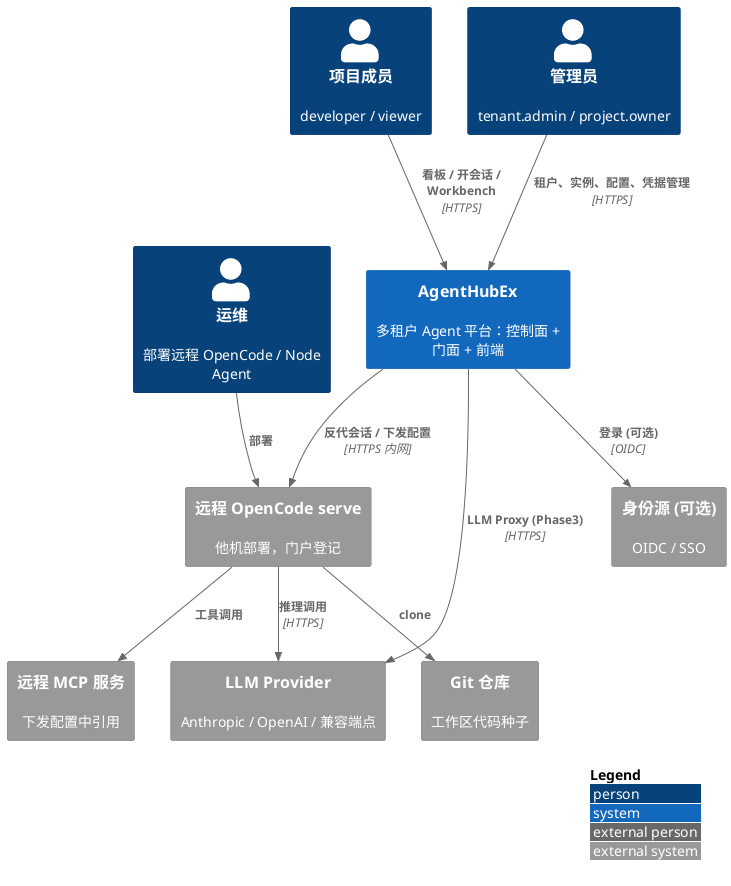
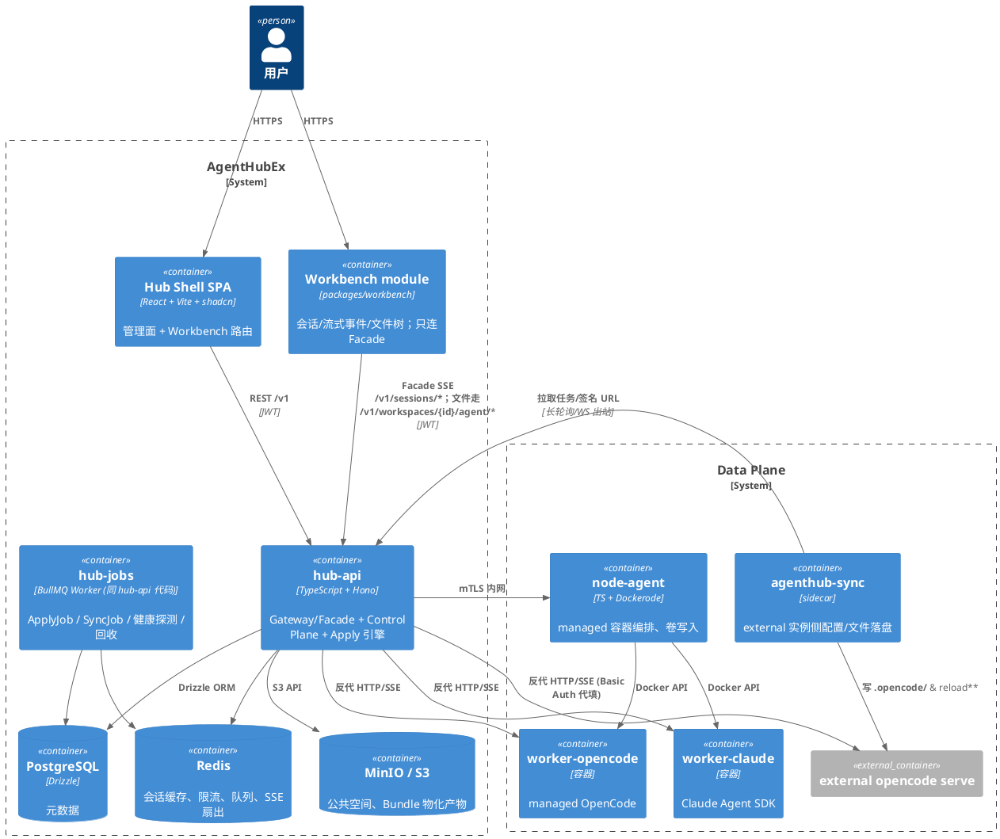
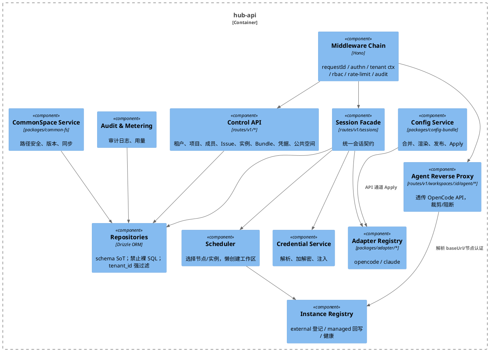
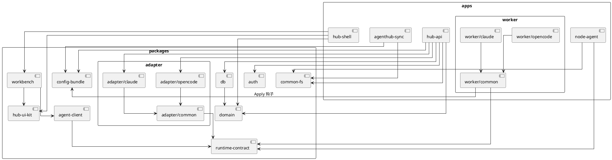
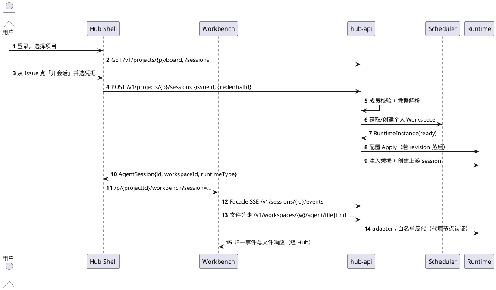

# 01 系统总览

## 1.1 目标与约束

- 双引擎（OpenCode / Claude Agent SDK）对等可调度，上层统一会话与事件抽象。
- 每个用户工作区 = 独立容器（或等价沙箱），文件系统与进程完全隔离。
- 一个 Project 多成员，会话归属用户，默认互不可见。
- 凭据可来自用户个人或项目共享，明文永不进浏览器。
- OpenCode 原生无多租户能力，多租户/授权/配置 SoT 全部由 Hub 补齐。

## 1.2 系统上下文（C4 Level 1）



## 1.3 容器视图（C4 Level 2）



## 1.4 hub-api 内部组件（C4 Level 3）



## 1.5 分层职责

| 层 | 组件 | 职责 |
|---|---|---|
| 前端 | Hub Shell / Workbench | 管理 UI / 会话 IDE |
| 接入 | Gateway Middleware | 鉴权、租户上下文、限流、审计 |
| 门面 | Session Facade / Agent Proxy | 统一会话契约 + 原生 OpenCode API 反代 |
| 控制面 | Registry / Scheduler / Config / Credential / CommonSpace / Board | 元数据与编排 |
| 数据面 | node-agent / worker-* / external / agenthub-sync | 执行与落盘 |
| 存储 | PG / Redis / S3 | 元数据 / 缓存队列 / 对象 |

## 1.6 仓库结构与包依赖



**依赖规则**

- `domain` 不依赖任何运行时库（纯类型 + zod schema）。
- `apps/*` 之间不得互相 import，只能通过 HTTP 契约通信。
- 前端只通过 `agent-client` 访问工作区 agent API；不得直连节点 URL（见 [10](10-frontend.md)）。

```text
AgentHubEx/
  apps/{hub-shell,hub-api,node-agent,agenthub-sync,worker/{common,opencode,claude}}
  packages/{domain,auth,db,runtime-contract,config-bundle,common-fs,hub-ui-kit,workbench,agent-client,adapter/{common,opencode,claude}}
  deploy/{docker,compose}
  docs/architecture/
```

## 1.7 关键端到端流程（概览）


