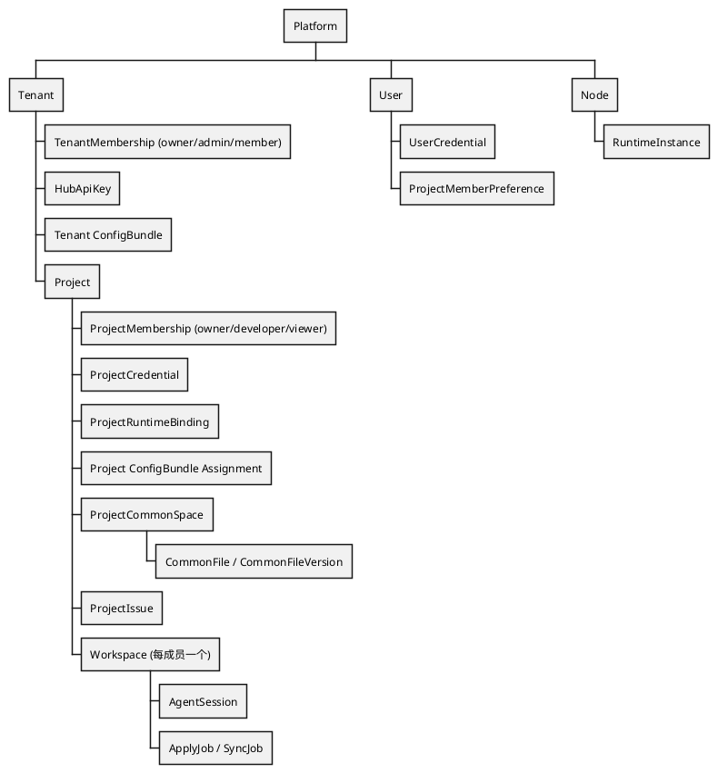
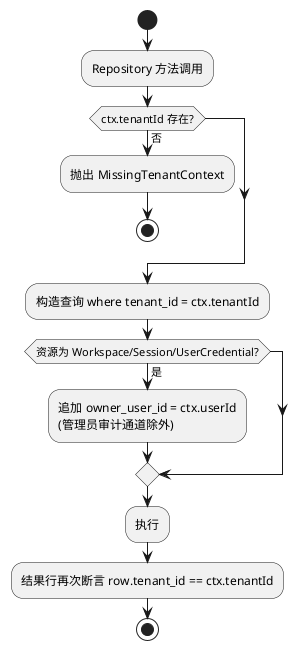

# 02 领域模型与数据设计

## 2.1 层级关系

## 2.2 领域类图

```plantuml
@startuml domain
hide empty methods
skinparam classAttributeIconSize 0

enum TenantRole {
  owner
  admin
  member
}
enum ProjectRole {
  owner
  developer
  viewer
}
enum RuntimeType {
  opencode
  claude
}
enum InstanceMode {
  external
  managed
}
enum CredentialSource {
  user
  project
}
enum CredentialPolicy {
  user_or_project
  project_only
  user_only
}
enum IssueStatus {
  todo
  in_progress
  in_review
  done
  cancelled
}

class Tenant {
  id: uuid
  slug: string
  name: string
  quota: TenantQuota
  defaultModel?: string
  status: active|suspended
}
class User {
  id: uuid
  email: string
  displayName: string
  passwordHash?: string
  idpSubject?: string
  isPlatformAdmin: bool
}
class TenantMembership {
  tenantId
  userId
  role: TenantRole
}
class Project {
  id; tenantId; key: string (PROJ)
  name; gitRepoUrl?
  credentialPolicy: CredentialPolicy
  commonSyncPolicy: on_workspace_start|on_common_publish
  configLock: ConfigLock
  issueSeq: int
}
class ProjectMembership {
  projectId
  userId
  role: ProjectRole
}
class ProjectMemberPreference {
  projectId
  userId
  preferredCredentialRef?
}
class UserCredential {
  id; userId; provider; label
  secretCiphertext; keyVersion
  metadata: json; status; version: int
}
class ProjectCredential {
  id; projectId; provider; label
  secretCiphertext; keyVersion
  allowedRoles: ProjectRole[]; isDefault: bool
  metadata; status; version: int
}
class Node {
  id; name; labels[]; status
  capacity: {cpu, memMb, diskGb, maxWorkspaces}
  lastHeartbeatAt
}
class RuntimeInstance {
  id; tenantId?; nodeId?
  mode: InstanceMode; runtimeType: RuntimeType
  baseUrl; authSecretRef
  isolation: dedicated|shared
  labels[]; healthStatus; latencyMs
  maxSessions; hasSyncAgent: bool
  assignedProjectIds[]
}
class ProjectRuntimeBinding {
  projectId; runtimeType
  instanceId? ; labelSelector?
  priority: int
}
class Workspace {
  id; tenantId; projectId; ownerUserId
  instanceId?; status
  volumePath; appliedRevisionId?
  commonSyncedAt?; lastActiveAt
}
class AgentSession {
  id; tenantId; projectId; workspaceId; ownerUserId
  title; runtimeType; runtimeSessionRef
  credentialSource: CredentialSource
  credentialId; credentialVersion
  issueId?; status
}
class ConfigBundle {
  id
  scope: tenant|project|user
  scopeId
  name
}
class ConfigRevision {
  id; bundleId; version: int
  state: draft|published|archived
  manifest: json; contentHash
  publishedBy; publishedAt
}
class ConfigAssignment {
  projectId
  bundleId
  pin: latest|revisionId
}
class ApplyJob {
  id; workspaceId; instanceId; revisionHash
  channel: api|file|both; status; diffSummary; error?
}
class CommonFile {
  id; projectId; path; size; mime; checksum
  currentVersion; deletedAt?; uploadedBy
}
class CommonFileVersion {
  fileId
  version
  objectKey
  checksum
  createdBy
}
class ProjectIssue {
  id; projectId; key: PROJ-12; title; description
  priority: P0..P3; status: IssueStatus
  assigneeUserId?; labels[]; resolutionNote?
  createdBy; rank: string (lexorank)
}
class IssueSessionLink {
  issueId
  sessionId
  linkedBy
}
class HubApiKey {
  id
  tenantId
  name
  prefix
  hash
  scopes[]
  expiresAt
}
class AuditLog {
  id
  tenantId
  actorId
  action
  target
  meta
  at
}
class UsageRecord {
  id; tenantId; projectId; userId; sessionId
  credentialSource; credentialId
  model; inputTokens; outputTokens; costMicros; at
}

Tenant "1" -- "*" TenantMembership
User "1" -- "*" TenantMembership
Tenant "1" -- "*" Project
Tenant "1" -- "*" HubApiKey
Project "1" -- "*" ProjectMembership
User "1" -- "*" ProjectMembership
Project "1" -- "*" ProjectCredential
User "1" -- "*" UserCredential
Project "1" -- "*" ProjectRuntimeBinding
Project "1" -- "*" Workspace
User "1" -- "*" Workspace
Workspace "1" -- "0..1" RuntimeInstance : runs_on
Node "1" -- "*" RuntimeInstance
Workspace "1" -- "*" AgentSession
AgentSession "*" -- "0..1" ProjectIssue
ProjectIssue "1" -- "*" IssueSessionLink
ConfigBundle "1" -- "*" ConfigRevision
Project "1" -- "*" ConfigAssignment
Workspace "1" -- "*" ApplyJob
Project "1" -- "*" CommonFile
CommonFile "1" -- "*" CommonFileVersion
Project "1" -- "*" ProjectIssue
@enduml
```

## 2.3 物理表（Drizzle schema → PostgreSQL）

表结构以 `packages/db/schema` 为 SoT（ADR-009）；下列为逻辑说明。业务访问只通过 Drizzle，不写裸 SQL。

所有业务表含 `tenant_id`（平台级表 `users`、`nodes` 除外），并以复合索引开头。

| 表 | 主要字段 | 约束 / 索引 |
|---|---|---|
| `tenants` | id, slug, name, quota jsonb, status | `uq(slug)` |
| `users` | id, email, display_name, password_hash, idp_subject, is_platform_admin | `uq(lower(email))` |
| `tenant_memberships` | tenant_id, user_id, role | `pk(tenant_id,user_id)` |
| `projects` | id, tenant_id, key, name, git_repo_url, credential_policy, common_sync_policy, config_lock jsonb, issue_seq | `uq(tenant_id,key)` |
| `project_memberships` | tenant_id, project_id, user_id, role | `pk(project_id,user_id)`, `idx(tenant_id,user_id)` |
| `project_member_prefs` | project_id, user_id, preferred_credential_ref | pk(project_id,user_id) |
| `user_credentials` | id, user_id, provider, label, secret_ciphertext bytea, key_version, metadata, status, version | `idx(user_id)` |
| `project_credentials` | id, tenant_id, project_id, …, allowed_roles text[], is_default | `uq(project_id) where is_default` |
| `credential_versions` | credential_id, kind, version, secret_ciphertext, created_at | 轮换快照，`pk(credential_id,kind,version)` |
| `nodes` | id, name, labels, status, capacity, last_heartbeat_at, cert_fingerprint | |
| `runtime_instances` | id, tenant_id?, node_id?, mode, runtime_type, base_url, auth_secret_ciphertext, isolation, labels, health_status, latency_ms, max_sessions, has_sync_agent, assigned_project_ids uuid[] | `idx(tenant_id,mode)`, GIN(labels) |
| `project_runtime_bindings` | id, tenant_id, project_id, runtime_type, instance_id?, label_selector jsonb, priority | check(instance_id 或 label_selector 二选一) |
| `workspaces` | id, tenant_id, project_id, owner_user_id, instance_id, status, volume_path, applied_revision_hash, common_synced_at, last_active_at | `uq(project_id,owner_user_id) where kind='personal'` |
| `agent_sessions` | id, tenant_id, project_id, workspace_id, owner_user_id, title, runtime_type, runtime_session_ref, credential_source, credential_id, credential_version, issue_id, status | `idx(tenant_id,owner_user_id,project_id,created_at desc)` |
| `config_bundles` | id, tenant_id, scope, scope_id, name | |
| `config_revisions` | id, bundle_id, version, state, manifest jsonb, content_hash, published_by | `uq(bundle_id,version)` |
| `config_assignments` | project_id, bundle_id, pin | |
| `apply_jobs` | id, tenant_id, workspace_id, instance_id, revision_hash, channel, status, diff_summary, error, attempts | `idx(workspace_id,created_at desc)` |
| `common_files` | id, tenant_id, project_id, path, size, mime, checksum, current_version, deleted_at | `uq(project_id,path) where deleted_at is null` |
| `common_file_versions` | file_id, version, object_key, checksum, created_by | |
| `common_protected_prefixes` | project_id, prefix | |
| `project_issues` | id, tenant_id, project_id, seq, title, description, priority, status, assignee_user_id, labels text[], rank, resolution_note, created_by | `uq(project_id,seq)`, `idx(project_id,status,rank)` |
| `issue_session_links` | issue_id, session_id, linked_by | pk |
| `hub_api_keys` | id, tenant_id, name, prefix, hash, scopes, expires_at, last_used_at | `uq(prefix)` |
| `audit_logs` | id, tenant_id, actor_id, actor_type, action, target_type, target_id, meta, ip, at | 按月分区 |
| `usage_records` | … | 按月分区，`idx(tenant_id,project_id,at)` |

## 2.4 多租户数据访问约束

- 实现方式：`packages/db` 暴露 `scoped(ctx)` 工厂，禁止直接使用裸 `db`（ESLint 规则 `no-restricted-imports`）。
- 二道防线（Phase 4）：PostgreSQL RLS，`SET app.tenant_id` 由连接池在事务开始时设置。
- 集成测试矩阵：每个资源 API × {同租户他人, 跨租户, 无成员} 三类 IDOR 必须 403/404。

## 2.5 ID 与编号

- 主键：UUIDv7（时间有序，利于索引）。
- 对外 Issue key：`{project.key}-{seq}`，`seq` 由 `UPDATE projects SET issue_seq = issue_seq + 1 RETURNING` 原子生成。
- 资源不存在与无权访问统一返回 `404`，避免枚举。
