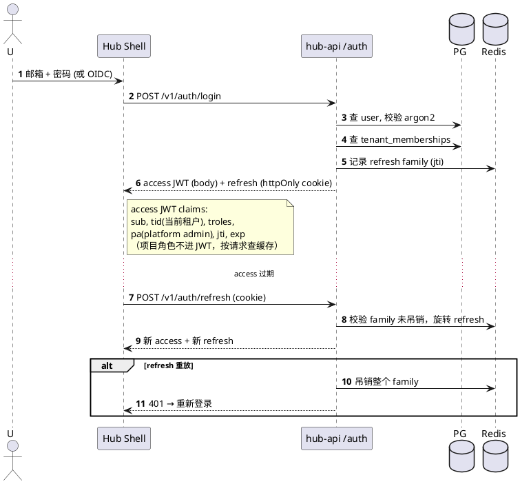
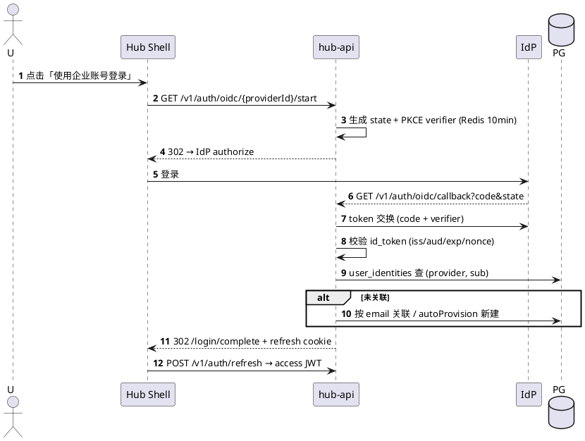
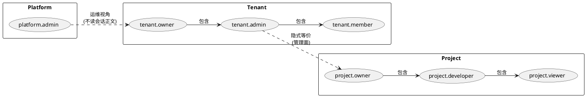
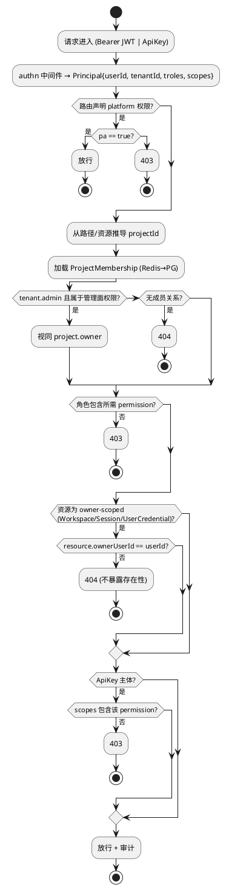
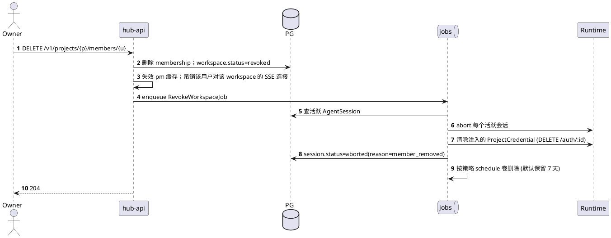

# 03 认证与 RBAC

## 3.1 身份类型

| 主体 | 凭证 | 用途 |
|---|---|---|
| 人类用户 | Hub JWT（access 15 min + refresh 7 d，refresh 存 httpOnly cookie） | Hub Shell / Workbench |
| 开放 API | `HubApiKey`（`ahk_<prefix>_<secret>`，库中存 argon2 hash） | SDK / CLI / CI |
| Node Agent | mTLS 客户端证书（bootstrap token 换发） | 心跳、任务回执 |
| agenthub-sync | 实例级 sync token（绑定 instanceId，可吊销） | 拉取 Apply/Sync 任务 |
| 内部 Job | 服务账号上下文（不出进程） | 队列任务 |

## 3.2 登录与令牌刷新



### 3.2.1 本地账号（首版）与 OIDC（预留）——ADR-001

| 项 | 方案 |
|---|---|
| 注册 | 不开放自助注册；租户 admin 发邀请链接（token 72h，单次），被邀请人设密码后加入租户 |
| 密码 | argon2id（m=64MB, t=3, p=1）；最少 10 位；连续 5 次失败锁 15 分钟（Redis 计数，按 email+IP） |
| 找回 | 邮件重置链接（token 30 min，单次）；未配置 SMTP 时由 admin 重置 |
| 平台初始化 | 首次启动读 `AGENTHUB_BOOTSTRAP_ADMIN_EMAIL`，打印一次性设密链接到日志 |
| OIDC | `oidc_providers(tenantId?, issuer, clientId, clientSecretCiphertext, scopes, claimMapping)`；Authorization Code + PKCE；`user_identities(provider, subject)` 关联用户 |
| 账号合并 | OIDC 首次登录：email 已存在且 `email_verified=true` → 关联已有用户；否则仅当租户开启 `autoProvision` 时新建 |
| 方式开关 | `tenants.settings.allowedLoginMethods = ['password','oidc:<id>']` |



- 切换租户：`POST /v1/auth/switch-tenant {tenantId}` 重新签发 access（校验成员身份）。
- 项目角色不写入 JWT：成员变更需立即生效，改为 Redis 缓存 `pm:{projectId}:{userId}`（TTL 60s，成员变更时主动失效）。

## 3.3 角色模型



> `tenant.admin` 在**管理面**等价于所有项目的 `project.owner`，但在**会话面**不具备读他人会话正文的权限（只能走审计接口看元数据）。

## 3.4 权限矩阵

| 能力（permission） | viewer | developer | p.owner | t.admin | 说明 |
|---|:-:|:-:|:-:|:-:|---|
| `project.read` | ✓ | ✓ | ✓ | ✓ | |
| `project.update` / `binding.manage` | | | ✓ | ✓ | |
| `member.manage` | | | ✓ | ✓ | |
| `issue.read` | ✓ | ✓ | ✓ | ✓ | |
| `issue.write`（建卡/改状态/指派） | | ✓ | ✓ | ✓ | |
| `issue.force_close` / 列策略 | | | ✓ | ✓ | |
| `common.read` | ✓ | ✓ | ✓ | ✓ | |
| `common.write`（非受保护前缀） | | ✓ | ✓ | ✓ | |
| `common.write_protected` / 配额 | | | ✓ | ✓ | |
| `workspace.own`（个人工作区） | | ✓ | ✓ | ✓ | viewer 首版不开会话 |
| `session.create` / `session.own` | | ✓ | ✓ | ✓ | 仅自己的 |
| `session.audit_meta` | | | ✓ | ✓ | 只看元数据 |
| `credential.project.use` | | ✓* | ✓ | ✓ | *受 `allowed_roles` 与 `credentialPolicy` 约束 |
| `credential.project.manage` | | | ✓ | ✓ | 只写不读 |
| `config.read_effective` | | ✓ | ✓ | ✓ | 合并预览 |
| `config.manage` / `config.apply` | | | ✓ | ✓ | |
| `instance.manage`（登记 external） | | | | ✓ | platform.admin 管全局 |
| `node.manage` | | | | | 仅 platform.admin |

## 3.5 授权判定流程



实现：Hono 路由声明式元数据

```ts
route.post('/v1/projects/:projectId/sessions',
  authz({ perm: 'session.create', project: p => p.param('projectId') }),
  handler)
```

## 3.6 成员移除的连锁处理


