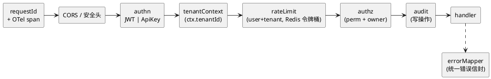
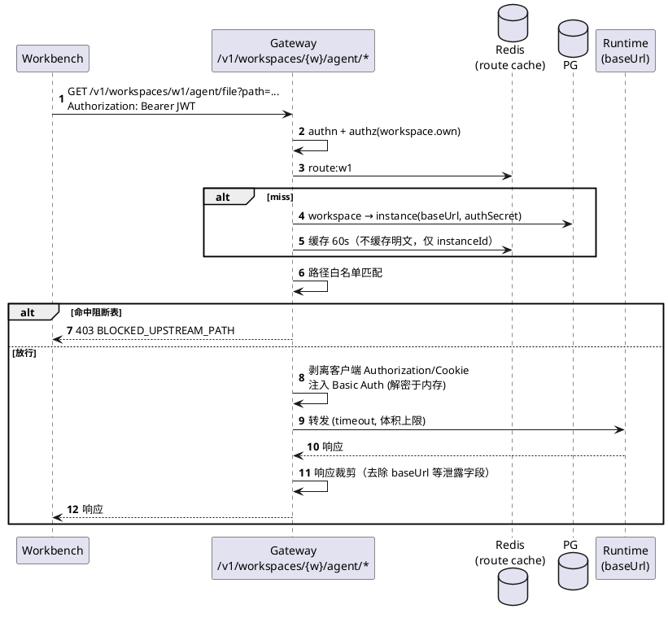
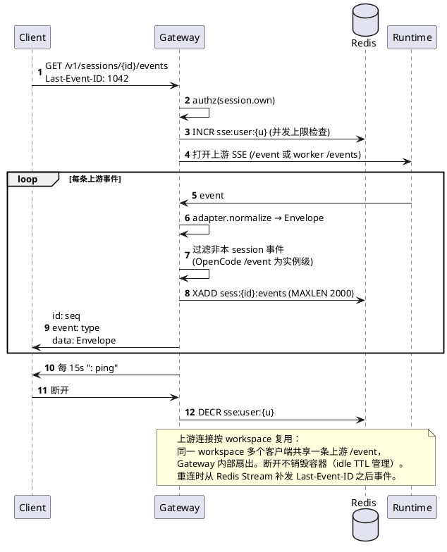
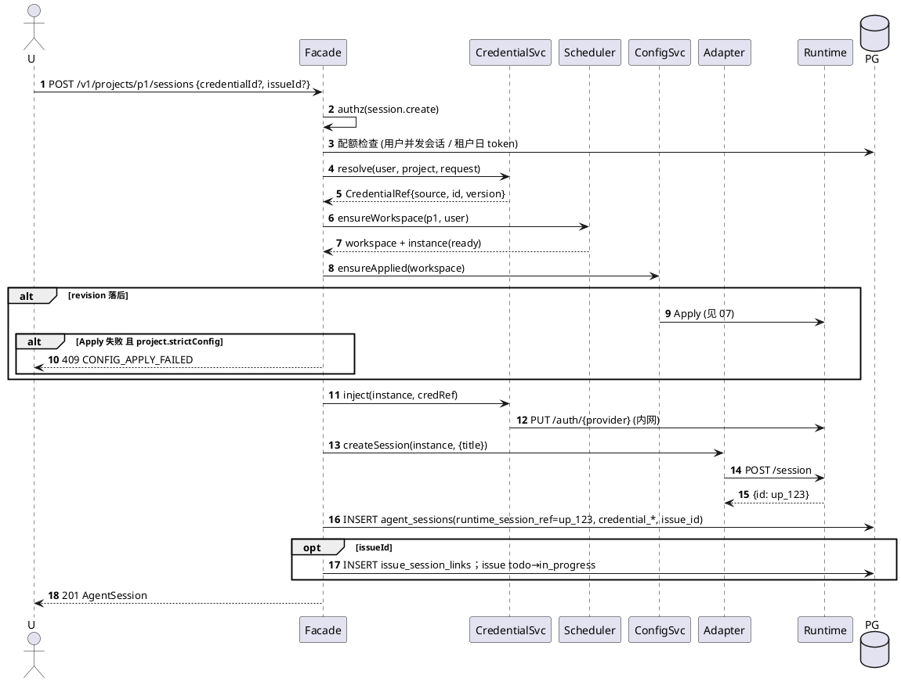

# 04 Gateway / Facade

对外只暴露 Hub API。节点 Basic Auth、baseUrl、Provider Key 永不出现在响应中。

## 4.1 中间件链



## 4.2 两类客户端通道（已收紧）

| 通道 | 路径 | 使用方 | 说明 |
|---|---|---|---|
| **A. 统一会话 Facade** | `/v1/projects/{p}/sessions`、`/v1/sessions/{id}/*` | **Workbench 聊天主路径**、Shell、SDK、看板 | 引擎无关；消息/权限/SSE 只走这里 |
| **B. 原生 Agent 反代** | `/v1/workspaces/{w}/agent/*` | Workbench **文件树 / find / PTY** | 白名单透传；**不**承载会话创建与事件流 |

`agent-client` 约定：会话 API → A；`files`/`find`/`pty`（及只读 `agent`/`mcp`/`config`）→ B。浏览器不得打开 `/agent/event` 或经 B `POST /session`。

## 4.3 反代请求处理



### 路径策略表（浏览器 → `/agent/*` → OpenCode 上游）

| 上游路径 | 方法 | 策略 |
|---|---|---|
| `/file/**`, `/find/**` | GET | **放行**（工作区内） |
| `/agent`, `/mcp` | GET | **放行**（只读发现） |
| `/config` | GET | **放行**（响应脱敏 secret） |
| `/pty/**` | WS | **放行**（P2+；受 `capabilities.pty` 与租户开关） |
| `/session`, `/session/:id/**` | * | **阻断**（会话一律 Facade；adapter 内网直连上游） |
| `/event` | GET | **阻断**（会话 SSE 仅 `/v1/sessions/{id}/events`；Gateway 内网拉上游 `/event`） |
| `/mcp` | POST | **阻断**（仅 Apply 引擎内部） |
| `/config` | PATCH | **阻断** |
| `/auth/**` | * | **阻断**，由 Hub 代写 |
| `/global/**`、`/project` 切换类 | * | **阻断** |
| 其它未知 | * | 默认**阻断**，日志告警 |

会话创建只走 `POST /v1/projects/{p}/sessions`（见 4.6）：Facade → adapter 内网 `createSession` → 上游，再写入 `agent_sessions.runtime_session_ref`。

## 4.4 SSE 代理



## 4.5 统一会话 API 清单

| 方法 | 路径 | 权限 | 说明 |
|---|---|---|---|
| GET | `/v1/projects/{p}/sessions` | session.own | 仅当前用户；`?issueId=&status=` |
| POST | `/v1/projects/{p}/sessions` | session.create | `{title?, runtimeType?, credentialSource?, credentialId?, issueId?}` |
| GET | `/v1/sessions/{id}` | session.own | 元数据 |
| POST | `/v1/sessions/{id}/messages` | session.own | `{parts:[{type:'text',text}], model?, agent?}` |
| POST | `/v1/sessions/{id}/abort` | session.own | |
| POST | `/v1/sessions/{id}/permissions/{reqId}` | session.own | `{decision: allow|deny|always}` |
| GET | `/v1/sessions/{id}/events` | session.own | SSE（Bearer 或 ticket） |
| POST | `/v1/sessions/{id}/events/ticket` | session.own | `{ ticket: string, expiresIn: 60 }`；单次、绑定 session+user |
| GET | `/v1/sessions/{id}/messages` | session.own | 历史，分页 |
| DELETE | `/v1/sessions/{id}` | session.own | 归档 |
| GET | `/v1/projects/{p}/credentials/options` | session.create | 可选凭据（元数据） |
| GET | `/v1/projects/{p}/workspaces/me` | workspace.own | 懒创建 |
| POST | `/v1/workspaces/{w}/start` / `stop` | workspace.own | managed |
| POST | `/v1/workspaces/{w}/sync-config` | workspace.own | 触发 Apply |
| POST | `/v1/workspaces/{w}/sync-common` | workspace.own | 同步公共空间 |
| GET | `/v1/admin/projects/{p}/sessions` | session.audit_meta | 元数据审计 |

控制面 API（项目/成员/实例/Bundle/公共空间/Issue）见各模块文档。

## 4.6 创建会话时序



## 4.7 错误信封与错误码

```json
{ "error": { "code": "CREDENTIAL_REQUIRED", "message": "...", "requestId": "01J...", "details": {} } }
```

| HTTP | code | 场景 |
|---|---|---|
| 400 | `VALIDATION_FAILED` | zod 校验失败 |
| 401 | `UNAUTHENTICATED` | |
| 403 | `FORBIDDEN` / `BLOCKED_UPSTREAM_PATH` | |
| 404 | `NOT_FOUND` | 包括无权访问 |
| 409 | `CREDENTIAL_REQUIRED` | 无可用凭据 |
| 409 | `CREDENTIAL_POLICY_VIOLATION` | 策略不允许该来源 |
| 409 | `CREDENTIAL_ROTATED` | 旧版本已失效，需重选 |
| 409 | `CONFIG_APPLY_FAILED` | |
| 409 | `WORKSPACE_NOT_READY` | 含 `retryAfter` |
| 429 | `RATE_LIMITED` / `QUOTA_EXCEEDED` | |
| 502 | `UPSTREAM_UNAVAILABLE` | 实例不健康 |
| 504 | `UPSTREAM_TIMEOUT` | |

## 4.8 限流与配额

| 维度 | 默认 | 实现 |
|---|---|---|
| API QPS / 用户 | 20 r/s 突发 40 | Redis 令牌桶 |
| SSE 并发 / 用户 | 10 | Redis 计数 |
| 并发活跃会话 / 用户 | 5 | PG count + Redis 缓存 |
| 活跃工作区 / 项目 | 50 | PG |
| Token / 租户 / 日 | 租户配额 | UsageRecord 聚合（Phase 3 LLM Proxy 精确拦截） |
