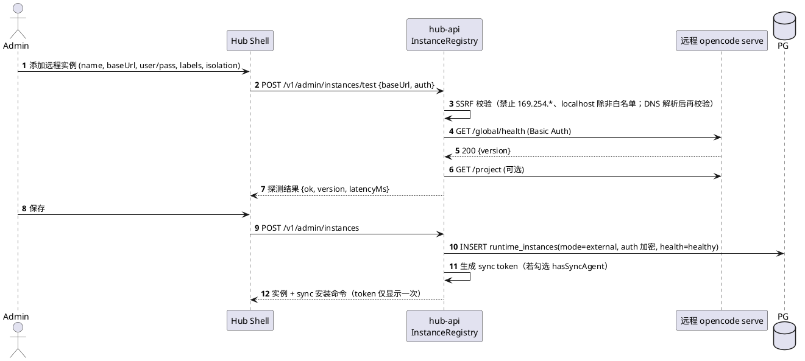
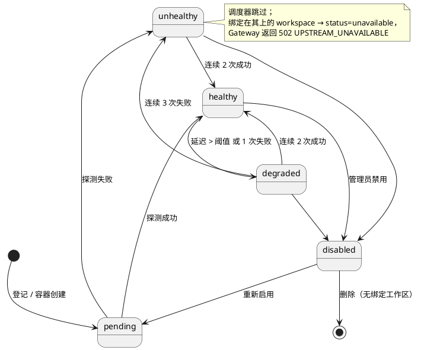
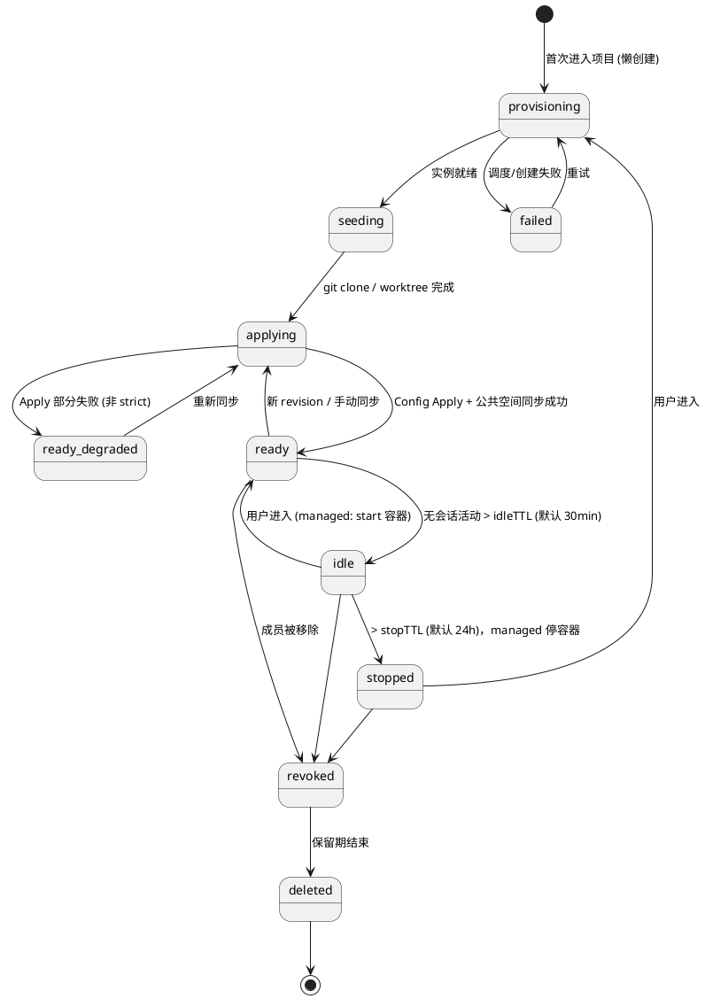
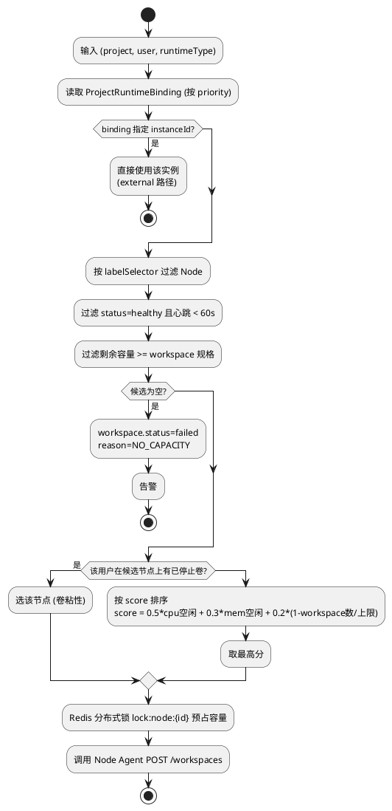
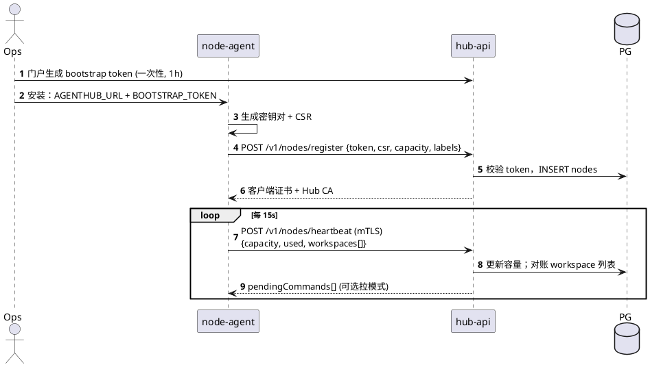
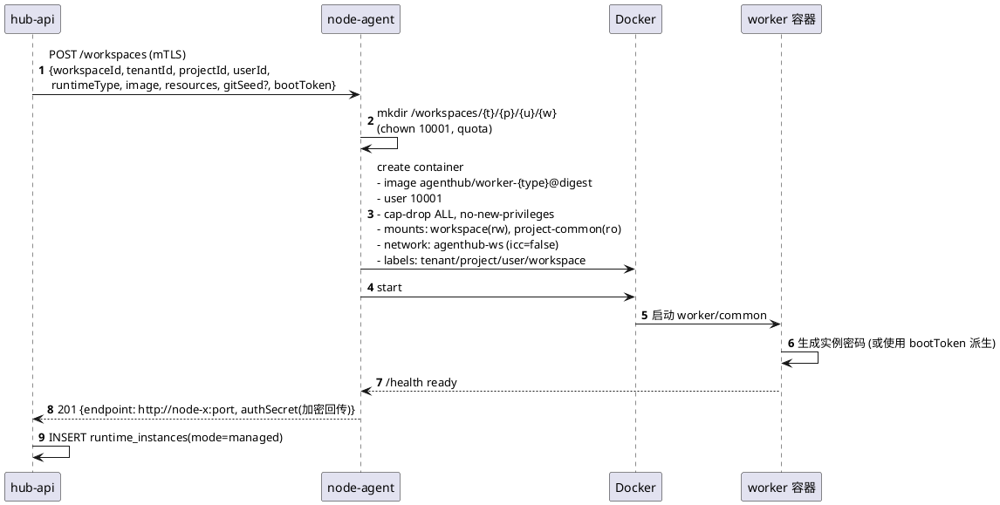

# 05 运行时实例、Node Agent 与调度

## 5.1 两种接入模式

| | external（登记连接） | managed（Node Agent 编排） |
|---|---|---|
| 创建者 | 运维自行部署 `opencode serve` | Node Agent 按 `(project,user)` 拉起 |
| 登记方式 | 门户手填 URL + Basic Auth | 自动写入 `runtime_instances` |
| 文件下发 | 需 `agenthub-sync` sidecar | Node Agent 写卷 |
| 隔离 | 推荐一进程一用户；`isolation=shared` 仅演示 | 强制一容器一工作区 |
| 阶段 | Phase 1 主路径 | Phase 2 |

## 5.2 external 实例登记流程



## 5.3 实例健康状态机



健康探测：`hub-jobs` 每 30s 对 healthy 实例、每 10s 对 degraded/unhealthy 实例 `GET /global/health`（managed 走 worker `/health`）。

## 5.4 Workspace 生命周期



> external 模式下 `idle/stopped` 只是 Hub 侧标记，不会去停远程进程。

## 5.5 调度算法（managed）



## 5.6 Node Agent 注册与心跳



## 5.7 Node Agent 创建工作区



**Node Agent API（mTLS）**

| 方法 | 路径 | 说明 |
|---|---|---|
| POST | `/workspaces` | create + start |
| POST | `/workspaces/:id/start` / `stop` | |
| DELETE | `/workspaces/:id?purgeVolume=` | |
| POST | `/workspaces/:id/files/apply` | 写入渲染后的配置文件树（tar + manifest） |
| POST | `/workspaces/:id/common/sync` | 用签名 URL 拉公共空间镜像到 ro 目录 |
| GET | `/health`, `/capacity` | |

## 5.8 容器安全基线（ADR-002 / ADR-003：保持简单）

| 项 | 要求 | 不做 |
|---|---|---|
| 运行时 | Docker 默认 runc | 不用 gVisor / Kata；首版不上 K8s |
| 用户 | 非 root（uid 10001），镜像内可用 `sudo`-less 的用户级包管理（npm/pip --user） | |
| 根文件系统 | 可写（便于装依赖）；容器重建即还原 | 不做只读根 |
| 能力 | `cap-drop=ALL`，`no-new-privileges`，Docker 默认 seccomp | 不写自定义 seccomp/AppArmor |
| 挂载 | 本 workspace 卷 `/workspace`(rw) + `project-common`(ro)；禁止 docker.sock | |
| 网络 | 所有工作区共用 `agenthub-ws` bridge，`icc=false`（容器间不通）；worker 端口只绑节点内网 IP | 不做每工作区独立网络 |
| 出网 | **默认放开**；`DOCKER-USER` 链仅拒绝云元数据地址与控制面网段；DNS 日志审计 | 不做域名白名单 |
| 资源 | `--cpus`、`--memory`、`--pids-limit=1024`；磁盘用定时 `du` 巡检超额告警（软限制） | 不做 xfs 硬配额 |
| 凭据 | 只在进程内存或 OpenCode auth 存储（`/run/agenthub` tmpfs）；不落 workspace 卷 | |

默认规格：`2 CPU / 4 GiB / 磁盘软限 20 GiB`，项目可调。

```bash
# node-agent 在节点初始化时写入的出网规则（示意）
iptables -I DOCKER-USER -s 172.30.0.0/16 -d 169.254.169.254 -j DROP
iptables -I DOCKER-USER -s 172.30.0.0/16 -d ${CONTROL_PLANE_CIDR} -j DROP
```
