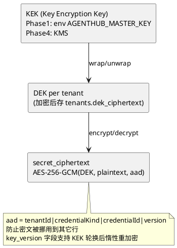
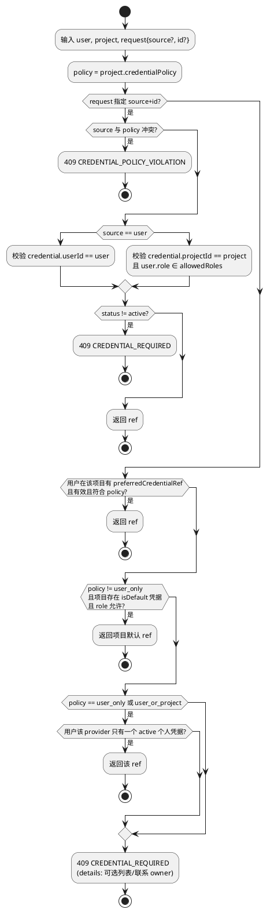
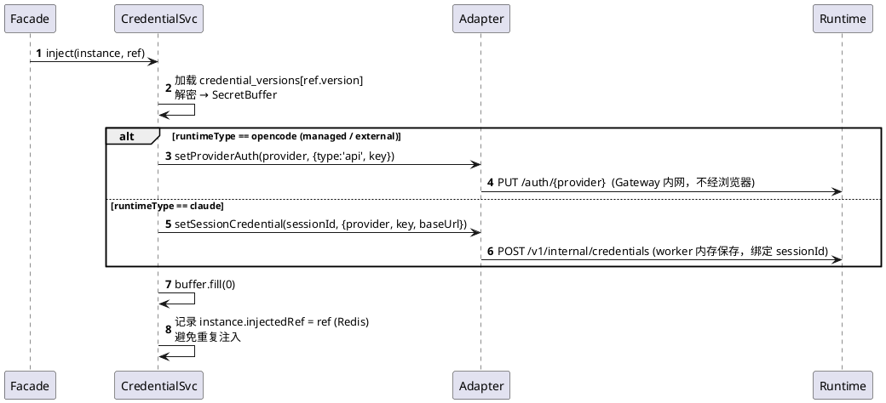
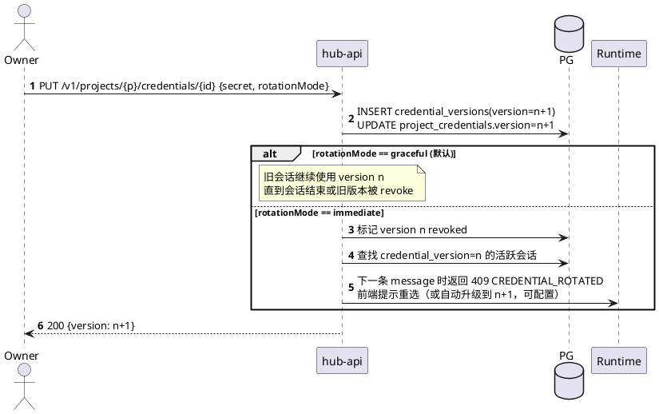
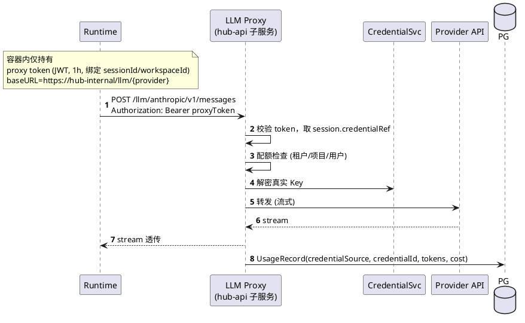

# 06 凭据模型

## 6.1 两类 Provider 凭据 + 其它秘密

| 类型 | 所有者 | 可写 | 可用 | 明文可读 |
|---|---|---|---|---|
| UserCredential | 用户 | 本人 | 本人在任意有权项目 | 永不 |
| ProjectCredential | 项目 | project.owner / tenant.admin | `allowed_roles` 内成员 | 永不 |
| 实例节点认证 | 平台/租户 | instance.manage | Gateway 内部 | 永不 |
| MCP secretRef 目标 | 项目凭据 / vault | config.manage | Apply 引擎 | 永不 |
| HubApiKey | 租户 | t.admin | API 调用 | 仅创建时显示一次 |

## 6.2 加密方案（信封加密）

- 解密只在 `CredentialService` 内存中进行，返回 `SecretBuffer`（用后 `fill(0)`），日志序列化器对其输出 `[REDACTED]`。
- API 只返回 `{id, label, provider, status, isDefault, metadata, last4?}`。

## 6.3 解析算法

返回值 `CredentialRef = {source, id, version}` 写入 `agent_sessions`，会话生命周期内锁定。

## 6.4 注入

> **OpenCode 注意**：`/auth` 为实例级而非会话级。由于一人一实例，同一实例上该用户切换凭据时，Hub 在下一条 message 前比较 `injectedRef` 与 `session.credentialRef`，不同则重新注入（同一用户的多个会话使用不同凭据时串行化消息发送前的注入）。Phase 3 LLM Proxy 后消除该问题。

## 6.5 轮换

## 6.6 Phase 3：LLM Proxy

收益：真实 Key 永不进容器；可精确计量与硬限额；会话级凭据自然隔离。

## 6.7 计量维度

`usage_records` 聚合视图：

- 个人 Key 消耗：`credential_source='user'` 按 user 汇总（仅本人可见）。
- 项目 Key 消耗：`credential_source='project'` 按 project/user 汇总（owner 可见）。
- Phase 1–2 数据来源：解析 OpenCode/Claude 事件中的 usage 字段（尽力而为）；Phase 3 以 Proxy 为准。
- **租户日 token 配额**与超限硬拦语义见 [04 §4.8.1](04-gateway-facade.md)（与本表同源累加）。
- 首版**只计量不结算**：提供只读 usage 聚合 API（见 [16](16-api-schema.md)），不做收银台/发票。

## 6.8 KEK / 凭据运维轮换（Runbook 摘要）

| 步骤 | 动作 |
|---|---|
| 1 | 生成新 KEK（Phase1：新 `AGENTHUB_MASTER_KEY_V{n}`；Phase4：KMS 新密钥版本），配置**双窗口**（旧+新均可 unwrap） |
| 2 | `hub-jobs` 跑 `ReencryptCredentialsJob`：按 `key_version` 惰性或全表重包 DEK/密文，写新 `key_version` |
| 3 | 监控 `credentials.key_version` 分布；旧版本归零后移除旧 KEK |
| 4 | 回滚：双窗口未关闭前可切回旧 KEK；已重加密行仍可用新 KEK 读 |
| 同步 | 节点 mTLS 证书续期、sync token rotate、HubApiKey 轮换检查表见 [12 §12.8](12-security-observability-deployment.md) |
