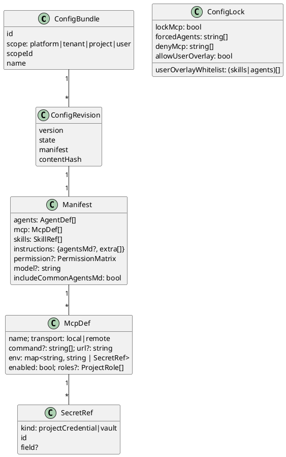
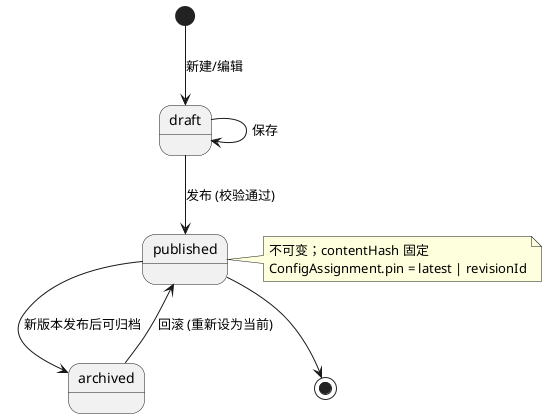
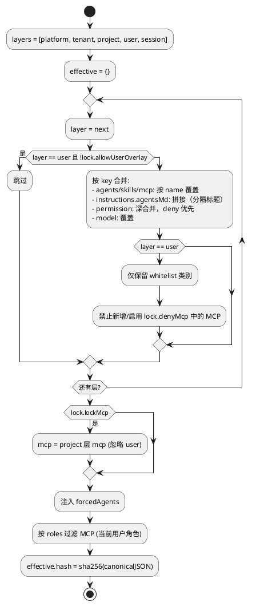
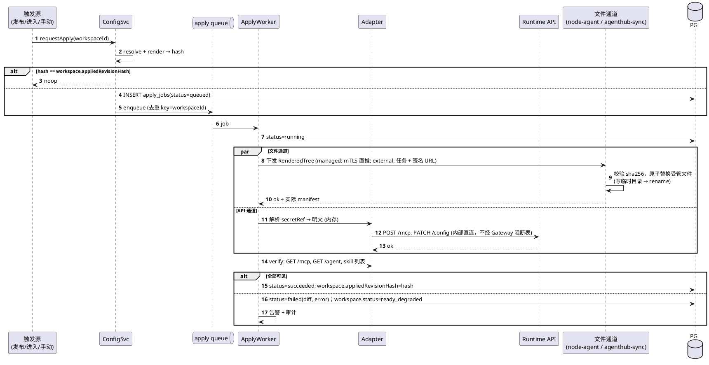
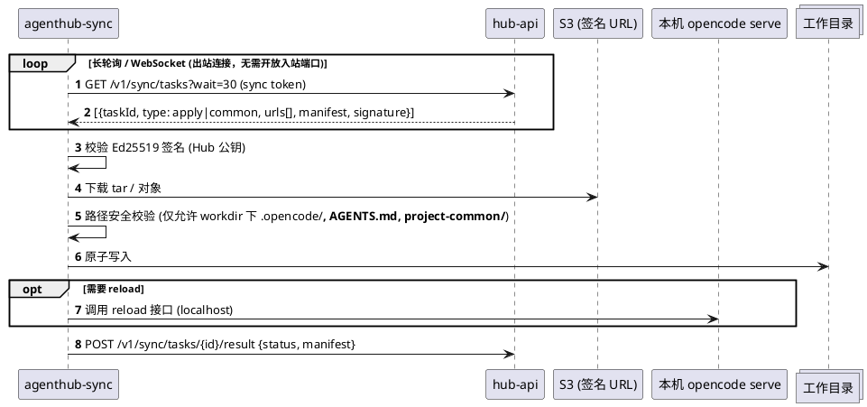

# 07 配置中心与下发（Agent / MCP / Skill / Instructions）

门户是唯一配置源（SoT）。Hub 合并 → 渲染 → 通过 API 通道与文件通道应用到每个工作区实例。

## 7.1 资产与目标映射

| 资产 | Hub 存储形态 | OpenCode 目标 | Claude worker 目标 |
|---|---|---|---|
| Agent | md(frontmatter+body) / json | `.opencode/agents/<name>.md` / `opencode.json#agent` | `agents` 选项（subagents） |
| MCP | `{name, transport, command/url, env, secretRefs, enabled, roles}` | `opencode.json#mcp`；运行时 `POST /mcp` | `mcpServers` 选项 |
| Skill | 目录 + `SKILL.md` + 附件 | `.opencode/skills/<name>/` | `.claude/skills/<name>/` |
| Instructions | `AGENTS.md` 正文 + `instructions[]` | 根 `AGENTS.md` + `opencode.json#instructions` | `CLAUDE.md` + systemPrompt append |
| Permission | 工具权限矩阵 | `opencode.json#permission` | `allowedTools`/`disallowedTools` + `canUseTool` |
| Model 默认 | provider/model | `opencode.json#model` | `model` 选项 |

映射表维护在 `packages/runtime-contract/src/bundle-mapping.ts`。

## 7.2 Bundle 模型



文件类资产（skill 附件、大 md）以内容寻址存于 S3：`bundles/{tenantId}/blobs/{sha256}`；manifest 只存 hash 引用。

## 7.3 Revision 状态机



发布校验：schema（zod）、MCP 命令白名单（租户可配）、secretRef 可解析、skill 名称唯一、文件路径安全。

## 7.4 合并算法



## 7.5 渲染

```text
render(effective, runtimeType) -> RenderedTree
  files:
    opencode.json            (仅 Hub 管理的片段，合并入用户已有文件的 "agenthub" 管理区)
    AGENTS.md
    .opencode/agents/*.md
    .opencode/skills/<name>/**
  apiOps:
    - { op: 'mcp.add', name, config }       # secret 以占位符 ${secret:ref}
    - { op: 'config.patch', path, value }
  manifest.json              (路径 → sha256，用于 diff 与受管文件识别)
```

- 受管文件写入 `.agenthub/managed.json` 记录清单；下次 Apply 时只删除/覆盖清单内文件，**不动用户自建文件**。
- secret 占位符只在 Apply 执行端（hub-api 进程内 / agenthub-sync 收到的已加密 payload）替换。

## 7.6 Apply 引擎时序



**重试**：指数退避 3 次；external 实例无 sync agent 时文件通道标记 `skipped`，状态为 `partial`。

**OpenCode 热更新**：文件通道完成后若上游不支持热加载 agents/skills，则 managed 重启 worker 内 opencode 进程（保留会话存储卷）；external 由 sync agent 调用 `POST /instance/dispose`（或等价接口）触发重新加载。

## 7.7 agenthub-sync（external 侧 sidecar）



- 只允许写入白名单路径；拒绝符号链接逃逸。
- 秘密内容（MCP env）不经 sync 通道下发，统一走 API 通道 `POST /mcp`。

## 7.8 配置中心 API

| 方法 | 路径 | 说明 |
|---|---|---|
| GET/POST | `/v1/tenants/{t}/bundles`, `/v1/projects/{p}/bundles` | 列表/新建 |
| GET/PUT | `/v1/bundles/{b}/draft` | 编辑草稿 |
| POST | `/v1/bundles/{b}/blobs` | 上传 skill zip / 文件（内容寻址） |
| POST | `/v1/bundles/{b}/publish` | 发布 → revision |
| POST | `/v1/bundles/{b}/rollback {revisionId}` | 回滚 |
| PUT | `/v1/projects/{p}/config/assignment` | 绑定 pin |
| PUT | `/v1/projects/{p}/config/lock` | 锁策略 |
| GET | `/v1/projects/{p}/config/effective?userId=` | 合并预览 |
| POST | `/v1/projects/{p}/config/apply {workspaceIds?|all}` | 批量下发 |
| GET | `/v1/projects/{p}/apply-jobs` | 下发记录 |
| PUT | `/v1/me/projects/{p}/overlay` | 用户 overlay |

## 7.9 自动推送（Phase 2）

发布 published revision → 对 `pin=latest` 的项目，找出在线（ready/idle）工作区 → 节流（每项目每分钟 ≤ 20 个）入队 Apply。有活跃生成中的会话时延迟到 `session.idle` 事件后执行。
