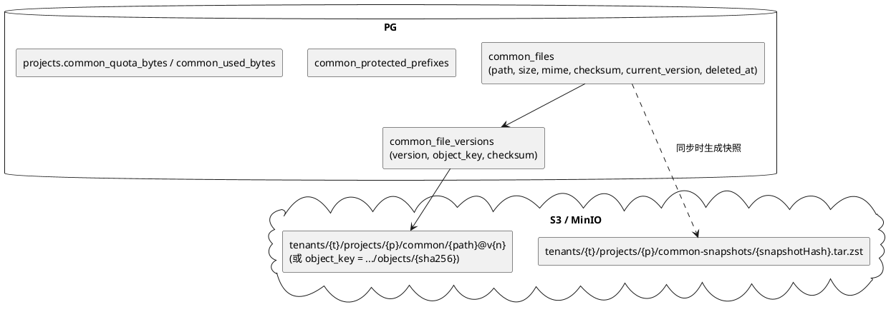
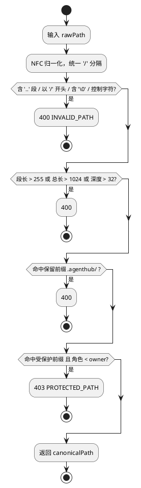
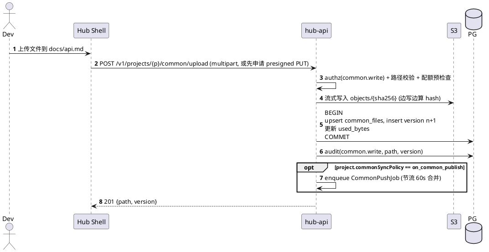
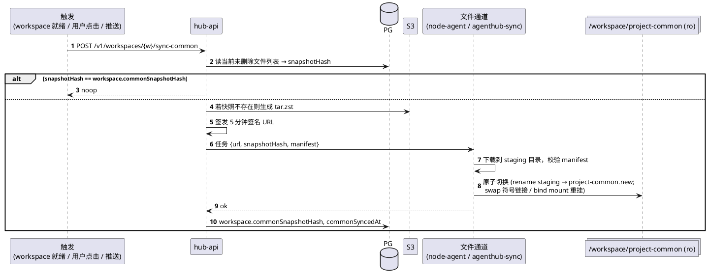
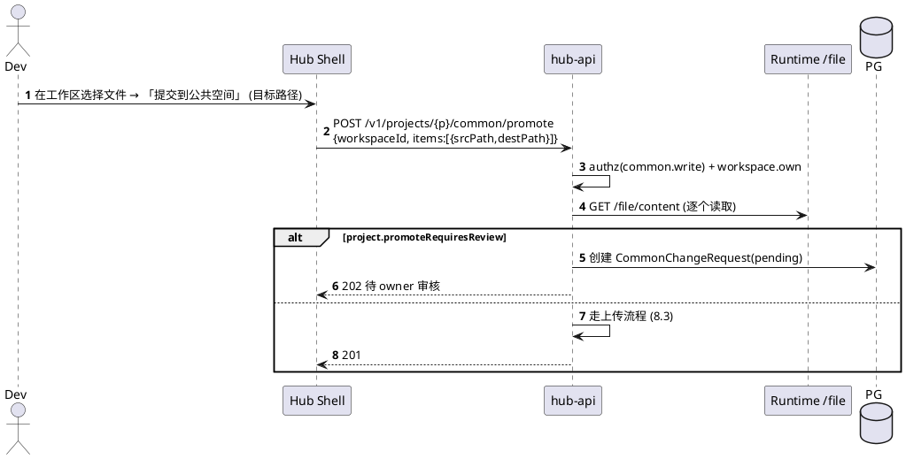

# 08 项目公共空间

与个人工作区分离，存放项目共享资料；同步到个人工作区 `/workspace/project-common/` 只读。

## 8.1 存储布局

- 对象键采用**内容寻址** `objects/{sha256}`（同内容去重，版本只是指针）；路径映射在 PG。
- 快照：同步时按 `(path, checksum)` 列表计算 `snapshotHash`，相同则复用 tar。

## 8.2 路径安全规则（`packages/common-fs`）

zip 批量上传：流式解压，逐条走上述校验；拒绝符号链接条目；解压总大小与条目数受配额限制（防 zip bomb）。

## 8.3 上传与编辑

在线编辑文本：`PUT /common/files/{path}` 携带 `If-Match: <checksum>` 乐观锁，冲突返回 `412`。

## 8.4 同步到个人工作区

- managed：`project-common` 是宿主机目录以 `ro` bind mount 进容器；Node Agent 在宿主机侧写入。
- external：agenthub-sync 写入工作目录下 `project-common/`，并 `chmod -R a-w`；同时在下发的 OpenCode permission 中 deny 对 `project-common/**` 的 edit/write。
- 若项目勾选 `includeCommonAgentsMd`，渲染时把 `project-common/AGENTS.md` 加入 `instructions[]`。

## 8.5 从工作区回流到公共空间

Agent 自身无法直接写公共空间（只读挂载 + 无 Hub 凭证）。

## 8.6 软删除与回收

- `DELETE` → `deleted_at=now()`；回收期 30 天内可恢复；`hub-jobs` 每日清理过期条目并对无引用对象做 GC。
- 单文件历史版本保留最近 20 个（可配），回滚 = 新建版本指向旧对象。

## 8.7 API

| 方法 | 路径 | 权限 |
|---|---|---|
| GET | `/v1/projects/{p}/common/tree?prefix=&depth=` | common.read |
| GET | `/v1/projects/{p}/common/files/{path}` (`?download=1`, `?version=`) | common.read |
| PUT | `/v1/projects/{p}/common/files/{path}` | common.write |
| PATCH | `/v1/projects/{p}/common/files/{path}` (`{move/rename}`) | common.write |
| DELETE | `/v1/projects/{p}/common/files/{path}` | common.write |
| POST | `/v1/projects/{p}/common/upload` / `upload-zip` | common.write |
| GET | `/v1/projects/{p}/common/files/{path}/versions` | common.read |
| POST | `/v1/projects/{p}/common/files/{path}/restore {version}` | common.write |
| GET | `/v1/projects/{p}/common/search?q=` | common.read |
| GET/PUT | `/v1/projects/{p}/common/settings` (配额、受保护前缀、同步策略) | common.write_protected |
| POST | `/v1/workspaces/{w}/sync-common` | workspace.own |
