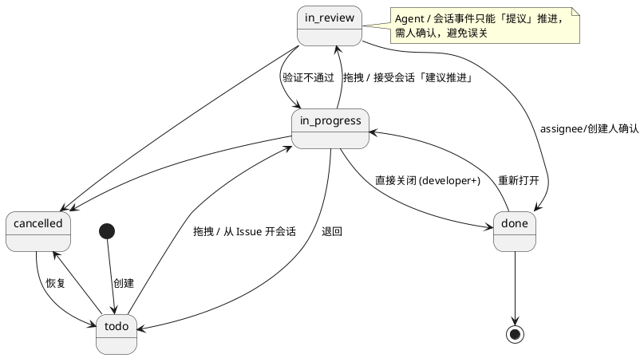
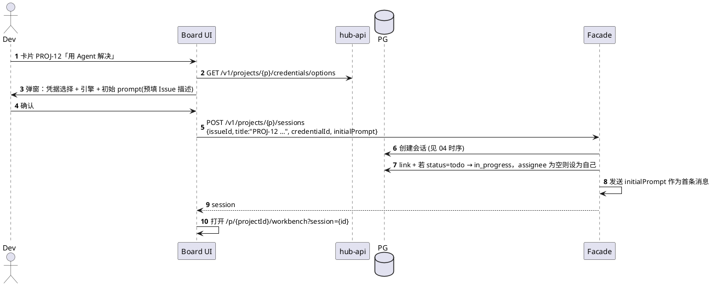
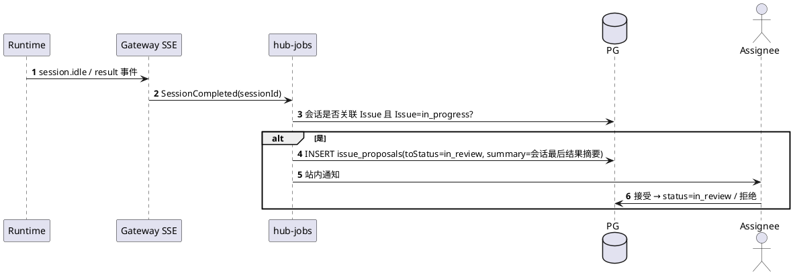
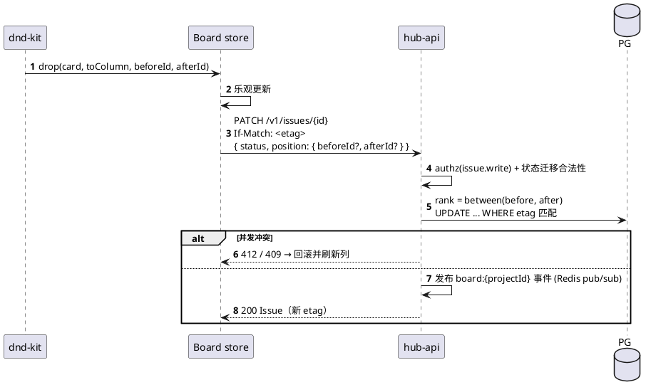

# 09 项目看板

项目维度问题跟踪（轻量，非 Jira），与 Agent 会话联动。

## 9.1 Issue 状态机



`owner` 可强制任意跳转（`issue.force_close`）。所有状态变更写 `issue_events`（时间线）。

## 9.2 数据补充

| 表 | 说明 |
|---|---|
| `project_issues` | 见 [02](02-domain-model.md)；`rank` 为 LexoRank 字符串，列内排序 |
| `issue_session_links` | 多对多 |
| `issue_events` | `(issueId, type: created|status_changed|assigned|linked|commented|proposal, from, to, actorId, at)` |
| `issue_proposals` | `(issueId, sessionId, toStatus, summary, state: pending|accepted|rejected)` |

## 9.3 从 Issue 一键开会话



初始 prompt 模板（项目可配置）：

```text
你正在处理 {{issue.key}}: {{issue.title}}
优先级: {{issue.priority}}  标签: {{issue.labels}}
描述:
{{issue.description}}
参考资料位于 project-common/ 目录（只读）。
```

## 9.4 会话结束提议推进



用户也可在 Workbench 顶栏点「标记关联解决」直接创建 proposal。

## 9.5 看板拖拽与排序



看板实时性：`GET /v1/projects/{p}/board/events`（SSE）推送 `issue.upserted` / `issue.deleted`；必要时 `board.resync` 触发整板重拉。断线指数退避；失败则每 15s 轮询 `GET .../board`。

## 9.6 API

| 方法 | 路径 | 说明 |
|---|---|---|
| GET | `/v1/projects/{p}/board` | 各列卡片（cancelled 默认折叠，分页每列 50） |
| GET | `/v1/projects/{p}/issues?status=&assignee=&label=&priority=&q=` | 列表/筛选 |
| POST | `/v1/projects/{p}/issues` | 创建 |
| GET/PATCH/DELETE | `/v1/issues/{id}` | |
| POST/DELETE | `/v1/issues/{id}/links/{sessionId}` | 关联 / 解除（只能关联自己的会话） |
| GET | `/v1/issues/{id}/timeline` | 事件 |
| POST | `/v1/issues/{id}/proposals/{pid}/accept|reject` | |
| GET | `/v1/projects/{p}/board/stats?range=week` | todo/in_progress/done 计数、本周新增/关闭 |

**可见性**：Issue 对项目成员可见；但关联会话列表只对会话 owner 显示可打开链接，其他人看到「由 X 的会话处理」元数据。
