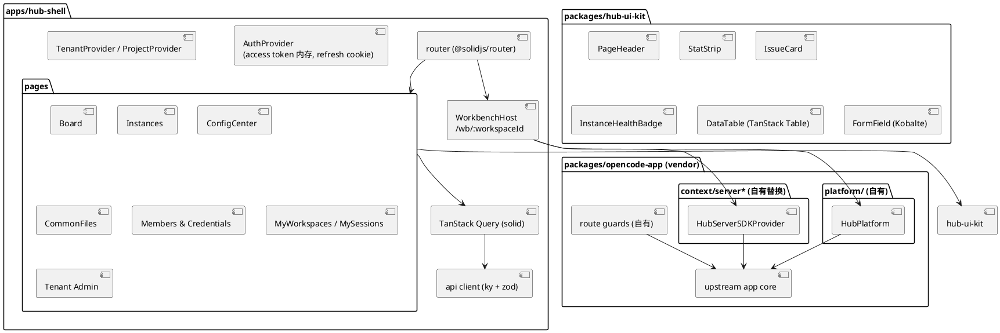
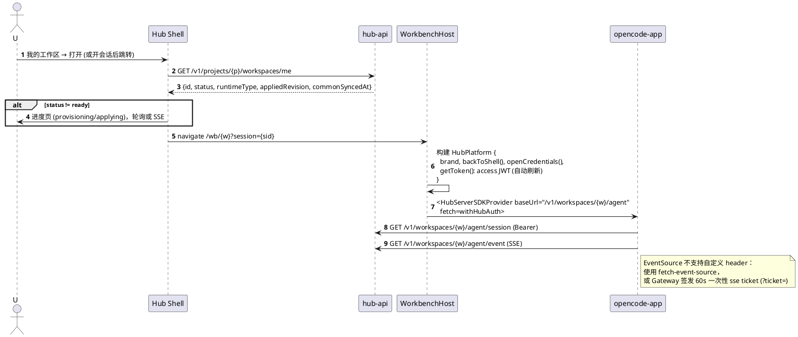
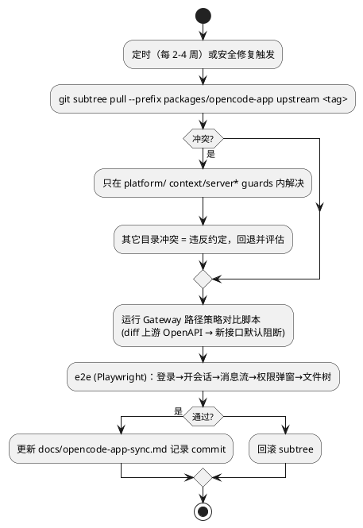

# 10 前端架构

两层、同栈（SolidJS + Vite）：**Hub Shell**（新建，通用组件库）+ **Workbench**（vendor OpenCode `packages/app`）。

## 10.1 结构

## 10.2 Hub Shell 路由

信息架构与交互以最新设计原型 [`.cursor/plans/html`](../../.cursor/plans/html/README.md) 为 SoT（含 `management.js` / `memberships.js`）。侧栏三组：`平台与组织` / `工作空间` / `项目配置`。

| 路由 | 页面 | 主要组件 |
|---|---|---|
| `/login` | 登录 | Kobalte FormField |
| `/tenants` | 租户管理（platform.operator） | DataTable、配额、启停 |
| `/t/:tenant/projects` | 项目管理 | 创建/归档、引擎与凭据策略、进入项目 |
| `/p/:project/overview` | 项目概览 | StatStrip、待办、动态、运行环境 |
| `/p/:project/board` | 项目看板 | solid-dnd + IssueCard；⌘K |
| `/p/:project/issues/:key` | Issue 详情 | 关联会话、开会话、解决说明 |
| `/p/:project/workbench` | 我的工作台壳 | 会话/文件树壳 + WorkbenchHost |
| `/p/:project/instances` | 运行实例 | 独占成员绑定、健康、sync |
| `/p/:project/config` | 配置中心 | Agent/MCP/Skill/AGENTS.md/权限与模型/下发记录 |
| `/p/:project/files/*` | 公共文件 | 树 + 面包屑 + 版本 |
| `/p/:project/members` | 当前项目成员 / 用户与多空间绑定 | 绑定对话框 |
| `/p/:project/credentials` | 凭据（项目/个人） | 连接参数表单 |
| `/p/:project/nodes` | 托管节点（Phase 2） | 设计页 |
| `/p/:project/audit` | 审计日志 | 元数据导出 |
| `/p/:project/settings` | 项目设置 | 五标签 |
| `/wb/:workspaceId` | Workbench 宿主 | 挂载 opencode-app |

## 10.3 进入 Workbench

## 10.4 Workbench 必改点

| # | 改动 | 位置 | 方式 |
|---|---|---|---|
| 1 | 连接层 baseUrl + 鉴权 | `context/server*` | 替换 Provider，注入 `fetch` 包装器加 Bearer、401 自动刷新 |
| 2 | 进入协议 | `platform/` | 从 URL/宿主 props 读 workspaceId/sessionId |
| 3 | 会话列表 | Facade 侧裁剪 | 前端不改或仅隐藏「全部实例会话」入口 |
| 4 | Provider Key 设置 UI | `platform/` 钩子 + 路由守卫 | 「添加 Provider」跳转 Hub `/me/credentials`；上游 `/auth` 已被 Gateway 阻断 |
| 5 | 多 Server 列表 | `platform/` | 映射为 Hub「我的工作区」，隐藏 URL |
| 6 | 顶栏 | `platform/` slot | 返回 Shell、当前 Issue、标记关联解决按钮 |

## 10.5 上游同步流程

## 10.6 Claude 引擎呈现

- Workbench 依据 `runtimeType` 不变；`worker/claude` 实现 OpenCode API 子集（`/session`, `/session/:id/message`, `/event`, `/file`, `/agent`, `/mcp` 只读）。
- 缺失能力（LSP、部分 find）由 Gateway 返回 `501`，前端按 capability 隐藏（`GET /v1/workspaces/{w}/capabilities`）。

## 10.7 UI 组件约定

- 基础 primitive：Kobalte（Dialog、Select、Tabs、DropdownMenu、Toast、Combobox、Tooltip）。
- 样式：Tailwind + CSS 变量 design token，与 opencode-app 的主题变量对齐（亮/暗）。
- 表格：`@tanstack/solid-table`；拖拽：`@thisbeyond/solid-dnd`；图标：`lucide-solid`。
- 服务端状态：`@tanstack/solid-query`；禁止在组件内直接 fetch。
- 不自研底层控件；`hub-ui-kit` 只放业务组合组件。
