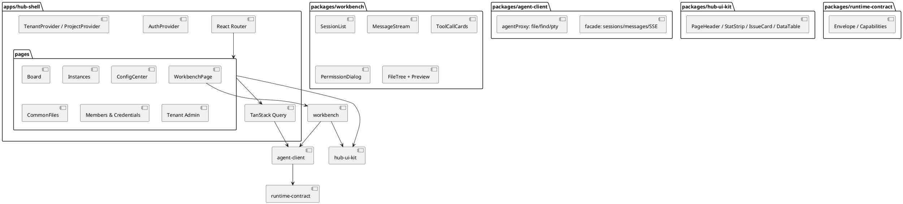
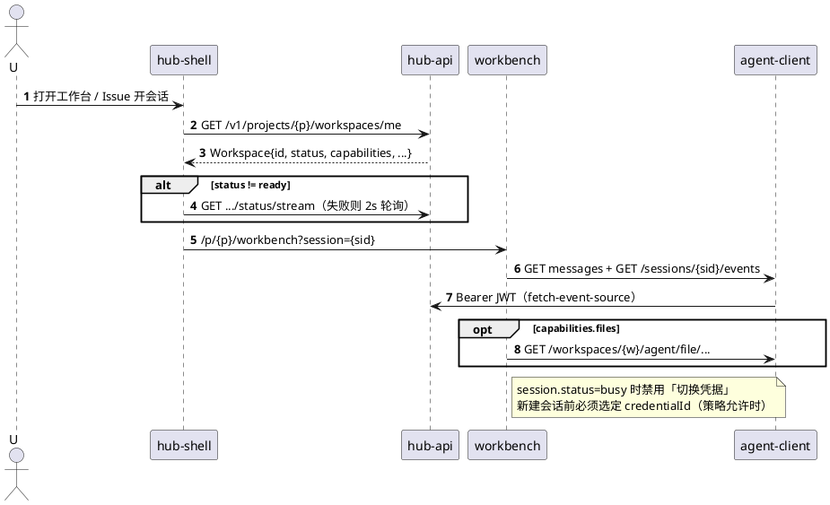

# 10 前端架构

**全站 React 单 SPA**（ADR-008）：管理面与 Workbench 同应用、同组件树。浏览器只连 Hub；不 vendor OpenCode Web。

## 10.1 结构

## 10.2 客户端通道（与 [04](04-gateway-facade.md) 对齐）

| 用途 | 路径 | 包方法 |
|---|---|---|
| 会话 CRUD / 发消息 / 权限 / **事件流** | `/v1/projects/{p}/sessions`、`/v1/sessions/{id}/*` | `agent-client` facade |
| 文件树、find、PTY（P2+） | `/v1/workspaces/{w}/agent/file\|find\|pty/...` | `agent-client` agentProxy |
| 工作区就绪 | 默认 `GET .../status/stream`；失败则 2s 轮询 `GET /workspaces/{w}` | Query |
| 看板实时 | `GET .../board/events` | Board 页 |

**禁止**：浏览器打开 `/agent/event`、经反代 `POST /session`、直连节点 URL、页面内裸 `fetch`（一律经 `agent-client` + Query）。

## 10.3 路由

IA 以 [`.cursor/plans/html`](../../.cursor/plans/html/README.md) 为 SoT。路径参数 **P1 使用 UUID**（`:tenantId` / `:projectId`）；展示名另字段，不做 slug 路由。

| 路由 | 页面 |
|---|---|
| `/login` | 登录 |
| `/tenants` | 租户管理 |
| `/t/:tenantId/projects` | 项目管理 |
| `/p/:projectId/overview` | 概览 |
| `/p/:projectId/board` | 看板 |
| `/p/:projectId/issues/:key` | Issue 详情 |
| `/p/:projectId/workbench` | 工作台（`?session=`） |
| `/p/:projectId/instances` | 实例 |
| `/p/:projectId/config` | 配置中心 |
| `/p/:projectId/files/*` | 公共文件 |
| `/p/:projectId/members` | 成员 / 多空间绑定 |
| `/p/:projectId/credentials` | 凭据 |
| `/p/:projectId/nodes` | 托管节点（P2） |
| `/p/:projectId/audit` | 审计 |
| `/p/:projectId/settings` | 设置 |

无独立 `/wb/*` 入口。

## 10.4 进入 Workbench

## 10.5 Workbench 分期

| 阶段 | 必须 | 不做（该阶段） |
|---|---|---|
| **P1** | 会话列表、流式消息（Envelope）、tool 卡片、权限弹窗、文件树+文本预览（`files`）、选凭据、同步入口、关联 Issue | LSP、多编辑器、PTY |
| **P2+** | 代码预览/轻量编辑、diff、`pty` 终端 | 对标 OpenCode Desktop 全插件 |

## 10.6 双引擎

UI 不分支双页面；只读 `runtimeType` + `Workspace.capabilities`。事件形状见 [11.3](11-runtime-contract.md)。

## 10.7 UI 与数据

- Primitive：shadcn/ui + Tailwind token（冷灰/白卡/蓝主色）。
- 表格 `@tanstack/react-table`；看板 `@dnd-kit`（PATCH 对齐 [16](16-api-schema.md)：`If-Match` + `position`）；图标 `lucide-react`。
- 服务端状态：TanStack Query；路由级 `React.lazy`（管理面 / workbench 分包）。

## 10.8 鉴权客户端

- access JWT 内存；refresh 在 httpOnly cookie；API `credentials: 'include'`。
- 401 → **单飞** refresh → 重放；refresh 失败 → `/login`。
- 多 Tab：`BroadcastChannel('auth')` 同步登出；登录页完成 OIDC 回调后同通道通知。
- CORS：仅配置的 Hub 前端源；refresh cookie **`SameSite=Strict`**（与 [16](16-api-schema.md) 一致）；跨子域部署时改用同站父域 cookie + Strict，不降为 Lax。

## 10.9 SSE 与连接预算

| 流 | 默认 | 回退 |
|---|---|---|
| 会话事件 | `@microsoft/fetch-event-source` + Bearer；支持 `Last-Event-ID` | `POST .../events/ticket` + 原生 EventSource（60s 单次） |
| 工作区状态 | `status/stream` | 2s 轮询 |
| 看板 | `board/events` | 15s 轮询 `GET board` |

每用户 SSE 并发上限 10（见 [04](04-gateway-facade.md) §4.8）。典型占用：会话 1 + 看板 1 + 工作区状态 1；PTY 另计。离开页面必须关闭流。

**会话 SSE 重连状态机**（与 [04 §4.4.1](04-gateway-facade.md) 对齐）：

1. 带 `Last-Event-ID` 重连 → 正常补事件。  
2. 收到 `SSE_CURSOR_STALE` 或 HTTP 409 → `GET .../messages` 对齐 UI → **清空** Last-Event-ID 重开流。  
3. 网络错误：指数退避 1s→30s；页面不可见（`document.hidden`）时暂停重连，可见后再连。  
4. 断连 UX：顶栏轻量「实时连接已断开，消息仍可发送」；不引入 PWA/浏览器离线包。

## 10.10 环境与部署

| 项 | 约定 |
|---|---|
| API base | `VITE_HUB_API_BASE`（空=同域 `/v1`） |
| Dev | Vite proxy `/v1` → hub-api |
| 生产 | **内网** Nginx/Caddy 托管 `dist`（不依赖公网 CDN）；`try_files` History fallback；`index.html` no-cache，带 hash 的 assets 长缓存；字体与脚本全部打包进 dist（ADR-011） |
| 测试 | Vitest + Testing Library；MSW mock Facade；Playwright e2e：登录→开会话→收 delta→权限弹窗 |

## 10.11 SoT

架构细节以 `docs/architecture/*` 为准；主 plan 摘要之；html 原型只定 IA/视觉，不定义 API。
