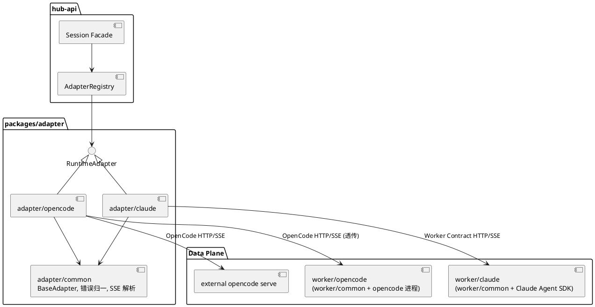
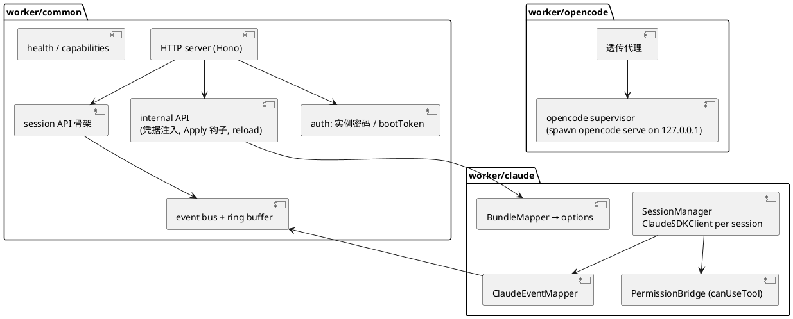
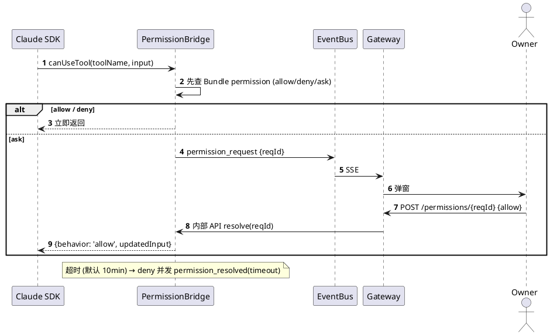

# 11 Runtime 契约（Worker / Adapter）

`packages/runtime-contract` 定义 Worker 与 Adapter 共用的协议；OpenCode 与 Claude 双引擎都实现它。

## 11.1 分层



## 11.2 Adapter 接口

```ts
interface RuntimeAdapter {
  readonly type: 'opencode' | 'claude'
  health(i: InstanceCtx): Promise<Health>
  capabilities(i: InstanceCtx): Promise<Capabilities>
  createSession(i, input: { title?: string; agent?: string }): Promise<{ ref: string }>
  sendMessage(i, ref, msg: MessageInput): Promise<void>
  abort(i, ref): Promise<void>
  listMessages(i, ref, page): Promise<Page<Message>>
  respondPermission(i, ref, reqId, decision): Promise<void>
  events(i, filter: { sessionRef?: string }, signal): AsyncIterable<Envelope>
  setCredential(i, cred: PlainCredential, scope: { sessionRef?: string }): Promise<void>
  clearCredential(i, provider: string): Promise<void>
  applyApiOps(i, ops: ApiOp[]): Promise<ApplyResult>
  verifyConfig(i, expected: EffectiveSummary): Promise<VerifyResult>
}
```

## 11.3 事件信封

```ts
type Envelope = {
  v: 1
  seq: number              // Gateway 分配，per session 单调
  sessionId: string        // Hub id
  ts: string               // ISO8601
  type: EnvelopeType
  data: EnvelopeData[EnvelopeType]
  raw?: unknown            // 调试开关下保留上游原文
}

type EnvelopeType =
  | 'session.status'
  | 'message.start'
  | 'assistant.delta'
  | 'assistant.message'
  | 'tool_call'
  | 'tool_result'
  | 'permission_request'
  | 'permission_resolved'
  | 'usage'
  | 'result'
  | 'error'

type EnvelopeData = {
  'session.status': { status: 'busy' | 'idle' | 'error'; reason?: string }
  'message.start': { messageId: string; role: 'assistant' }
  'assistant.delta': { messageId: string; text: string }
  'assistant.message': { messageId: string; text: string }
  'tool_call': { toolId: string; name: string; input: unknown }
  'tool_result': { toolId: string; output: unknown; isError: boolean }
  'permission_request': {
    reqId: string; tool: string; input: unknown
    options: Array<'allow' | 'deny' | 'always'>
  }
  'permission_resolved': {
    reqId: string; decision: 'allow' | 'deny' | 'always' | 'timeout'
  }
  'usage': {
    model: string; inputTokens: number; outputTokens: number
    cacheRead?: number; cost?: number
  }
  'result': { stopReason: string; summary?: string }
  'error': { code: string; message: string }
}
```

### Capabilities（与 Workspace 嵌入字段同形，见 [16](16-api-schema.md)）

```ts
type Capabilities = {
  v: 1
  files: boolean
  find: boolean
  lsp: boolean
  pty: boolean
  mcpRuntimeAdd: boolean
  permissions: boolean
  streaming: boolean   // 是否产生 assistant.delta
  abort: boolean
  usage: boolean
}
```

前端只读 `Workspace.capabilities`；无独立 `GET .../capabilities`。缺失能力时对应 UI 隐藏，API 可返回 `501`。

## 11.4 事件映射

| Envelope | OpenCode `/event` | Claude Agent SDK |
|---|---|---|
| session.status | `session.status` / `session.idle` | 自生成（query 开始/结束） |
| assistant.delta | `message.part.updated` (text, delta) | `stream_event` content_block_delta |
| assistant.message | `message.updated` (assistant, completed) | `assistant` message |
| tool_call | `message.part.updated` (tool, state=running) | `assistant` 中 `tool_use` block |
| tool_result | part tool state=completed/error | `user` 中 `tool_result` |
| permission_request | `permission.updated` / `permission.asked` | `canUseTool` 回调 → worker 挂起并发事件 |
| usage | `message.updated` tokens/cost | `result.usage` |
| result | `session.idle` | `result` message |
| error | `session.error` | 异常 / `result.is_error` |

OpenCode `/event` 为实例级：adapter 按 `sessionID` 过滤；`runtimeSessionRef → hubSessionId` 映射存 Redis。

## 11.5 Worker 公共框架（apps/worker/common）



- `worker/opencode`：容器内以 127.0.0.1 启动 `opencode serve`，worker 只做健康、凭据、Apply 钩子与透传；对外端口只暴露 worker。
- `worker/claude`：自己实现 OpenCode 子集 API + 统一契约。

## 11.6 Claude worker 权限桥



## 11.7 Bundle → Claude 选项映射

| Effective 字段 | Claude Agent SDK options |
|---|---|
| model | `model` |
| instructions.agentsMd | 写入 `CLAUDE.md` + `settingSources: ['project']`；或 `systemPrompt: {preset:'claude_code', append}` |
| agents | `agents: { name: {description, prompt, tools, model} }` |
| mcp (local) | `mcpServers[name] = {type:'stdio', command, args, env}` |
| mcp (remote) | `mcpServers[name] = {type:'http'|'sse', url, headers}` |
| skills | 写入 `.claude/skills/<name>/SKILL.md` |
| permission | `allowedTools` / `disallowedTools` / `permissionMode` + PermissionBridge |
| cwd | `/workspace` |

## 11.8 契约测试

`packages/runtime-contract/test/conformance.ts`：对任一实现跑相同用例（创建会话、发消息收到 delta+result、工具调用、权限 ask/allow、abort、凭据注入后可调用模型（mock provider）、Apply 后 MCP 可见）。CI 中对 `worker/opencode`、`worker/claude`、本地 `opencode serve` 三者执行。
