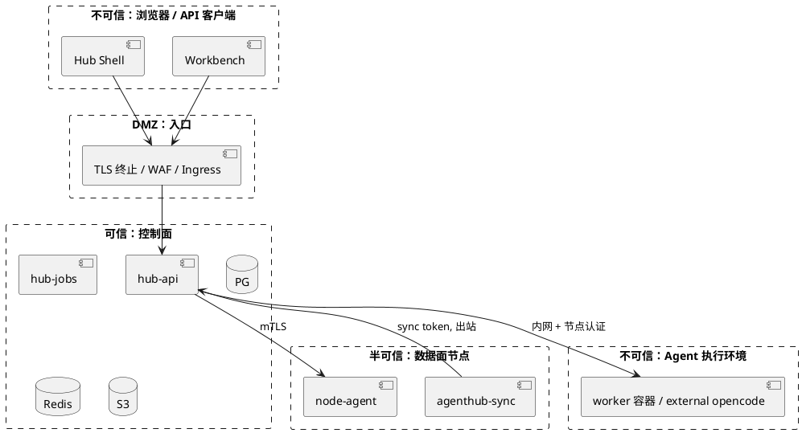
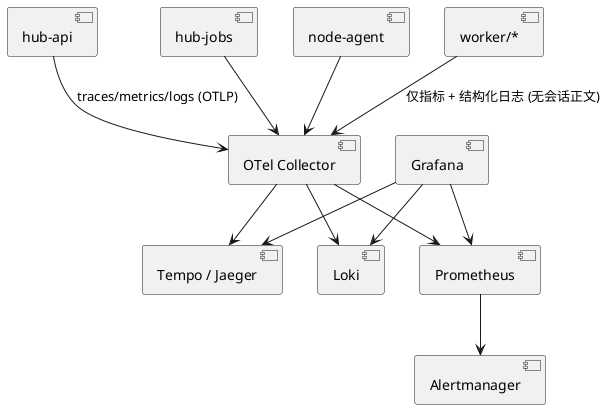
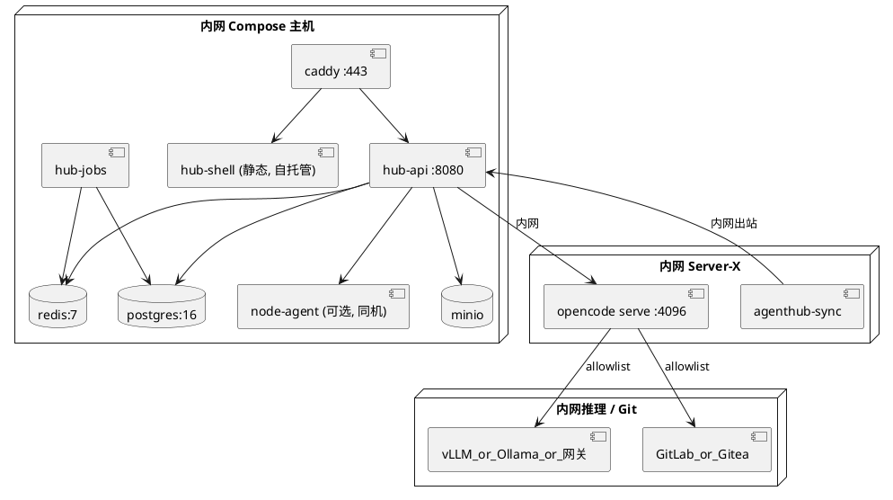
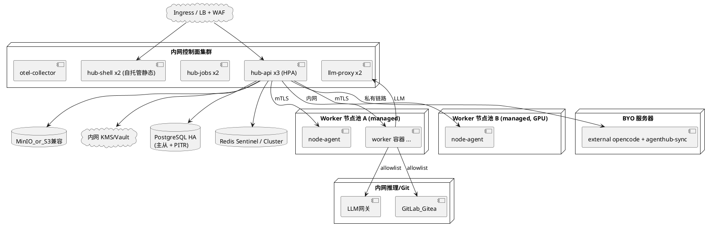

# 12 安全、观测与部署

## 12.1 信任边界

> Agent 执行环境视为**不可信**：它会运行 LLM 生成的命令，可能受提示注入。因此其中不放任何 Hub 凭证；Phase 3 后连 Provider Key 也不放。

## 12.2 威胁与对策（STRIDE 摘要）

| 威胁 | 场景 | 对策 |
|---|---|---|
| 越权 (IDOR) | 用户猜他人 sessionId/workspaceId | owner 校验 + 404；IDOR 集成测试阻断发布 |
| 跨租户泄露 | 漏写 tenant 过滤 | `scoped(ctx)` 强制 + RLS（P4）+ 测试矩阵 |
| 凭据泄露 | 响应/日志/前端带出 Key | 只写不读；SecretBuffer 脱敏；Gateway 阻断 `/auth`；响应裁剪 |
| 节点密码泄露 | Workbench 直连节点 | 节点仅内网，浏览器只连 Hub |
| SSRF | 登记 external URL 指向元数据服务 | DNS 解析后 IP 黑名单、出站代理、仅 admin 可登记 |
| 容器逃逸 | Agent 执行恶意命令 | 非 root、cap-drop、默认 seccomp、无 docker.sock（ADR-002：不防高级逃逸，接受该风险） |
| 横向移动 | 容器访问其他工作区 / 控制面 | `icc=false`；拒绝控制面网段与元数据；**intranet 档默认拒公网 + allowlist**（ADR-003/011） |
| 数据外传 | 提示注入外传代码/Key | 内网档无公网出口则难外传；仍不放真实 Key（P3 Proxy）、Git 凭据不落盘、DNS 审计 |
| 配置注入 | 恶意 MCP command | 发布校验 + 租户 MCP 命令白名单 + 审计 |
| 路径穿越 | 公共空间/zip/sync | `common-fs` 统一校验；sync 白名单；拒绝 symlink |
| 提示注入改公共资料 | Agent 写共享文件 | 只读挂载 + promote 需人工 |
| 重放 | refresh token 被盗 | refresh family 旋转 + 重放即吊销 |
| 抵赖 | 谁改了配置/凭据 | 全写操作审计（不含明文） |
| DoS | SSE/会话滥用 | 限流、并发上限、配额 |

## 12.3 审计事件清单

`auth.login/logout/refresh_reuse`、`member.add/remove/role_change`、`credential.create/rotate/delete/use(仅 id)`、`instance.register/update/disable/test`、`bundle.publish/rollback`、`apply.run`、`common.write/delete/restore/promote`、`issue.status_change`、`session.create/abort`、`permission.decision`、`workspace.create/revoke/delete`、`admin.audit_view`。

## 12.4 可观测性

**关键指标**

| 指标 | 类型 | 告警 |
|---|---|---|
| `hub_http_requests_total{route,code}` | counter | 5xx 比例 > 2% 5min |
| `hub_proxy_upstream_latency_seconds{instance}` | histogram | p95 > 2s |
| `hub_sse_connections{tenant}` | gauge | |
| `hub_instance_health{instance,state}` | gauge | unhealthy > 5min |
| `hub_workspace_provision_seconds` | histogram | p95 > 120s |
| `hub_apply_jobs_total{status}` | counter | failed 比例 > 10% |
| `hub_common_sync_total{status}` | counter | |
| `hub_llm_tokens_total{tenant,project,source}` | counter | 配额 80% / 100% |
| `node_capacity_free_ratio{node}` | gauge | < 10% |

日志规范：JSON，字段 `ts, level, requestId, traceId, tenantId, userId, route, msg`；禁止记录消息正文、凭据、节点密码。

## 12.5 部署拓扑

### 内网单机 / 小集群（Phase 0–1 默认，ADR-011）

无公网。镜像来自私有 Registry 或 `docker load`。LLM/Git 为内网服务。

离线包与验收见 [18](18-intranet-offline.md)。

### 生产（Phase 4）

- hub-api 无状态；SSE 连接粘性不是必须（事件通过 Redis Stream 补发）。
- 数据面保持 Docker + node-agent（ADR-002）；控制面可跑在 K8s 或 compose，二者不耦合。K8s 工作区 provider 不在规划内，如有需要另开 ADR。
- **默认 intranet**：Worker **不**默认访问公网；见 ADR-003/011 与 [18](18-intranet-offline.md)。

## 12.6 备份与恢复

| 数据 | 方式 | RPO / RTO |
|---|---|---|
| PostgreSQL | WAL 归档 + 每日全量 | 5 min / 1 h |
| S3 公共空间 | 版本化 + 跨区复制 | 15 min |
| 工作区卷 | 不承诺（代码以 git 为准）；可选每日快照 | — |
| KEK | KMS 托管，禁止导出 | — |
