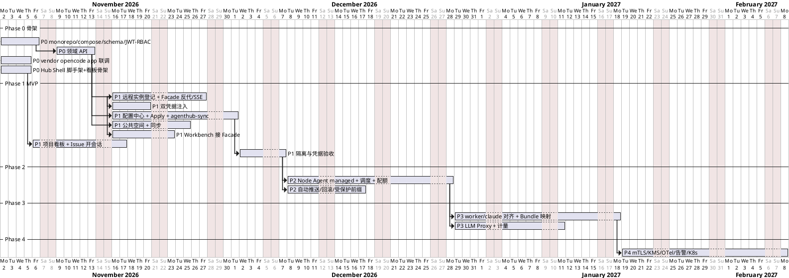
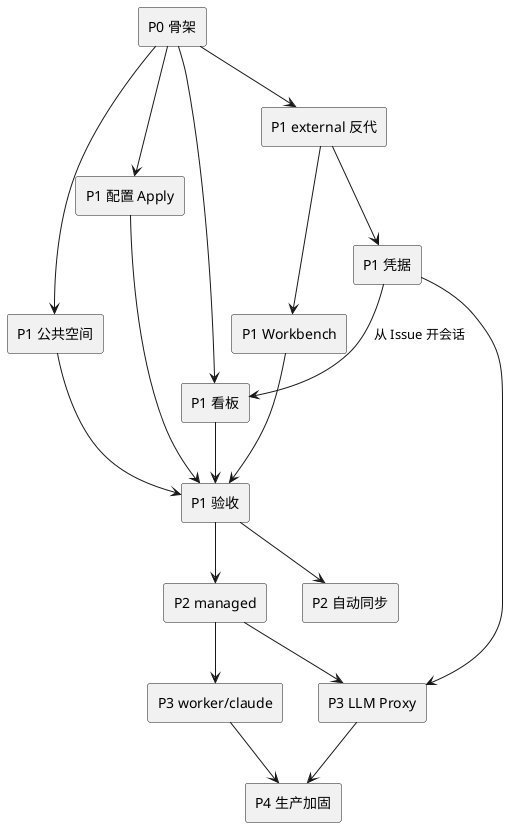

# 13 分阶段交付与验收

## 13.1 里程碑甘特（估算）

## 13.2 依赖关系

## 13.3 各阶段交付物与 DoD

| 阶段 | 交付物 | 完成定义 |
|---|---|---|
| P0 | monorepo、compose(pg/redis/minio)、Drizzle 迁移、JWT/RBAC、领域 CRUD、Shell 脚手架、vendor app | `pnpm dev` 一键起；RBAC 单测；本地 opencode serve 可被 vendor app 连通 |
| P1 | external 登记 + 反代 + SSE、双凭据、配置中心 + Apply + sync、公共空间、Workbench 接 Facade、看板 | 13.4 中 A1–A9 全通过 |
| P2 | node-agent、调度、idle/配额、自动推送、回滚、受保护前缀 | managed 工作区 p95 就绪 < 120s；节点故障时新会话调度到其它节点 |
| P3 | worker/claude、Bundle 双引擎、LLM Proxy、计量 | 契约测试双引擎通过；容器内无 Provider Key |
| P4 | mTLS、KMS、RLS、OTel 告警、上游同步流程（数据面保持 Docker，见 ADR-002） | 渗透测试无高危；告警演练通过 |

## 13.4 首版（P1）验收用例

| ID | 场景 | 步骤 | 期望 |
|---|---|---|---|
| A1 | 远程登记即连 | 他机部署 opencode serve → 门户登记 → 项目绑定 → 成员进入 Workbench | 可对话；浏览器网络面板中无远程地址与节点密码 |
| A2 | 配置下发 | 项目 Bundle 加 1 Agent + 1 MCP + 1 Skill + AGENTS.md → 发布 → 同步 | 会话中能看到并使用；ApplyJob=succeeded |
| A3 | 回滚 | 回滚到上一 revision | 受管文件恢复；用户自建文件不受影响 |
| A4 | 公共空间 | 上传 docs/spec.md → 同步 | 工作区 `project-common/docs/spec.md` 存在；Agent 写入被拒 |
| A5 | 看板 | 建 3 卡，拖到不同列 | 计数正确；他人实时看到 |
| A6 | Issue 开会话 | PROJ-1 点开会话 | 会话标题含 PROJ-1；Issue→in_progress；关联可见 |
| A7 | 双凭据 | 用户 A 用个人 Key，用户 B 用项目 Key | usage 记录来源正确；GET 凭据接口无 secret |
| A8 | 用户隔离 | B 访问 A 的 sessionId / workspaceId / 反代路径 | 全部 404 |
| A9 | 租户隔离 | 租户 T2 用户访问 T1 任意资源 | 全部 404；审计有记录 |
| A10 | 阻断 | Workbench 尝试 `PUT /agent/auth/...`、`PATCH /agent/config` | 403 BLOCKED_UPSTREAM_PATH |
| A11 | 成员移除 | 移除 B | B 的活跃会话 abort；B 无法再进入工作区 |
| A12 | UI 规范 | 代码审查 | 无自研底层控件（Dialog/Select 等均来自 Kobalte） |

## 13.5 明确不做（首版）

- OpenCode 服务端内核多租户 ACL；
- 大改 `packages/app` 渲染核心或另起 React IDE；
- 自研 Design System / 拖拽底层；
- 完整 Jira 工作流、燃尽图；
- SSH 手改远程 `opencode.json`；
- 多人共容器、公共空间实时协同、会话分享、前端持久化 Key、计费收银台。

## 13.6 风险登记

| 风险 | 影响 | 缓解 |
|---|---|---|
| 上游 OpenCode API 变动 | 反代/adapter 失效 | 锁版本；OpenAPI diff 脚本；未知路径默认阻断 |
| OpenCode `/auth` 实例级 | 同用户多凭据会话需串行注入 | P1 串行化；P3 LLM Proxy 根治 |
| 上游不支持热加载 agents/skills | Apply 需重启进程 | 会话 idle 时再重启；保留会话存储 |
| external 实例被共用 | 隔离失效 | `isolation=shared` 仅单活跃用户；正式环境禁止 |
| 许可证 | vendor 合规 | P0 确认许可证，保留 NOTICE |
| Claude SDK 能力与 OpenCode 不对等 | Workbench 体验差异 | capabilities 降级；契约测试 |
