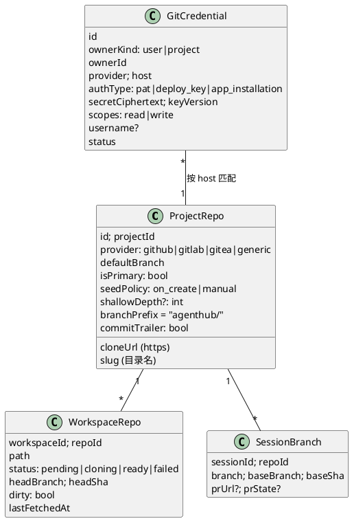
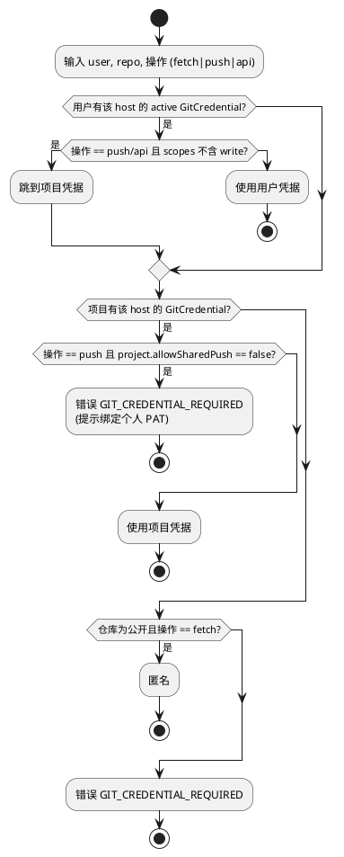
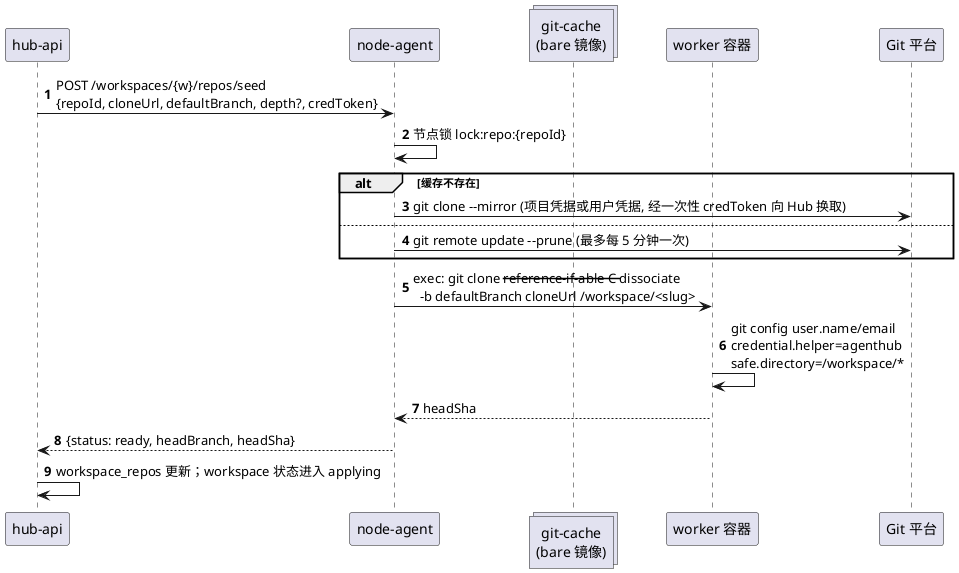
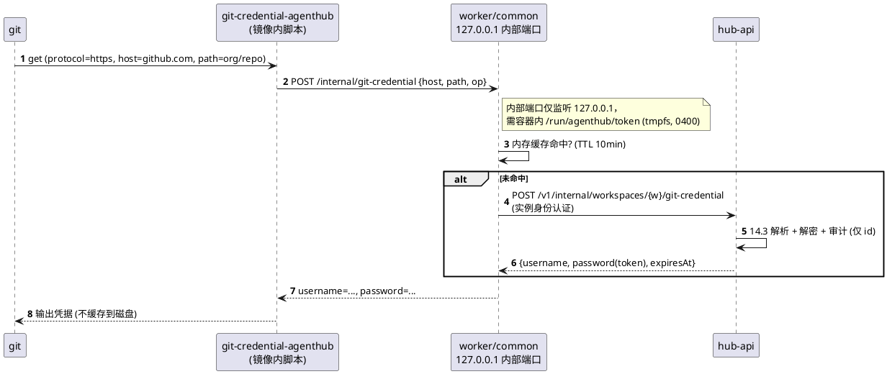
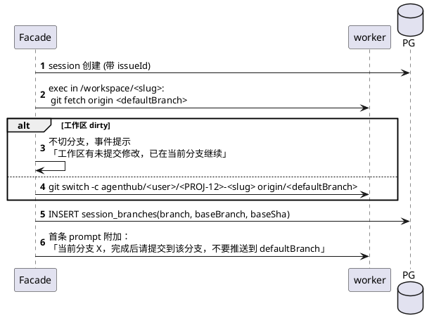
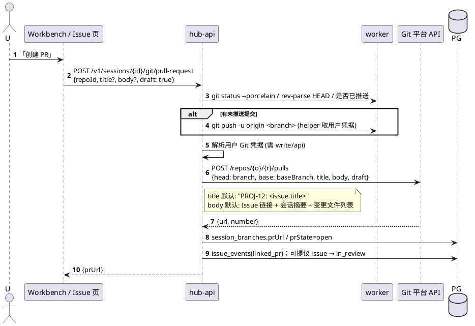

# 14 工作区代码种子与 Git

目标：每个成员的个人工作区都有一份**独立可写**的项目代码；Agent 可以提交、推送分支、创建 PR；Git 凭据不落盘、不进浏览器。

## 14.1 关键决策（ADR-005 / ADR-006）

| 项 | 方案 |
|---|---|
| 仓库来源 | `project_repos` 表，一个项目可挂 1..N 个仓库（首版 UI 只暴露 1 个主仓库） |
| 种子方式 | 每用户**独立 clone** 到 `/workspace/<repoSlug>`；不共享 worktree（多人共享 `.git` 有锁冲突与越权风险） |
| 加速 | node-agent 在节点维护 bare 镜像缓存 `/var/lib/agenthub/git-cache/<repoId>.git`，clone 用 `--reference-if-able --dissociate` |
| 默认分支 | 跟随仓库 `defaultBranch`；工作区创建后**不自动切新分支** |
| 工作分支命名 | `agenthub/<userHandle>/<issueKey或sessionShortId>-<slug>`，由「从 Issue 开会话」时自动创建 |
| 凭据来源 | 用户个人 Git 凭据（PAT）优先；项目可配置共享 Git 凭据（只读 deploy key 或 bot token） |
| 凭据注入 | 容器内 `git-credential-agenthub` helper → worker 内存，不写 `~/.git-credentials` |
| 提交身份 | `user.name / user.email` = Hub 用户显示名 / 邮箱；可加 `Co-authored-by: AgentHub Agent` trailer（项目开关） |
| PR 创建 | Hub 调 Git 平台 API（GitHub / GitLab / Gitea），用发起用户的凭据，在 Workbench / Issue 中一键创建 |
| external 模式 | 由运维自备代码目录；Hub 不 clone，仅在 `project_repos` 中记录 `workdirHint`；可选由 agenthub-sync 执行 clone |

## 14.2 数据模型



## 14.3 Git 凭据解析



默认 `allowSharedPush=false`：推送一律用个人身份，保证提交归属与平台权限一致。

## 14.4 工作区种子流程（managed）



- clone 在容器内执行（文件属主即容器用户），但网络凭据通过 helper 获取，与后续 Agent 使用同一机制。
- 失败（凭据缺失/仓库不可达）：`workspace_repos.status=failed`，工作区仍可 `ready_degraded` 进入，Shell 提示「绑定 Git 凭据后重试」。

## 14.5 容器内凭据 helper



> 风险说明：`internet-lab` 出网较松时，Agent 理论上能读取 helper 返回的 token 并外传。**intranet/airgap** 默认拒公网 + Git 在 allowlist，外传面更小。缓解：细粒度/短期 PAT；Phase 3 可改为 Hub Git 代理（`https://hub/git/...`），容器内只持代理 token。

## 14.6 从 Issue 开会话时的分支



- 不阻止 Agent 自行切分支；`session_branches` 只记录会话起点。
- 推送保护：下发的 OpenCode permission 对 `git push * <defaultBranch>`、`git push --force*` 设为 `ask`（Bundle 内置规则，项目可改）。

## 14.7 推送与创建 PR



PR 状态回流：Phase 2 接 Git 平台 webhook（`/v1/webhooks/git/{provider}`，HMAC 校验），`merged` 时提议 Issue → `done`。

## 14.8 工作区内多仓库与目录约定

```text
/workspace/
  <primary-repo-slug>/        # 主仓库（OpenCode 的工作目录 cwd）
  <other-repo-slug>/          # 附加仓库（可选）
  project-common/             # 公共空间只读镜像 (08)
  AGENTS.md                   # Hub 下发（受管文件）
  .opencode/                  # Hub 下发（受管文件）
  .agenthub/managed.json      # 受管清单
```

OpenCode 进程 `cwd=/workspace`，主仓库路径写入 `AGENTS.md` 头部提示，保证 Agent 同时看得到代码与 `project-common/`。

## 14.9 生命周期与清理

| 事件 | 处理 |
|---|---|
| 工作区 stop | 不动代码；`dirty` 状态记录在 `workspace_repos` |
| 工作区重建（镜像升级） | 卷保留，代码不受影响 |
| 成员移除 | 保留卷 7 天；若 `dirty` 或有未推送提交，通知项目 owner |
| 卷删除前 | 生成 `git bundle --all` 存 S3 30 天（可选，项目开关） |
| git-cache GC | 节点每日 `git gc --auto`；30 天未使用的镜像删除 |

## 14.10 API

| 方法 | 路径 | 说明 |
|---|---|---|
| GET/POST | `/v1/projects/{p}/repos` | 项目仓库 |
| PATCH/DELETE | `/v1/projects/{p}/repos/{repoId}` | |
| GET/PUT/DELETE | `/v1/me/git-credentials[/{id}]` | 个人 Git 凭据（只写不读） |
| GET/PUT/DELETE | `/v1/projects/{p}/git-credentials[/{id}]` | 项目 Git 凭据（owner） |
| POST | `/v1/workspaces/{w}/repos/{repoId}/seed` | 重新 clone / 重试 |
| GET | `/v1/workspaces/{w}/repos` | 状态（分支、sha、dirty） |
| POST | `/v1/workspaces/{w}/repos/{repoId}/fetch` | |
| POST | `/v1/sessions/{id}/git/pull-request` | 推送 + 建 PR |
| POST | `/v1/webhooks/git/{provider}` | PR 状态回流（P2） |
