# 15 数据库 DDL（PostgreSQL 16）

> **权威（ADR-009）**：`packages/db/schema/*.ts`（Drizzle）。本文件 SQL 为可读对照，须与 schema **一致**；冲突时改 schema 并 `drizzle-kit generate`，再回写本节。  
> 业务代码经 Drizzle Repository 访问数据库，**禁止**手写业务 SQL（例外见 ADR-009）。

## 15.1 约定

| 项 | 约定 |
|---|---|
| ORM | Drizzle；迁移 `drizzle-kit generate` → 审阅 → apply |
| 主键 | `uuid`，应用层生成 UUIDv7（ADR-004） |
| 时间 | `timestamptz`，统一 `created_at` / `updated_at`（可用 DB 触发器或 Drizzle `$onUpdate`） |
| 命名 | 表复数 snake_case；外键 `<entity>_id`；索引 `ix_<table>_<cols>`；唯一 `uq_<table>_<cols>` |
| 租户 | 业务表必有 `tenant_id`；Repository 查询强制带租户谓词 |
| 枚举 | 使用 `text + CHECK`（Drizzle `text` + check），不用 PG enum |
| 软删除 | 仅 `common_files`、`project_issues` 使用 `deleted_at` |
| 密文 | `bytea`，配 `key_version int` |
| JSON | `jsonb`，结构由 zod 校验 |
| 分区 | `audit_logs`、`usage_records` 按月 RANGE（运维脚本可例外用 SQL；业务读写仍走 ORM） |

## 15.2 ER 总览

```plantuml
@startuml er
hide circle
skinparam linetype ortho

entity tenants
entity users
entity user_identities
entity oidc_providers
entity invitations
entity tenant_memberships
entity projects
entity project_memberships
entity project_member_prefs
entity user_credentials
entity project_credentials
entity credential_versions
entity git_credentials
entity project_repos
entity nodes
entity node_bootstrap_tokens
entity runtime_instances
entity instance_sync_tokens
entity project_runtime_bindings
entity workspaces
entity workspace_repos
entity agent_sessions
entity session_branches
entity config_bundles
entity config_revisions
entity config_assignments
entity apply_jobs
entity common_files
entity common_file_versions
entity common_protected_prefixes
entity common_change_requests
entity project_issues
entity issue_session_links
entity issue_events
entity issue_proposals
entity hub_api_keys
entity audit_logs
entity usage_records

users ||--o{ user_identities
oidc_providers ||--o{ user_identities
tenants ||--o{ invitations
tenants ||--o{ tenant_memberships
users ||--o{ tenant_memberships
tenants ||--o{ projects
projects ||--o{ project_memberships
users ||--o{ project_memberships
projects ||--o{ project_member_prefs
users ||--o{ user_credentials
projects ||--o{ project_credentials
user_credentials ||--o{ credential_versions
project_credentials ||--o{ credential_versions
projects ||--o{ project_repos
nodes ||--o{ runtime_instances
runtime_instances ||--o{ instance_sync_tokens
projects ||--o{ project_runtime_bindings
projects ||--o{ workspaces
users ||--o{ workspaces
runtime_instances ||--o{ workspaces
workspaces ||--o{ workspace_repos
project_repos ||--o{ workspace_repos
workspaces ||--o{ agent_sessions
agent_sessions ||--o{ session_branches
config_bundles ||--o{ config_revisions
projects ||--o{ config_assignments
workspaces ||--o{ apply_jobs
projects ||--o{ common_files
common_files ||--o{ common_file_versions
projects ||--o{ project_issues
project_issues ||--o{ issue_session_links
agent_sessions ||--o{ issue_session_links
project_issues ||--o{ issue_events
project_issues ||--o{ issue_proposals
tenants ||--o{ hub_api_keys
@enduml
```



## 15.3 公共函数

```sql
CREATE EXTENSION IF NOT EXISTS citext;
CREATE EXTENSION IF NOT EXISTS pg_trgm;

CREATE OR REPLACE FUNCTION set_updated_at() RETURNS trigger AS $$
BEGIN NEW.updated_at := now(); RETURN NEW; END $$ LANGUAGE plpgsql;
-- 每张含 updated_at 的表：
-- CREATE TRIGGER trg_<t>_updated BEFORE UPDATE ON <t> FOR EACH ROW EXECUTE FUNCTION set_updated_at();
```

## 15.4 身份与租户

```sql
CREATE TABLE tenants (
  id            uuid PRIMARY KEY,
  slug          text NOT NULL,
  name          text NOT NULL,
  status        text NOT NULL DEFAULT 'active' CHECK (status IN ('active','suspended')),
  quota         jsonb NOT NULL DEFAULT '{}',      -- {maxConcurrentSessions, maxWorkspaces, diskGb, tokensPerDay}
  settings      jsonb NOT NULL DEFAULT '{}',      -- {allowedLoginMethods, defaultModel, autoApprovePermissions}
  dek_ciphertext bytea NOT NULL,                  -- 租户数据密钥（KEK 包裹）
  dek_key_version int NOT NULL DEFAULT 1,
  created_at    timestamptz NOT NULL DEFAULT now(),
  updated_at    timestamptz NOT NULL DEFAULT now(),
  CONSTRAINT uq_tenants_slug UNIQUE (slug),
  CONSTRAINT ck_tenants_slug CHECK (slug ~ '^[a-z0-9][a-z0-9-]{1,38}$')
);

CREATE TABLE users (
  id                uuid PRIMARY KEY,
  email             citext NOT NULL,
  display_name      text NOT NULL,
  handle            text NOT NULL,                -- 用于分支名，^[a-z0-9-]+$
  password_hash     text,                         -- 仅 OIDC 用户为空
  is_platform_admin boolean NOT NULL DEFAULT false,
  status            text NOT NULL DEFAULT 'active' CHECK (status IN ('active','disabled')),
  last_login_at     timestamptz,
  created_at        timestamptz NOT NULL DEFAULT now(),
  updated_at        timestamptz NOT NULL DEFAULT now(),
  CONSTRAINT uq_users_email UNIQUE (email),
  CONSTRAINT uq_users_handle UNIQUE (handle)
);

CREATE TABLE oidc_providers (
  id                    uuid PRIMARY KEY,
  tenant_id             uuid REFERENCES tenants(id) ON DELETE CASCADE,  -- NULL = 平台级
  name                  text NOT NULL,
  issuer                text NOT NULL,
  client_id             text NOT NULL,
  client_secret_ciphertext bytea NOT NULL,
  key_version           int NOT NULL DEFAULT 1,
  scopes                text[] NOT NULL DEFAULT '{openid,email,profile}',
  claim_mapping         jsonb NOT NULL DEFAULT '{}',
  auto_provision        boolean NOT NULL DEFAULT false,
  enabled               boolean NOT NULL DEFAULT true,
  created_at            timestamptz NOT NULL DEFAULT now(),
  updated_at            timestamptz NOT NULL DEFAULT now()
);

CREATE TABLE user_identities (
  id          uuid PRIMARY KEY,
  user_id     uuid NOT NULL REFERENCES users(id) ON DELETE CASCADE,
  provider_id uuid NOT NULL REFERENCES oidc_providers(id) ON DELETE CASCADE,
  subject     text NOT NULL,
  email       citext,
  created_at  timestamptz NOT NULL DEFAULT now(),
  CONSTRAINT uq_user_identities_sub UNIQUE (provider_id, subject)
);
CREATE INDEX ix_user_identities_user ON user_identities(user_id);

CREATE TABLE invitations (
  id          uuid PRIMARY KEY,
  tenant_id   uuid NOT NULL REFERENCES tenants(id) ON DELETE CASCADE,
  email       citext NOT NULL,
  tenant_role text NOT NULL CHECK (tenant_role IN ('owner','admin','member')),
  project_grants jsonb NOT NULL DEFAULT '[]',     -- [{projectId, role}]
  token_hash  text NOT NULL,
  invited_by  uuid NOT NULL REFERENCES users(id),
  expires_at  timestamptz NOT NULL,
  accepted_at timestamptz,
  created_at  timestamptz NOT NULL DEFAULT now(),
  CONSTRAINT uq_invitations_token UNIQUE (token_hash)
);
CREATE INDEX ix_invitations_tenant_email ON invitations(tenant_id, email);

CREATE TABLE tenant_memberships (
  tenant_id  uuid NOT NULL REFERENCES tenants(id) ON DELETE CASCADE,
  user_id    uuid NOT NULL REFERENCES users(id) ON DELETE CASCADE,
  role       text NOT NULL CHECK (role IN ('owner','admin','member')),
  created_at timestamptz NOT NULL DEFAULT now(),
  PRIMARY KEY (tenant_id, user_id)
);
CREATE INDEX ix_tenant_memberships_user ON tenant_memberships(user_id);

CREATE TABLE hub_api_keys (
  id           uuid PRIMARY KEY,
  tenant_id    uuid NOT NULL REFERENCES tenants(id) ON DELETE CASCADE,
  created_by   uuid NOT NULL REFERENCES users(id),
  acting_user_id uuid REFERENCES users(id),       -- Key 代表的用户身份（可空 = 服务账号）
  name         text NOT NULL,
  prefix       text NOT NULL,                     -- ahk_xxxxxxxx
  secret_hash  text NOT NULL,                     -- argon2id
  scopes       text[] NOT NULL,
  expires_at   timestamptz,
  last_used_at timestamptz,
  revoked_at   timestamptz,
  created_at   timestamptz NOT NULL DEFAULT now(),
  CONSTRAINT uq_hub_api_keys_prefix UNIQUE (prefix)
);
```

## 15.5 项目与成员

```sql
CREATE TABLE projects (
  id                 uuid PRIMARY KEY,
  tenant_id          uuid NOT NULL REFERENCES tenants(id) ON DELETE CASCADE,
  key                text NOT NULL,               -- PROJ
  name               text NOT NULL,
  description        text,
  credential_policy  text NOT NULL DEFAULT 'user_or_project'
                     CHECK (credential_policy IN ('user_or_project','project_only','user_only')),
  common_sync_policy text NOT NULL DEFAULT 'on_workspace_start'
                     CHECK (common_sync_policy IN ('on_workspace_start','on_common_publish')),
  common_quota_bytes bigint NOT NULL DEFAULT 5368709120,   -- 5 GiB
  common_used_bytes  bigint NOT NULL DEFAULT 0,
  config_lock        jsonb NOT NULL DEFAULT '{}',
  settings           jsonb NOT NULL DEFAULT '{}',  -- {strictConfig, promoteRequiresReview, allowSharedPush, workspaceSpec, issuePromptTemplate}
  issue_seq          int NOT NULL DEFAULT 0,
  archived_at        timestamptz,
  created_at         timestamptz NOT NULL DEFAULT now(),
  updated_at         timestamptz NOT NULL DEFAULT now(),
  CONSTRAINT uq_projects_tenant_key UNIQUE (tenant_id, key),
  CONSTRAINT uq_projects_tenant_id UNIQUE (tenant_id, id),       -- 供复合外键使用
  CONSTRAINT ck_projects_key CHECK (key ~ '^[A-Z][A-Z0-9]{1,9}$')
);

CREATE TABLE project_memberships (
  tenant_id  uuid NOT NULL,
  project_id uuid NOT NULL,
  user_id    uuid NOT NULL REFERENCES users(id) ON DELETE CASCADE,
  role       text NOT NULL CHECK (role IN ('owner','developer','viewer')),
  created_at timestamptz NOT NULL DEFAULT now(),
  PRIMARY KEY (project_id, user_id),
  FOREIGN KEY (tenant_id, project_id) REFERENCES projects(tenant_id, id) ON DELETE CASCADE,
  FOREIGN KEY (tenant_id, user_id) REFERENCES tenant_memberships(tenant_id, user_id) ON DELETE CASCADE
);
CREATE INDEX ix_project_memberships_user ON project_memberships(tenant_id, user_id);

CREATE TABLE project_member_prefs (
  project_id uuid NOT NULL,
  user_id    uuid NOT NULL,
  preferred_credential_source text CHECK (preferred_credential_source IN ('user','project')),
  preferred_credential_id     uuid,
  preferred_runtime_type      text CHECK (preferred_runtime_type IN ('opencode','claude')),
  updated_at timestamptz NOT NULL DEFAULT now(),
  PRIMARY KEY (project_id, user_id),
  FOREIGN KEY (project_id, user_id) REFERENCES project_memberships(project_id, user_id) ON DELETE CASCADE
);
```

## 15.6 凭据

```sql
CREATE TABLE user_credentials (
  id                uuid PRIMARY KEY,
  user_id           uuid NOT NULL REFERENCES users(id) ON DELETE CASCADE,
  provider          text NOT NULL,               -- anthropic|openai|opencode|custom
  label             text NOT NULL,
  metadata          jsonb NOT NULL DEFAULT '{}', -- {baseUrl, defaultModel, orgId}
  last4             text,
  status            text NOT NULL DEFAULT 'active' CHECK (status IN ('active','disabled','expired')),
  current_version   int NOT NULL DEFAULT 1,
  created_at        timestamptz NOT NULL DEFAULT now(),
  updated_at        timestamptz NOT NULL DEFAULT now()
);
CREATE INDEX ix_user_credentials_user ON user_credentials(user_id, provider);
-- 注：用户凭据跨租户可用，加密使用平台级 DEK（users 不属于租户），key 存于 KMS/环境变量

CREATE TABLE project_credentials (
  id              uuid PRIMARY KEY,
  tenant_id       uuid NOT NULL,
  project_id      uuid NOT NULL,
  provider        text NOT NULL,
  label           text NOT NULL,
  metadata        jsonb NOT NULL DEFAULT '{}',
  last4           text,
  allowed_roles   text[] NOT NULL DEFAULT '{owner,developer}',
  is_default      boolean NOT NULL DEFAULT false,
  status          text NOT NULL DEFAULT 'active' CHECK (status IN ('active','disabled','expired')),
  current_version int NOT NULL DEFAULT 1,
  created_by      uuid NOT NULL REFERENCES users(id),
  created_at      timestamptz NOT NULL DEFAULT now(),
  updated_at      timestamptz NOT NULL DEFAULT now(),
  FOREIGN KEY (tenant_id, project_id) REFERENCES projects(tenant_id, id) ON DELETE CASCADE
);
CREATE UNIQUE INDEX uq_project_credentials_default ON project_credentials(project_id) WHERE is_default;

-- 密文与版本统一存放；凭据主表不含密文
CREATE TABLE credential_versions (
  credential_kind   text NOT NULL CHECK (credential_kind IN ('user','project','git')),
  credential_id     uuid NOT NULL,
  version           int NOT NULL,
  secret_ciphertext bytea NOT NULL,
  key_version       int NOT NULL,
  revoked_at        timestamptz,
  created_by        uuid NOT NULL REFERENCES users(id),
  created_at        timestamptz NOT NULL DEFAULT now(),
  PRIMARY KEY (credential_kind, credential_id, version)
);

CREATE TABLE git_credentials (
  id          uuid PRIMARY KEY,
  owner_kind  text NOT NULL CHECK (owner_kind IN ('user','project')),
  owner_id    uuid NOT NULL,                     -- users.id 或 projects.id
  tenant_id   uuid REFERENCES tenants(id) ON DELETE CASCADE,  -- project 凭据必填
  provider    text NOT NULL CHECK (provider IN ('github','gitlab','gitea','generic')),
  host        text NOT NULL,
  auth_type   text NOT NULL CHECK (auth_type IN ('pat','deploy_key','app_installation')),
  username    text,
  scopes      text[] NOT NULL DEFAULT '{read}',  -- read | write | api
  label       text NOT NULL,
  last4       text,
  status      text NOT NULL DEFAULT 'active' CHECK (status IN ('active','disabled','expired')),
  current_version int NOT NULL DEFAULT 1,
  expires_at  timestamptz,
  created_at  timestamptz NOT NULL DEFAULT now(),
  updated_at  timestamptz NOT NULL DEFAULT now(),
  CONSTRAINT ck_git_credentials_tenant CHECK (owner_kind = 'user' OR tenant_id IS NOT NULL)
);
CREATE INDEX ix_git_credentials_owner ON git_credentials(owner_kind, owner_id, host);
```

## 15.7 节点与实例

```sql
CREATE TABLE nodes (
  id                uuid PRIMARY KEY,
  name              text NOT NULL,
  labels            jsonb NOT NULL DEFAULT '{}',  -- {"region":"cn-east","gpu":"true"}
  status            text NOT NULL DEFAULT 'active' CHECK (status IN ('active','draining','offline','disabled')),
  capacity          jsonb NOT NULL,               -- {cpu, memMb, diskGb, maxWorkspaces}
  used              jsonb NOT NULL DEFAULT '{}',
  agent_version     text,
  cert_fingerprint  text NOT NULL,
  internal_address  text NOT NULL,
  last_heartbeat_at timestamptz,
  created_at        timestamptz NOT NULL DEFAULT now(),
  updated_at        timestamptz NOT NULL DEFAULT now(),
  CONSTRAINT uq_nodes_name UNIQUE (name)
);
CREATE INDEX ix_nodes_labels ON nodes USING gin(labels);

CREATE TABLE node_bootstrap_tokens (
  id          uuid PRIMARY KEY,
  token_hash  text NOT NULL UNIQUE,
  labels      jsonb NOT NULL DEFAULT '{}',
  created_by  uuid NOT NULL REFERENCES users(id),
  expires_at  timestamptz NOT NULL,
  used_at     timestamptz,
  node_id     uuid REFERENCES nodes(id)
);

CREATE TABLE runtime_instances (
  id                   uuid PRIMARY KEY,
  tenant_id            uuid REFERENCES tenants(id) ON DELETE CASCADE,  -- NULL = 平台共享（仅 external）
  node_id              uuid REFERENCES nodes(id) ON DELETE SET NULL,
  name                 text NOT NULL,
  mode                 text NOT NULL CHECK (mode IN ('external','managed')),
  runtime_type         text NOT NULL CHECK (runtime_type IN ('opencode','claude')),
  base_url             text NOT NULL,
  tls_verify           boolean NOT NULL DEFAULT true,
  auth_username        text,
  auth_secret_ciphertext bytea,
  auth_key_version     int,
  isolation            text NOT NULL DEFAULT 'dedicated' CHECK (isolation IN ('dedicated','shared')),
  labels               jsonb NOT NULL DEFAULT '{}',
  health_status        text NOT NULL DEFAULT 'pending'
                       CHECK (health_status IN ('pending','healthy','degraded','unhealthy','disabled')),
  health_fail_count    int NOT NULL DEFAULT 0,
  latency_ms           int,
  upstream_version     text,
  max_sessions         int,
  has_sync_agent       boolean NOT NULL DEFAULT false,
  assigned_project_ids uuid[] NOT NULL DEFAULT '{}',
  workdir_hint         text,
  last_checked_at      timestamptz,
  created_at           timestamptz NOT NULL DEFAULT now(),
  updated_at           timestamptz NOT NULL DEFAULT now(),
  CONSTRAINT ck_runtime_instances_managed CHECK (mode = 'external' OR (node_id IS NOT NULL AND tenant_id IS NOT NULL))
);
CREATE INDEX ix_runtime_instances_tenant ON runtime_instances(tenant_id, mode, health_status);
CREATE INDEX ix_runtime_instances_labels ON runtime_instances USING gin(labels);

CREATE TABLE instance_sync_tokens (
  id          uuid PRIMARY KEY,
  instance_id uuid NOT NULL REFERENCES runtime_instances(id) ON DELETE CASCADE,
  token_hash  text NOT NULL UNIQUE,
  last_seen_at timestamptz,
  agent_version text,
  revoked_at  timestamptz,
  created_at  timestamptz NOT NULL DEFAULT now()
);

CREATE TABLE project_runtime_bindings (
  id             uuid PRIMARY KEY,
  tenant_id      uuid NOT NULL,
  project_id     uuid NOT NULL,
  runtime_type   text NOT NULL CHECK (runtime_type IN ('opencode','claude')),
  instance_id    uuid REFERENCES runtime_instances(id) ON DELETE CASCADE,
  label_selector jsonb,
  priority       int NOT NULL DEFAULT 100,
  created_at     timestamptz NOT NULL DEFAULT now(),
  FOREIGN KEY (tenant_id, project_id) REFERENCES projects(tenant_id, id) ON DELETE CASCADE,
  CONSTRAINT ck_binding_target CHECK ((instance_id IS NULL) <> (label_selector IS NULL))
);
CREATE INDEX ix_bindings_project ON project_runtime_bindings(project_id, priority);
```

## 15.8 工作区、会话、Git

```sql
CREATE TABLE workspaces (
  id                     uuid PRIMARY KEY,
  tenant_id              uuid NOT NULL,
  project_id             uuid NOT NULL,
  owner_user_id          uuid NOT NULL REFERENCES users(id),
  kind                   text NOT NULL DEFAULT 'personal' CHECK (kind IN ('personal')),
  runtime_type           text NOT NULL CHECK (runtime_type IN ('opencode','claude')),
  instance_id            uuid REFERENCES runtime_instances(id) ON DELETE SET NULL,
  status                 text NOT NULL DEFAULT 'provisioning' CHECK (status IN
                         ('provisioning','seeding','applying','ready','ready_degraded','idle',
                          'stopped','unavailable','revoked','failed','deleted')),
  status_reason          text,
  volume_path            text,
  spec                   jsonb NOT NULL DEFAULT '{}',   -- {cpu, memMb, diskGb}
  applied_revision_hash  text,
  common_snapshot_hash   text,
  common_synced_at       timestamptz,
  last_active_at         timestamptz,
  revoked_at             timestamptz,
  purge_after            timestamptz,
  created_at             timestamptz NOT NULL DEFAULT now(),
  updated_at             timestamptz NOT NULL DEFAULT now(),
  FOREIGN KEY (tenant_id, project_id) REFERENCES projects(tenant_id, id) ON DELETE CASCADE,
  CONSTRAINT uq_workspaces_tenant_id UNIQUE (tenant_id, id)
);
CREATE UNIQUE INDEX uq_workspaces_personal ON workspaces(project_id, owner_user_id, runtime_type)
  WHERE kind = 'personal' AND status <> 'deleted';
CREATE INDEX ix_workspaces_instance ON workspaces(instance_id);
CREATE INDEX ix_workspaces_idle ON workspaces(status, last_active_at);

CREATE TABLE project_repos (
  id             uuid PRIMARY KEY,
  tenant_id      uuid NOT NULL,
  project_id     uuid NOT NULL,
  provider       text NOT NULL CHECK (provider IN ('github','gitlab','gitea','generic')),
  clone_url      text NOT NULL CHECK (clone_url ~ '^https://'),
  host           text NOT NULL,
  full_name      text,                            -- org/repo，用于 PR API
  default_branch text NOT NULL DEFAULT 'main',
  slug           text NOT NULL CHECK (slug ~ '^[a-z0-9][a-z0-9._-]{0,63}$'),
  is_primary     boolean NOT NULL DEFAULT false,
  seed_policy    text NOT NULL DEFAULT 'on_create' CHECK (seed_policy IN ('on_create','manual')),
  shallow_depth  int,
  branch_prefix  text NOT NULL DEFAULT 'agenthub/',
  commit_trailer boolean NOT NULL DEFAULT true,
  created_at     timestamptz NOT NULL DEFAULT now(),
  updated_at     timestamptz NOT NULL DEFAULT now(),
  FOREIGN KEY (tenant_id, project_id) REFERENCES projects(tenant_id, id) ON DELETE CASCADE,
  CONSTRAINT uq_project_repos_slug UNIQUE (project_id, slug)
);
CREATE UNIQUE INDEX uq_project_repos_primary ON project_repos(project_id) WHERE is_primary;

CREATE TABLE workspace_repos (
  workspace_id    uuid NOT NULL REFERENCES workspaces(id) ON DELETE CASCADE,
  repo_id         uuid NOT NULL REFERENCES project_repos(id) ON DELETE CASCADE,
  path            text NOT NULL,
  status          text NOT NULL DEFAULT 'pending' CHECK (status IN ('pending','cloning','ready','failed')),
  error           text,
  head_branch     text,
  head_sha        text,
  dirty           boolean NOT NULL DEFAULT false,
  ahead           int NOT NULL DEFAULT 0,
  last_fetched_at timestamptz,
  updated_at      timestamptz NOT NULL DEFAULT now(),
  PRIMARY KEY (workspace_id, repo_id)
);

CREATE TABLE agent_sessions (
  id                  uuid PRIMARY KEY,
  tenant_id           uuid NOT NULL,
  project_id          uuid NOT NULL,
  workspace_id        uuid NOT NULL,
  owner_user_id       uuid NOT NULL REFERENCES users(id),
  title               text NOT NULL,
  runtime_type        text NOT NULL CHECK (runtime_type IN ('opencode','claude')),
  runtime_session_ref text,                       -- 上游 session id
  credential_source   text NOT NULL CHECK (credential_source IN ('user','project')),
  credential_id       uuid NOT NULL,
  credential_version  int NOT NULL,
  issue_id            uuid,
  status              text NOT NULL DEFAULT 'active'
                      CHECK (status IN ('creating','active','busy','idle','aborted','archived','failed')),
  status_reason       text,
  model               text,
  agent               text,
  last_message_at     timestamptz,
  usage_input_tokens  bigint NOT NULL DEFAULT 0,
  usage_output_tokens bigint NOT NULL DEFAULT 0,
  created_at          timestamptz NOT NULL DEFAULT now(),
  updated_at          timestamptz NOT NULL DEFAULT now(),
  FOREIGN KEY (tenant_id, workspace_id) REFERENCES workspaces(tenant_id, id) ON DELETE CASCADE,
  FOREIGN KEY (tenant_id, project_id) REFERENCES projects(tenant_id, id) ON DELETE CASCADE
);
CREATE INDEX ix_sessions_owner ON agent_sessions(tenant_id, owner_user_id, project_id, created_at DESC);
CREATE INDEX ix_sessions_workspace ON agent_sessions(workspace_id, status);
CREATE UNIQUE INDEX uq_sessions_runtime_ref ON agent_sessions(workspace_id, runtime_session_ref)
  WHERE runtime_session_ref IS NOT NULL;

CREATE TABLE session_branches (
  session_id  uuid NOT NULL REFERENCES agent_sessions(id) ON DELETE CASCADE,
  repo_id     uuid NOT NULL REFERENCES project_repos(id) ON DELETE CASCADE,
  branch      text NOT NULL,
  base_branch text NOT NULL,
  base_sha    text NOT NULL,
  pr_url      text,
  pr_number   int,
  pr_state    text CHECK (pr_state IN ('open','merged','closed')),
  created_at  timestamptz NOT NULL DEFAULT now(),
  updated_at  timestamptz NOT NULL DEFAULT now(),
  PRIMARY KEY (session_id, repo_id)
);
```

## 15.9 配置中心

```sql
CREATE TABLE config_bundles (
  id         uuid PRIMARY KEY,
  tenant_id  uuid REFERENCES tenants(id) ON DELETE CASCADE,  -- platform 层为 NULL
  scope      text NOT NULL CHECK (scope IN ('platform','tenant','project','user')),
  scope_id   uuid,                               -- tenant/project/user id
  name       text NOT NULL,
  description text,
  draft      jsonb NOT NULL DEFAULT '{}',        -- 当前草稿 manifest
  draft_updated_by uuid REFERENCES users(id),
  created_at timestamptz NOT NULL DEFAULT now(),
  updated_at timestamptz NOT NULL DEFAULT now(),
  CONSTRAINT ck_bundle_scope CHECK ((scope = 'platform') = (scope_id IS NULL))
);
CREATE INDEX ix_bundles_scope ON config_bundles(scope, scope_id);

CREATE TABLE config_revisions (
  id           uuid PRIMARY KEY,
  bundle_id    uuid NOT NULL REFERENCES config_bundles(id) ON DELETE CASCADE,
  version      int NOT NULL,
  state        text NOT NULL CHECK (state IN ('published','archived')),
  manifest     jsonb NOT NULL,
  content_hash text NOT NULL,
  changelog    text,
  published_by uuid NOT NULL REFERENCES users(id),
  published_at timestamptz NOT NULL DEFAULT now(),
  CONSTRAINT uq_revisions_version UNIQUE (bundle_id, version)
);

CREATE TABLE config_blobs (
  tenant_id  uuid,
  sha256     text NOT NULL,
  size       bigint NOT NULL,
  object_key text NOT NULL,
  created_at timestamptz NOT NULL DEFAULT now(),
  PRIMARY KEY (sha256)
);

CREATE TABLE config_assignments (
  project_id uuid NOT NULL REFERENCES projects(id) ON DELETE CASCADE,
  bundle_id  uuid NOT NULL REFERENCES config_bundles(id) ON DELETE CASCADE,
  pin        text NOT NULL DEFAULT 'latest',     -- 'latest' 或 revision uuid
  ordering   int NOT NULL DEFAULT 100,
  PRIMARY KEY (project_id, bundle_id)
);

CREATE TABLE apply_jobs (
  id            uuid PRIMARY KEY,
  tenant_id     uuid NOT NULL,
  workspace_id  uuid NOT NULL REFERENCES workspaces(id) ON DELETE CASCADE,
  instance_id   uuid REFERENCES runtime_instances(id) ON DELETE SET NULL,
  kind          text NOT NULL CHECK (kind IN ('config','common','git_seed')),
  target_hash   text NOT NULL,
  trigger       text NOT NULL CHECK (trigger IN ('workspace_ready','manual','publish','rollback','schedule')),
  channel       text CHECK (channel IN ('api','file','both')),
  status        text NOT NULL DEFAULT 'queued'
                CHECK (status IN ('queued','running','succeeded','partial','failed','skipped','cancelled')),
  attempts      int NOT NULL DEFAULT 0,
  diff_summary  jsonb,
  error         text,
  requested_by  uuid REFERENCES users(id),
  started_at    timestamptz,
  finished_at   timestamptz,
  created_at    timestamptz NOT NULL DEFAULT now()
);
CREATE INDEX ix_apply_jobs_ws ON apply_jobs(workspace_id, created_at DESC);
CREATE INDEX ix_apply_jobs_status ON apply_jobs(status) WHERE status IN ('queued','running');
```

## 15.10 公共空间

```sql
CREATE TABLE common_files (
  id              uuid PRIMARY KEY,
  tenant_id       uuid NOT NULL,
  project_id      uuid NOT NULL,
  path            text NOT NULL,                 -- canonical，不以 / 开头
  is_dir          boolean NOT NULL DEFAULT false,
  size            bigint NOT NULL DEFAULT 0,
  mime            text,
  checksum        text,                          -- sha256
  current_version int NOT NULL DEFAULT 0,
  uploaded_by     uuid NOT NULL REFERENCES users(id),
  deleted_at      timestamptz,
  created_at      timestamptz NOT NULL DEFAULT now(),
  updated_at      timestamptz NOT NULL DEFAULT now(),
  FOREIGN KEY (tenant_id, project_id) REFERENCES projects(tenant_id, id) ON DELETE CASCADE
);
CREATE UNIQUE INDEX uq_common_files_path ON common_files(project_id, path) WHERE deleted_at IS NULL;
CREATE INDEX ix_common_files_trgm ON common_files USING gin(path gin_trgm_ops);

CREATE TABLE common_file_versions (
  file_id    uuid NOT NULL REFERENCES common_files(id) ON DELETE CASCADE,
  version    int NOT NULL,
  object_key text NOT NULL,                      -- tenants/{t}/projects/{p}/objects/{sha256}
  checksum   text NOT NULL,
  size       bigint NOT NULL,
  created_by uuid NOT NULL REFERENCES users(id),
  created_at timestamptz NOT NULL DEFAULT now(),
  PRIMARY KEY (file_id, version)
);

CREATE TABLE common_protected_prefixes (
  project_id uuid NOT NULL REFERENCES projects(id) ON DELETE CASCADE,
  prefix     text NOT NULL,
  PRIMARY KEY (project_id, prefix)
);

CREATE TABLE common_change_requests (
  id           uuid PRIMARY KEY,
  tenant_id    uuid NOT NULL,
  project_id   uuid NOT NULL REFERENCES projects(id) ON DELETE CASCADE,
  workspace_id uuid NOT NULL REFERENCES workspaces(id) ON DELETE CASCADE,
  requested_by uuid NOT NULL REFERENCES users(id),
  items        jsonb NOT NULL,                   -- [{srcPath, destPath, objectKey, checksum, size}]
  state        text NOT NULL DEFAULT 'pending' CHECK (state IN ('pending','approved','rejected')),
  reviewed_by  uuid REFERENCES users(id),
  reviewed_at  timestamptz,
  created_at   timestamptz NOT NULL DEFAULT now()
);
```

## 15.11 看板

```sql
CREATE TABLE project_issues (
  id               uuid PRIMARY KEY,
  tenant_id        uuid NOT NULL,
  project_id       uuid NOT NULL,
  seq              int NOT NULL,
  title            text NOT NULL CHECK (length(title) BETWEEN 1 AND 200),
  description      text NOT NULL DEFAULT '',
  priority         text NOT NULL DEFAULT 'P2' CHECK (priority IN ('P0','P1','P2','P3')),
  status           text NOT NULL DEFAULT 'todo'
                   CHECK (status IN ('todo','in_progress','in_review','done','cancelled')),
  assignee_user_id uuid REFERENCES users(id),
  labels           text[] NOT NULL DEFAULT '{}',
  rank             text NOT NULL,                -- LexoRank
  resolution_note  text,
  created_by       uuid NOT NULL REFERENCES users(id),
  closed_at        timestamptz,
  deleted_at       timestamptz,
  created_at       timestamptz NOT NULL DEFAULT now(),
  updated_at       timestamptz NOT NULL DEFAULT now(),
  FOREIGN KEY (tenant_id, project_id) REFERENCES projects(tenant_id, id) ON DELETE CASCADE,
  CONSTRAINT uq_issues_seq UNIQUE (project_id, seq)
);
CREATE INDEX ix_issues_board ON project_issues(project_id, status, rank) WHERE deleted_at IS NULL;
CREATE INDEX ix_issues_assignee ON project_issues(project_id, assignee_user_id) WHERE deleted_at IS NULL;
CREATE INDEX ix_issues_labels ON project_issues USING gin(labels);
CREATE INDEX ix_issues_title_trgm ON project_issues USING gin(title gin_trgm_ops);

ALTER TABLE agent_sessions
  ADD CONSTRAINT fk_sessions_issue FOREIGN KEY (issue_id) REFERENCES project_issues(id) ON DELETE SET NULL;

CREATE TABLE issue_session_links (
  issue_id   uuid NOT NULL REFERENCES project_issues(id) ON DELETE CASCADE,
  session_id uuid NOT NULL REFERENCES agent_sessions(id) ON DELETE CASCADE,
  linked_by  uuid NOT NULL REFERENCES users(id),
  created_at timestamptz NOT NULL DEFAULT now(),
  PRIMARY KEY (issue_id, session_id)
);

CREATE TABLE issue_events (
  id         uuid PRIMARY KEY,
  issue_id   uuid NOT NULL REFERENCES project_issues(id) ON DELETE CASCADE,
  type       text NOT NULL CHECK (type IN ('created','updated','status_changed','assigned',
                                           'linked_session','unlinked_session','linked_pr',
                                           'commented','proposal_created','proposal_resolved')),
  from_value text,
  to_value   text,
  payload    jsonb NOT NULL DEFAULT '{}',
  actor_id   uuid REFERENCES users(id),          -- NULL = 系统
  created_at timestamptz NOT NULL DEFAULT now()
);
CREATE INDEX ix_issue_events_issue ON issue_events(issue_id, created_at);

CREATE TABLE issue_proposals (
  id          uuid PRIMARY KEY,
  issue_id    uuid NOT NULL REFERENCES project_issues(id) ON DELETE CASCADE,
  session_id  uuid REFERENCES agent_sessions(id) ON DELETE SET NULL,
  to_status   text NOT NULL CHECK (to_status IN ('in_review','done')),
  summary     text,
  state       text NOT NULL DEFAULT 'pending' CHECK (state IN ('pending','accepted','rejected')),
  resolved_by uuid REFERENCES users(id),
  resolved_at timestamptz,
  created_at  timestamptz NOT NULL DEFAULT now()
);
CREATE UNIQUE INDEX uq_issue_proposals_pending ON issue_proposals(issue_id) WHERE state = 'pending';
```

## 15.12 审计与计量（分区）

```sql
CREATE TABLE audit_logs (
  id          uuid NOT NULL,
  tenant_id   uuid,                              -- 平台操作为 NULL
  actor_type  text NOT NULL CHECK (actor_type IN ('user','api_key','node','sync','system')),
  actor_id    uuid,
  action      text NOT NULL,                     -- 见 12.3
  target_type text NOT NULL,
  target_id   uuid,
  project_id  uuid,
  meta        jsonb NOT NULL DEFAULT '{}',       -- 严禁明文秘密
  ip          inet,
  request_id  text,
  at          timestamptz NOT NULL DEFAULT now(),
  PRIMARY KEY (id, at)
) PARTITION BY RANGE (at);
CREATE INDEX ix_audit_tenant_at ON audit_logs(tenant_id, at DESC);
CREATE INDEX ix_audit_target ON audit_logs(target_type, target_id);

CREATE TABLE usage_records (
  id                uuid NOT NULL,
  tenant_id         uuid NOT NULL,
  project_id        uuid NOT NULL,
  user_id           uuid NOT NULL,
  session_id        uuid,
  credential_source text NOT NULL CHECK (credential_source IN ('user','project')),
  credential_id     uuid NOT NULL,
  provider          text NOT NULL,
  model             text NOT NULL,
  input_tokens      bigint NOT NULL DEFAULT 0,
  output_tokens     bigint NOT NULL DEFAULT 0,
  cache_read_tokens bigint NOT NULL DEFAULT 0,
  cost_micros       bigint,
  source            text NOT NULL CHECK (source IN ('runtime_event','llm_proxy')),
  at                timestamptz NOT NULL DEFAULT now(),
  PRIMARY KEY (id, at)
) PARTITION BY RANGE (at);
CREATE INDEX ix_usage_tenant_project_at ON usage_records(tenant_id, project_id, at);
CREATE INDEX ix_usage_user_at ON usage_records(user_id, at);

-- 示例分区
CREATE TABLE audit_logs_2026_11 PARTITION OF audit_logs
  FOR VALUES FROM ('2026-11-01') TO ('2026-12-01');
CREATE TABLE usage_records_2026_11 PARTITION OF usage_records
  FOR VALUES FROM ('2026-11-01') TO ('2026-12-01');
```

## 15.13 关键事务

| 操作 | 事务要点 |
|---|---|
| 生成 Issue 编号 | `UPDATE projects SET issue_seq = issue_seq + 1 WHERE id=$1 RETURNING issue_seq` 与 INSERT 同事务 |
| 设置默认项目凭据 | 同事务先 `UPDATE ... SET is_default=false WHERE project_id=$1` 再设新值（部分唯一索引兜底） |
| 公共空间写入 | `SELECT ... FROM projects FOR UPDATE` 检查配额 → upsert 文件 + 插版本 + 更新 used_bytes |
| 懒创建工作区 | `INSERT ... ON CONFLICT (project_id, owner_user_id, runtime_type) WHERE ... DO NOTHING RETURNING`，冲突则再查 |
| 看板拖拽 | `UPDATE project_issues SET status, rank WHERE id=$1 AND updated_at=$expected` 影响 0 行 → 409 |
| 成员移除 | 删 membership + workspace.status=revoked + 入队 RevokeWorkspaceJob（outbox 表或同事务写 `jobs_outbox`） |

## 15.14 RLS（Phase 4 预留）

```sql
ALTER TABLE projects ENABLE ROW LEVEL SECURITY;
CREATE POLICY p_tenant ON projects
  USING (tenant_id = current_setting('app.tenant_id')::uuid);
-- 应用连接在每个事务开始时：SET LOCAL app.tenant_id = '<uuid>';
-- 迁移/后台任务使用 BYPASSRLS 角色
```
